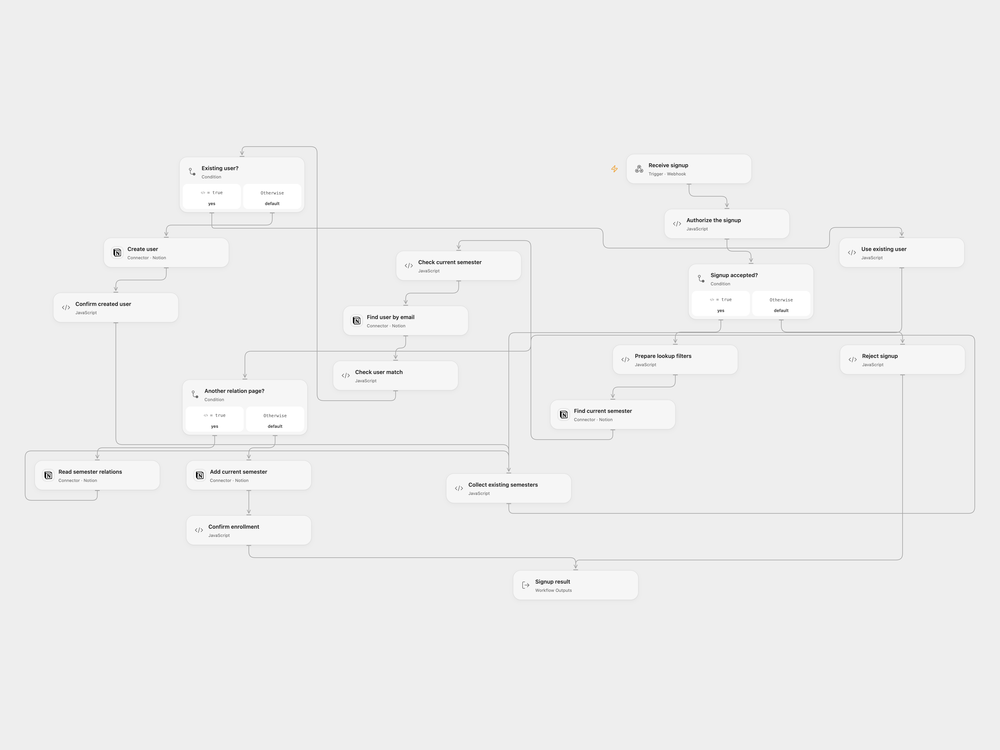

# Enroll Webhook Signups in the Current Notion Semester

Find or create a Notion user and add the current semester without removing existing relations.

<picture>
  <source media="(prefers-color-scheme: dark)" srcset="preview-dark.png">
  
</picture>

[Open Flow JSON](templates/enroll-webhook-signups-in-current-notion-semester.openflow.json) · [n8n JSON](templates/enroll-webhook-signups-in-current-notion-semester.n8n.json)

## Setup

Connect Notion with access to the users and semesters data sources. Set their data source IDs in **Authorize the signup**. The users source needs a title property **Name**, an email property **Email**, and a relation **Semesters** to the semesters source. The semesters source needs checkbox **Is Current?** with exactly one selected row.

Create a secret Variable **SIGNUP_BASIC_AUTH** containing a complete HTTP Basic Authorization value, such as Basic followed by base64 of username:password. Deploy the webhook over HTTPS and send POST JSON with name and email. Restrict access to execution history, which can contain authorization headers and personal data. In n8n configure the Webhook Basic Auth credential, enter both data source IDs in **Prepare signup**, and select the same Notion credential in **Find current semester**, **Find user by email**, **Create user**, **Read semester relations** and **Add current semester**. Activate one format.

## Behavior

An authorized signup finds a user by email or creates one, then adds the current semester while preserving existing relations. Duplicate email matches or multiple current semesters stop rather than choosing one. The relation list is fully paginated. Notion allows at most 100 relations in one update request; if the combined list is larger, the workflow stops before changing it. Platform execution limits also apply. If reading or updating relations fails after creating a user, the new user remains. A failed or uncertain create/update may already have succeeded; inspect Notion before replaying. Simultaneous signups for the same email can create duplicates.

Open Flow returns a response after the update; a timeout or lost response does not prove that no write occurred. The n8n source acknowledges the webhook before processing.

Inspiration &amp; credits

## Changes to the source

- Configure private IDs and credentials, require a single current semester and reject duplicate users. Check the current semester before creating a user.
- Read all pages of the relation property before replacing it, so older relations are not silently dropped.

Adapted from [Signup and semester relation in Notion](https://github.com/Zie619/n8n-workflows/blob/ae8cf6dc5b873cbb4f74587aa9180ed3a9f70682/workflows/Notion/0141_Notion_Webhook_Create_Webhook.json) in [Zie619/n8n-workflows](https://github.com/Zie619/n8n-workflows). The matching [n8n listing](https://n8n.io/workflows/1373-create-a-new-user-in-notion-based-on-the-signup-form-submission/) credits Will Stenzel. The original template does not state a separate license.

The collection’s [MIT notice](https://github.com/Zie619/n8n-workflows/blob/94007c1445d9258a7da116646b79473e7c7c3282/LICENSE) is pinned at a later revision. This is the collection notice at that revision; it does not establish a separate original template author's license. Our changes are listed above; see [repository licensing](../../README.md#licensing).

> MIT License
>
> Copyright (c) 2025 Zie619
>
> Permission is hereby granted, free of charge, to any person obtaining a copy
> of this software and associated documentation files (the "Software"), to deal
> in the Software without restriction, including without limitation the rights
> to use, copy, modify, merge, publish, distribute, sublicense, and/or sell
> copies of the Software, and to permit persons to whom the Software is
> furnished to do so, subject to the following conditions:
>
> The above copyright notice and this permission notice shall be included in all
> copies or substantial portions of the Software.
>
> THE SOFTWARE IS PROVIDED "AS IS", WITHOUT WARRANTY OF ANY KIND, EXPRESS OR
> IMPLIED, INCLUDING BUT NOT LIMITED TO THE WARRANTIES OF MERCHANTABILITY,
> FITNESS FOR A PARTICULAR PURPOSE AND NONINFRINGEMENT. IN NO EVENT SHALL THE
> AUTHORS OR COPYRIGHT HOLDERS BE LIABLE FOR ANY CLAIM, DAMAGES OR OTHER
> LIABILITY, WHETHER IN AN ACTION OF CONTRACT, TORT OR OTHERWISE, ARISING FROM,
> OUT OF OR IN CONNECTION WITH THE SOFTWARE OR THE USE OR OTHER DEALINGS IN THE
> SOFTWARE.

