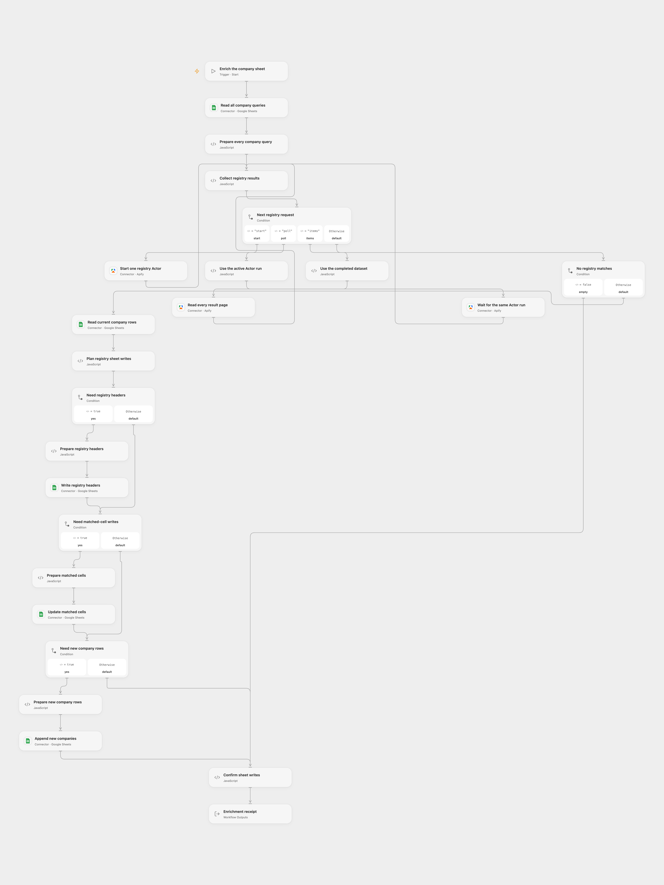

# EU Company Register to Google Sheets

Enrich a company sheet with registration details from seven national business registers through the original Apify Actor.

<picture>
  <source media="(prefers-color-scheme: dark)" srcset="preview-dark.png">
  
</picture>

[Open Flow JSON](templates/eu-company-register-to-google-sheets.openflow.json) · [n8n JSON](templates/eu-company-register-to-google-sheets.n8n.json)

## Setup

Create a worksheet named `Companies` with a `company` header and a company name or registration number on every nonempty row. Keep headers unique, contiguous and plain text. Store registration numbers as text to preserve leading zeros; numeric cells are converted to text without display-format separators. Set the same spreadsheet ID and worksheet on every Google Sheets request.

In Open Flow, select your Apify connection on all three Actor actions and your Google Sheets connection on all sheet actions. In n8n, configure a Header Auth credential with header `Authorization` and value `Bearer YOUR_APIFY_TOKEN` for the three Apify HTTP nodes, and Google Sheets OAuth2 for the sheet HTTP nodes. Run the workflow manually.

The original Actor is [gubidonius/company-registry-lookup](https://apify.com/gubidonius/company-registry-lookup). It searches Czechia, Estonia, Finland, France, Norway, Poland and Slovakia with `maxResultsPerQuery: 1` and `onlyActive: true`. Each sheet query starts its own Actor with a 600-second runtime limit and 1,024MB memory. An empty build setting uses the Actor's current default build. Poland supports number lookups; a name can produce no Polish match.

## Results and failure handling

Every query waits for its own successful Actor run and reads all dataset pages before the next query. All queries and returned companies finish before any sheet write. Open Flow applies its standard payload limits; oversized batches fail instead of dropping records. Failed, aborted or timed-out runs stop the workflow. Polling uses the native node's run timeout plus five-minute grace period, or its 24-hour fallback if the first nonterminal response lacks a positive timeout. The adapted requests wait up to ten seconds per poll instead of sleeping one second between native community polls.

The workflow adds missing registry headers, updates matching non-null fields, then appends unmatched company records. The fields are `company`, `registrationNumber`, `vatNumber`, `country`, `registry`, `status`, `incorporatedAt`, `address`, `city`, `website` and `registryUrl`. Missing register fields remain empty on new rows and preserve existing cells on matched rows. Other existing cells remain untouched. Values use `USER_ENTERED`, matching the source Google Sheets version; text that looks like a number, date or formula can be interpreted by Sheets.

Matching uses the Actor's returned company name, with exact case and text. It does not match a registration-number query back to its original row. An unmatched canonical name creates a new row and leaves the query row intact. Duplicate returned names are retained; existing duplicate names match the first sheet row, as in the source. The receipt counts result records processed, rather than distinct company names.

No-match queries leave their input rows unchanged. A failed read produces no successful data or sheet writes. Each completed header or cell-update receipt must match before a later write can start. A header/update/append failure stops later writes; earlier confirmed writes can remain. Unknown Actor starts and sheet writes are not automatically replayed. Check the Actor run and sheet before restarting after an uncertain result. There is no transaction or concurrency guarantee across services.

## Changes to the source

- Use visible Actor start, completion polling and complete dataset reads; a background run is never treated as company data.
- Replace the n8n community request wrapper with standard HTTP nodes so an ambiguous startup response cannot trigger its built-in POST retry. The source wrapper retries transient reads; these adapted requests stop on a failed read without fabricating results. Open Flow uses native Apify and Google Sheets Actions.
- Update only mapped cells and use the append API for unmatched rows after existing-cell updates. This avoids rewriting unrelated cells and replaces the source helper's inserted empty row and direct append-range write.
- Preserve the source read defaults, unformatted values and formatted date strings. Normalize numeric company queries to text for the Actor. Keep the full seven-country query, runtime, memory and eleven mapped fields. Use explicit setup placeholders and validate write receipts.

Review actual register records before using the enrichment. The workflow does not establish legal identity, current registration accuracy or the quality of a name match. Configure accounts and run a small sheet test before use.

Source and license

Adapted from [Enrich a Google Sheet of companies with EU business register data](https://github.com/enescingoz/awesome-n8n-templates/blob/827110332c21cbe000ab13f6d292d5adb1f1f8db/Google_Drive_and_Google_Sheets/Enrich%20a%20Google%20Sheet%20of%20companies%20with%20EU%20business%20register%20data.json) in [enescingoz/awesome-n8n-templates](https://github.com/enescingoz/awesome-n8n-templates).

Source collection notice: © 2024–2026 Enes Cingoz, [CC BY 4.0](https://github.com/enescingoz/awesome-n8n-templates/blob/827110332c21cbe000ab13f6d292d5adb1f1f8db/LICENSE). The source export does not identify a separate template author or license. See [repository licensing](../../README.md#licensing) for the scope of OOMOL contributions and third-party material.

