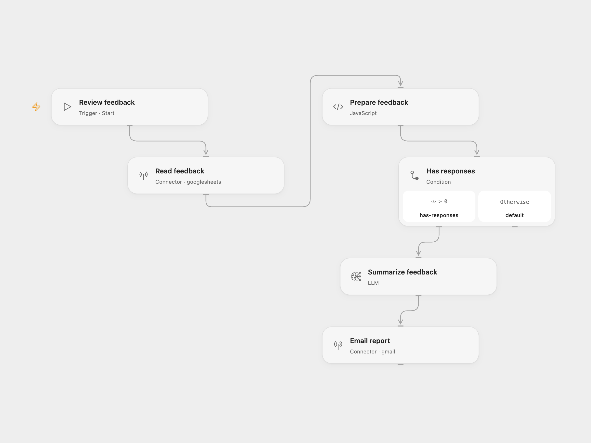

# Event Feedback Report

Summarize event feedback from Google Sheets and email a report on overall sentiment and ideas for improving the event. Run it manually when you want to review the responses collected so far.

## Setup

Create a sheet named `Feedback` with these exact question headers in columns A–C:

| What went great? | How can we improve? | What is the chance of recommending our event? |
| --- | --- | --- |
| Helpful workshops | More time for questions | 9/10 |

For Open Flow, import the JSON and configure:

| Node | Configuration |
| --- | --- |
| Read feedback | Connect Google Sheets; replace `YOUR_SPREADSHEET_ID` and change the `'Feedback'!A:C` range if needed. Include the header row. |
| Summarize feedback | Configure `gpt-4.1-2025-04-14` or choose a compatible available model. Review the report instructions. |
| Email report | Connect Gmail and replace `report-recipient@example.com`. |

For n8n, configure the same spreadsheet, model, and recipient in `Get Google Sheets records`, `Summarize via GPT model`, and `Send via Gmail`.

Use Run in Open Flow or Execute Workflow in n8n. A run reads all rows in the configured range and sends one HTML email. An empty sheet or a sheet with only headers sends no email. Repeated runs include the same existing responses. Source feedback is sent to your configured AI provider. Large response sets must fit your model's context window.

OpenAI lists this snapshot for [shutdown on January 14, 2027](https://developers.openai.com/api/docs/deprecations/). Choose an available compatible model in both formats before that date and check the report output. The replacement model can produce different wording and assessments; no model quality or account availability is guaranteed.

## Changes to the source

- Preserve blank answers in each question's list so response positions remain aligned.
- Replace the original private spreadsheet and recipient with setup placeholders.
- Generate the HTML report directly in the model step, retaining the sentiment and improvement brief while removing the intermediate Markdown conversion.
- Replace the retired `gpt-4-turbo-preview` default with `gpt-4.1-2025-04-14`, an officially documented compatible replacement, retaining temperature `0.3` and the report instructions. See [OpenAI's deprecation guidance](https://developers.openai.com/api/docs/deprecations/) and [GPT-4.1 model details](https://developers.openai.com/api/docs/models/gpt-4.1).

<picture>
  <source media="(prefers-color-scheme: dark)" srcset="preview-dark.png">
  
</picture>

[Open Flow JSON](templates/event-feedback-report.openflow.json) · [n8n JSON](templates/event-feedback-report.n8n.json)

Source and license

Adapted from [Summarize Google Sheets form feedback via OpenAI_s GPT-4](https://github.com/enescingoz/awesome-n8n-templates/blob/827110332c21cbe000ab13f6d292d5adb1f1f8db/Google_Drive_and_Google_Sheets/Summarize%20Google%20Sheets%20form%20feedback%20via%20OpenAI_s%20GPT-4.json) in [enescingoz/awesome-n8n-templates](https://github.com/enescingoz/awesome-n8n-templates).

Source collection notice: © 2024–2026 Enes Cingoz, [CC BY 4.0](https://github.com/enescingoz/awesome-n8n-templates/blob/827110332c21cbe000ab13f6d292d5adb1f1f8db/LICENSE). The source export does not identify a separate template author or license. See [repository licensing](../../README.md#licensing) for the scope of OOMOL contributions and third-party material.

