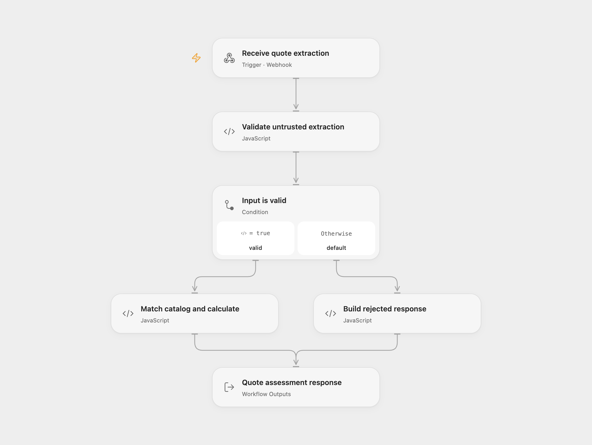

# Exact-Match Quote Guard

Check untrusted AI or OCR line items against an exact reference catalog. This example uses a synthetic catalog and sample CHF pricing rules. Known references produce a calculated assessment; unknown references require review without a total.

<picture>
  <source media="(prefers-color-scheme: dark)" srcset="preview-dark.png">
  
</picture>

[Open Flow JSON](templates/exact-match-quote-guard.openflow.json) · [n8n JSON](templates/exact-match-quote-guard.n8n.json)

## Setup

Import the JSON. No model or service connection is required to try the sample. Publish and enable the configured workflow in a test environment and POST JSON to its webhook:

```json
{
  "request_id": "quote-demo-001",
  "source_description": "Example extracted service request",
  "labor_hours": 1.25,
  "travel_required": true,
  "extracted_items": [
    { "reference": "SYN-VALVE-100", "quantity": 2, "claimed_unit_price_chf": 1 }
  ]
}
```

Use these synthetic references to exercise the example:

| Reference | Sample unit price |
| --- | --- |
| `SYN-VALVE-100` | CHF 120.00 |
| `SYN-PIPE-200` | CHF 85.50 |
| `SYN-SEAL-300` | CHF 32.40 |

The sample adds 15% to the materials subtotal, CHF 95 per labor hour, CHF 45 when travel is requested, and 8.1% VAT on the resulting net amount. These are demonstration settings. Replace the catalog and rates in **Match catalog and calculate** (Open Flow) or **Exact Match and Calculate** (n8n), and update the reference validation in the validation node to fit your catalog.

For real requests, supply a trusted, authenticated catalog and approved business rules, configure webhook access controls, and add human approval before sending any quote. This template does not include a production catalog connection, an approval action, or outgoing quote delivery. The sample webhook has no configured authentication; n8n supports configuring Header Auth or JWT Auth on its Webhook node. Configure access controls supported by your Open Flow deployment before exposing that endpoint.

## Results

| HTTP status | Body status | Meaning |
| --- | --- | --- |
| 200 | `QUOTABLE` | Every reference matched; the response includes sample rates and calculated totals. |
| 422 | `NEEDS_REVIEW` | At least one validly shaped reference is unknown; `totals` is `null`. |
| 400 | `REJECTED` | A field failed validation; `invalid_fields` names the failed checks. |

Responses include `Cache-Control: no-store`. A `claimed_unit_price_chf` never sets a catalog price. `ignored_claimed_prices` becomes true when a claimed price on a matched item differs after rounding to cents. Unknown references are listed in input order, including repeats. Repeated known references remain separate line items.

The request ID must match `quote-` followed by 3–40 letters, digits, or hyphens, without regard to case. `source_description` must contain 1–1,000 characters. Labor accepts 0–24 hours with up to two decimal places; travel must be a boolean. Supply 1–10 items, each with a case-sensitive reference matching `SYN-[A-Z]+-[0-9]{3}` and an integer quantity from 1 to 20. A supplied claimed price must be a finite number. The description is recorded as untrusted context for validation; it does not drive pricing or reference matching.

Calculations use integer cents for line totals and round the material margin, labor, and VAT to the nearest cent using JavaScript's `Math.round`. No records are saved and no external calls or automatic retries are made. Reusing a request ID recomputes the assessment; it does not deduplicate requests. Open Flow waits up to 30 seconds for a response. Malformed JSON or requests rejected by the hosting platform's HTTP contract use that platform's error response.

## Changes to the source

- Make n8n's Code execution mode and webhook body access explicit.
- Normalize missing intermediate fields to JSON `null` before validation routing.
- In Open Flow, return the result and corresponding HTTP status through workflow outputs. Preserve the exact-match checks, synthetic prices, rounding, and three response statuses.

## Source and license

Adapted from [Deterministic Exact-Match Quote Guard for AI and OCR Inputs](https://github.com/enescingoz/awesome-n8n-templates/blob/827110332c21cbe000ab13f6d292d5adb1f1f8db/Other_Integrations_and_Use_Cases/Deterministic%20Exact-Match%20Quote%20Guard%20for%20AI%20and%20OCR%20Inputs.json) in [enescingoz/awesome-n8n-templates](https://github.com/enescingoz/awesome-n8n-templates).

Source collection notice: © 2024–2026 Enes Cingoz, [CC BY 4.0](https://github.com/enescingoz/awesome-n8n-templates/blob/827110332c21cbe000ab13f6d292d5adb1f1f8db/LICENSE). The source export does not identify a separate template author or license. This adaptation includes the changes listed above; see [repository licensing](../../README.md#licensing) for the scope of OOMOL contributions and third-party material.
