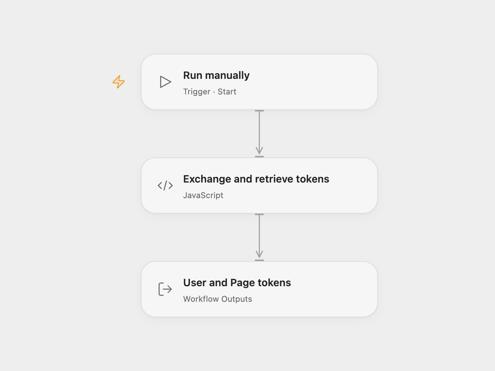

# Exchange Facebook User and Page Tokens

Exchange a short-lived Facebook user token and retrieve the first page of associated Page tokens.

<picture>
  <source media="(prefers-color-scheme: dark)" srcset="preview-dark.png">
  
</picture>

[Open Flow JSON](templates/exchange-facebook-user-and-page-tokens.openflow.json) · [n8n JSON](templates/exchange-facebook-user-and-page-tokens.n8n.json)

## Setup and use

Create a Meta app, obtain a valid short-lived user token, and grant the permissions needed to list Pages. In Open Flow set the app ID and app-scoped user ID in **Exchange and retrieve tokens**. Bind secret Variables **META_APP_SECRET** and **FACEBOOK_SHORT_TOKEN**. In n8n configure a Custom Auth credential for **Get long-lived user token** with JSON `{"qs":{"client_id":"YOUR_APP_ID","client_secret":"YOUR_APP_SECRET","fb_exchange_token":"YOUR_SHORT_TOKEN"}}`; set the app-scoped user ID in **Get Page tokens**.

## Behavior

A manual run exchanges the user token, then requests the first page of the user's Pages and their tokens. Open Flow returns the user token and Page response; in n8n the user token is in **Get long-lived user token** and Page tokens are in **Get Page tokens**. They are sensitive and appear in workflow results and execution history; restrict access to runs and remove history according to your retention policy. The Page response can include a paging link for additional pages. A failed request stops the workflow. Meta's [token guide](https://developers.facebook.com/documentation/facebook-login/guides/access-tokens/get-long-lived) describes token validity and permissions.

Inspiration &amp; credits

## Changes to the source

- Fix the leading spaces in parameter names, use Graph API v27.0, and bind the original credentials as secrets. The app-scoped user ID is required for the Page request.

Adapted from [Exchange Facebook user and Page tokens](https://github.com/Zie619/n8n-workflows/blob/ae8cf6dc5b873cbb4f74587aa9180ed3a9f70682/workflows/Manual/1884_Manual_Stickynote_Import_Webhook.json) in [Zie619/n8n-workflows](https://github.com/Zie619/n8n-workflows). The source export does not identify a separate template author or license.

The collection’s [MIT notice](https://github.com/Zie619/n8n-workflows/blob/94007c1445d9258a7da116646b79473e7c7c3282/LICENSE) is pinned at a later revision. This is the collection notice at that revision; it does not establish a separate original template author's license. Our changes are listed above; see [repository licensing](../../README.md#licensing).

> MIT License
>
> Copyright (c) 2025 Zie619
>
> Permission is hereby granted, free of charge, to any person obtaining a copy
> of this software and associated documentation files (the "Software"), to deal
> in the Software without restriction, including without limitation the rights
> to use, copy, modify, merge, publish, distribute, sublicense, and/or sell
> copies of the Software, and to permit persons to whom the Software is
> furnished to do so, subject to the following conditions:
>
> The above copyright notice and this permission notice shall be included in all
> copies or substantial portions of the Software.
>
> THE SOFTWARE IS PROVIDED "AS IS", WITHOUT WARRANTY OF ANY KIND, EXPRESS OR
> IMPLIED, INCLUDING BUT NOT LIMITED TO THE WARRANTIES OF MERCHANTABILITY,
> FITNESS FOR A PARTICULAR PURPOSE AND NONINFRINGEMENT. IN NO EVENT SHALL THE
> AUTHORS OR COPYRIGHT HOLDERS BE LIABLE FOR ANY CLAIM, DAMAGES OR OTHER
> LIABILITY, WHETHER IN AN ACTION OF CONTRACT, TORT OR OTHERWISE, ARISING FROM,
> OUT OF OR IN CONNECTION WITH THE SOFTWARE OR THE USE OR OTHER DEALINGS IN THE
> SOFTWARE.

