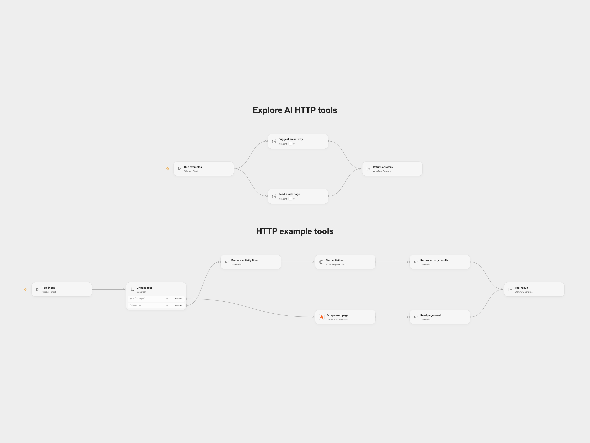

# Explore AI HTTP Tools

Explore model-selected web scraping and activity search tools.

<picture>
  <source media="(prefers-color-scheme: dark)" srcset="preview-dark.png">
  
</picture>

[Open Flow JSON](templates/explore-ai-http-tools.openflow.json) · [n8n JSON](templates/explore-ai-http-tools.n8n.json)

## Setup

Import **Explore AI HTTP tools** and **HTTP example tools** in the Open Flow bundle, connect Firecrawl, publish **HTTP example tools**, and refresh both tool interfaces in the main workflow. Configure a tool-capable model. In n8n connect OpenAI and configure a Firecrawl header credential with Authorization: Bearer and your API key.

## Behavior

Run the two example questions. One agent can request a page as Markdown with Firecrawl; the other can find activities by type or participant count. The service may return no matching activities. Model answers can be inaccurate and external page content is untrusted. Firecrawl receives requested URLs.

Inspiration &amp; credits

## Changes to the source

Use the current Firecrawl scrape API and a bundled HTTP tool workflow.

Adapted from [Introduction to the HTTP Tool](https://github.com/enescingoz/awesome-n8n-templates/blob/827110332c21cbe000ab13f6d292d5adb1f1f8db/Other_Integrations_and_Use_Cases/Introduction%20to%20the%20HTTP%20Tool.json) in [enescingoz/awesome-n8n-templates](https://github.com/enescingoz/awesome-n8n-templates).

Source collection notice: © 2024–2026 Enes Cingoz, [CC BY 4.0](https://github.com/enescingoz/awesome-n8n-templates/blob/827110332c21cbe000ab13f6d292d5adb1f1f8db/LICENSE). The source export does not identify a separate template author or license. See [repository licensing](../../README.md#licensing) for the scope of OOMOL contributions and third-party material.

