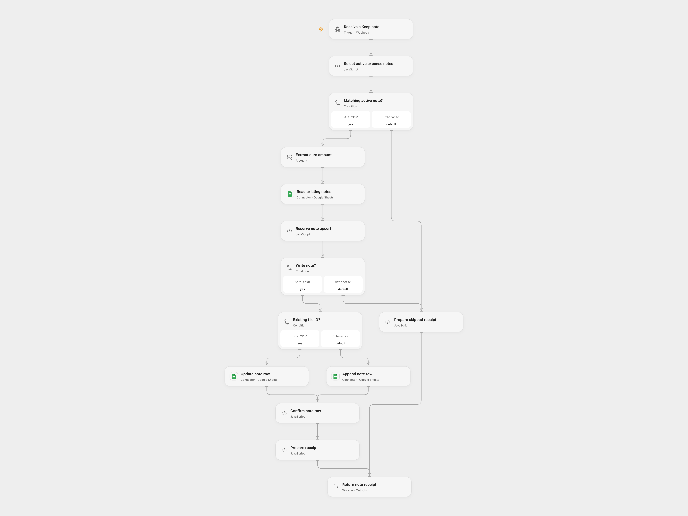

# Export Keep Expense Notes to Sheets

Extract euro amounts from selected Google Keep exports and upsert the notes in Google Sheets.

<!-- template-actions:start -->
 
<!-- template-actions:end -->

<picture>
  <source media="(prefers-color-scheme: dark)" srcset="preview-dark.png">
  
</picture>

## Setup

Export Google Keep via Google Takeout and place the extracted JSON files in a Google Drive folder. Connect Google Drive, Google Sheets and OpenAI. Run manually and prevent overlapping runs.

Connect Google Sheets, select a model, set the same spreadsheet ID in all sheet nodes, and set the range and sheet name. Enable persistent State. Restrict access to the Open Flow webhook at the deployment boundary; it has no built-in authentication. Use one mode and one format.

## Behavior

Each run lists the first two Drive files from the source folder, processes JSON files, and selects notes whose HTML contains the case-sensitive text dépensé or depense and whose isArchived value is false. The model extracts a euro amount from the note text. The workflow writes the file ID, text, edited and created timestamps, archive flag and amount; an existing file ID is updated and a new one is appended. Timestamps are ISO UTC. Review AI output, which can be inaccurate. Note content is sent to the model and may be present in execution history. Open Flow Code ports must each fit within 1 MiB.

If a sheet write or relay result is unknown, inspect the sheet and downstream execution before rerunning. In Open Flow enter the pending key in **Reserve note upsert** and select confirmed if applied or absent if not; replay the same note and clear both fields. The workflow refuses duplicate file IDs in Open Flow.

In n8n

In the n8n workflow configure the folder in **Search in "Keep" folder** and a spreadsheet with columns fileId, textContent, Edited, Created, isArchived and Amount in that order. Select the same Data Table in the checkpoint nodes, with text columns item_key and status. For Open Flow set the n8n **Prepare Keep note** mode to relay and configure the Open Flow webhook URL. For direct n8n leave the mode in **Prepare Keep note** set to direct. In n8n reconcile the pending Data Table row, mark it done after the write, or remove it only if no write occurred.

Inspiration &amp; credits

Add stable Drive file ID matching and per-note checkpoints; retain the source filters.

Adapted from [Export Google Keep notes to a Google Sheet](https://github.com/Zie619/n8n-workflows/blob/ae8cf6dc5b873cbb4f74587aa9180ed3a9f70682/workflows/Filter/0849_Filter_Extractfromfile_Create_Triggered.json) in [Zie619/n8n-workflows](https://github.com/Zie619/n8n-workflows). The source export does not identify a separate template author or license.

The collection’s [MIT notice](https://github.com/Zie619/n8n-workflows/blob/94007c1445d9258a7da116646b79473e7c7c3282/LICENSE) is pinned at a later revision. This is the collection notice at that revision; it does not establish a separate original template author's license. Our changes are listed above; see [repository licensing](../../README.md#licensing).

> MIT License
>
> Copyright (c) 2025 Zie619
>
> Permission is hereby granted, free of charge, to any person obtaining a copy
> of this software and associated documentation files (the "Software"), to deal
> in the Software without restriction, including without limitation the rights
> to use, copy, modify, merge, publish, distribute, sublicense, and/or sell
> copies of the Software, and to permit persons to whom the Software is
> furnished to do so, subject to the following conditions:
>
> The above copyright notice and this permission notice shall be included in all
> copies or substantial portions of the Software.
>
> THE SOFTWARE IS PROVIDED "AS IS", WITHOUT WARRANTY OF ANY KIND, EXPRESS OR
> IMPLIED, INCLUDING BUT NOT LIMITED TO THE WARRANTIES OF MERCHANTABILITY,
> FITNESS FOR A PARTICULAR PURPOSE AND NONINFRINGEMENT. IN NO EVENT SHALL THE
> AUTHORS OR COPYRIGHT HOLDERS BE LIABLE FOR ANY CLAIM, DAMAGES OR OTHER
> LIABILITY, WHETHER IN AN ACTION OF CONTRACT, TORT OR OTHERWISE, ARISING FROM,
> OUT OF OR IN CONNECTION WITH THE SOFTWARE OR THE USE OR OTHER DEALINGS IN THE
> SOFTWARE.

