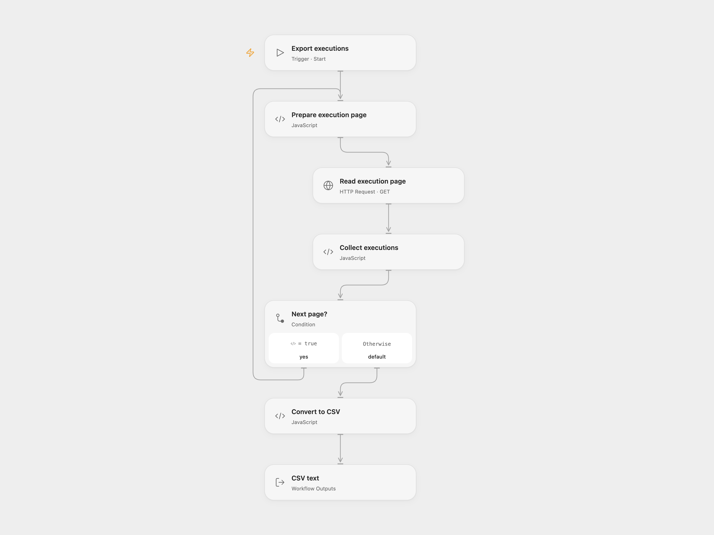

# Export n8n Executions as CSV

Read all available n8n executions and convert their metadata to CSV.

<picture>
  <source media="(prefers-color-scheme: dark)" srcset="preview-dark.png">
  
</picture>

[Open Flow JSON](templates/export-n8n-executions-as-csv.openflow.json) · [n8n JSON](templates/export-n8n-executions-as-csv.n8n.json)

## Setup and use

Bind N8N_API_KEY as a secret Variable containing an n8n API key. Run with the n8n base URL. Copy the resulting CSV text to a .csv file or pass it to another workflow. In n8n configure the n8n credential and run manually; its Convert to CSV node produces a file that can be connected to cloud storage. Use one format.

## Behavior

The workflow follows every execution-list cursor and exports the available execution metadata. Nested values are encoded as JSON within CSV cells, with quotes escaped. An empty list returns empty text. Access and results depend on the API key's permissions. Protect execution metadata and output files.

Inspiration &amp; credits

## Changes to the source

- Open Flow uses the n8n HTTP API and returns CSV text. The source's n8n format produces a binary CSV file.

Adapted from [Export n8n executions as CSV](https://github.com/Zie619/n8n-workflows/blob/ae8cf6dc5b873cbb4f74587aa9180ed3a9f70682/workflows/Converttofile/0508_Converttofile_Manual_Process_Triggered.json) in [Zie619/n8n-workflows](https://github.com/Zie619/n8n-workflows). The source export does not identify a separate template author or license.

The collection’s [MIT notice](https://github.com/Zie619/n8n-workflows/blob/94007c1445d9258a7da116646b79473e7c7c3282/LICENSE) is pinned at a later revision. This is the collection notice at that revision; it does not establish a separate original template author's license. Our changes are listed above; see [repository licensing](../../README.md#licensing).

> MIT License
>
> Copyright (c) 2025 Zie619
>
> Permission is hereby granted, free of charge, to any person obtaining a copy
> of this software and associated documentation files (the "Software"), to deal
> in the Software without restriction, including without limitation the rights
> to use, copy, modify, merge, publish, distribute, sublicense, and/or sell
> copies of the Software, and to permit persons to whom the Software is
> furnished to do so, subject to the following conditions:
>
> The above copyright notice and this permission notice shall be included in all
> copies or substantial portions of the Software.
>
> THE SOFTWARE IS PROVIDED "AS IS", WITHOUT WARRANTY OF ANY KIND, EXPRESS OR
> IMPLIED, INCLUDING BUT NOT LIMITED TO THE WARRANTIES OF MERCHANTABILITY,
> FITNESS FOR A PARTICULAR PURPOSE AND NONINFRINGEMENT. IN NO EVENT SHALL THE
> AUTHORS OR COPYRIGHT HOLDERS BE LIABLE FOR ANY CLAIM, DAMAGES OR OTHER
> LIABILITY, WHETHER IN AN ACTION OF CONTRACT, TORT OR OTHERWISE, ARISING FROM,
> OUT OF OR IN CONNECTION WITH THE SOFTWARE OR THE USE OR OTHER DEALINGS IN THE
> SOFTWARE.

