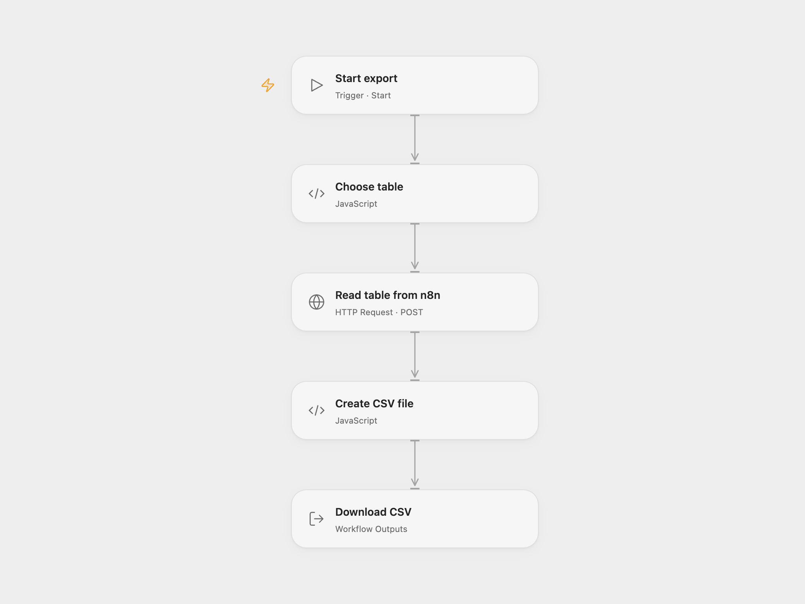

# Export a Postgres Table to CSV

Read a PostgreSQL table and export its rows as a CSV file.

<picture>
  <source media="(prefers-color-scheme: dark)" srcset="preview-dark.png">
  
</picture>

[Open Flow JSON](templates/export-postgres-table-to-csv.openflow.json) · [n8n JSON](templates/export-postgres-table-to-csv.n8n.json)

## Setup

Import the supplied n8n workflow and connect the PostgreSQL credential. For Open Flow, enable **Postgres relay webhook**, connect its **Read table for relay** node, activate n8n, and set the relay URL in **Read table from n8n**. Set the table name in **Choose table** and run Open Flow manually. For n8n-only use, disable the relay webhook and set the table in **TableName** before running manually.

## Behavior

The workflow selects all rows from one table and creates a CSV file. Nested values are flattened into dot-separated columns. Table names must be unqualified identifiers containing letters, digits or underscores and beginning with a letter or underscore. The database account controls table visibility. An empty table produces an empty CSV in Open Flow. In direct n8n mode the source query emits no items, so no file is produced. The relay does not authenticate callers and can read tables accessible to its credential; restrict access to trusted callers. Large tables are subject to request and artifact size limits.

Inspiration &amp; credits

## Changes to the source

- Replace the example table name with configuration, validate the identifier and provide an n8n database relay.

Adapted from [PostgreSQL export to CSV](https://github.com/Zie619/n8n-workflows/blob/ae8cf6dc5b873cbb4f74587aa9180ed3a9f70682/workflows/Manual/0930_Manual_Spreadsheetfile_Export_Triggered.json) in [Zie619/n8n-workflows](https://github.com/Zie619/n8n-workflows). The source export does not identify a separate template author or license.

The collection’s [MIT notice](https://github.com/Zie619/n8n-workflows/blob/94007c1445d9258a7da116646b79473e7c7c3282/LICENSE) is pinned at a later revision. This is the collection notice at that revision; it does not establish a separate original template author's license. Our changes are listed above; see [repository licensing](../../README.md#licensing).

> MIT License
>
> Copyright (c) 2025 Zie619
>
> Permission is hereby granted, free of charge, to any person obtaining a copy
> of this software and associated documentation files (the "Software"), to deal
> in the Software without restriction, including without limitation the rights
> to use, copy, modify, merge, publish, distribute, sublicense, and/or sell
> copies of the Software, and to permit persons to whom the Software is
> furnished to do so, subject to the following conditions:
>
> The above copyright notice and this permission notice shall be included in all
> copies or substantial portions of the Software.
>
> THE SOFTWARE IS PROVIDED "AS IS", WITHOUT WARRANTY OF ANY KIND, EXPRESS OR
> IMPLIED, INCLUDING BUT NOT LIMITED TO THE WARRANTIES OF MERCHANTABILITY,
> FITNESS FOR A PARTICULAR PURPOSE AND NONINFRINGEMENT. IN NO EVENT SHALL THE
> AUTHORS OR COPYRIGHT HOLDERS BE LIABLE FOR ANY CLAIM, DAMAGES OR OTHER
> LIABILITY, WHETHER IN AN ACTION OF CONTRACT, TORT OR OTHERWISE, ARISING FROM,
> OUT OF OR IN CONNECTION WITH THE SOFTWARE OR THE USE OR OTHER DEALINGS IN THE
> SOFTWARE.

SheetJS xlsx 0.20.2 is included under the [Apache License 2.0](https://www.apache.org/licenses/LICENSE-2.0); copyright 2013-present SheetJS. The full license is included in the workflow module.

