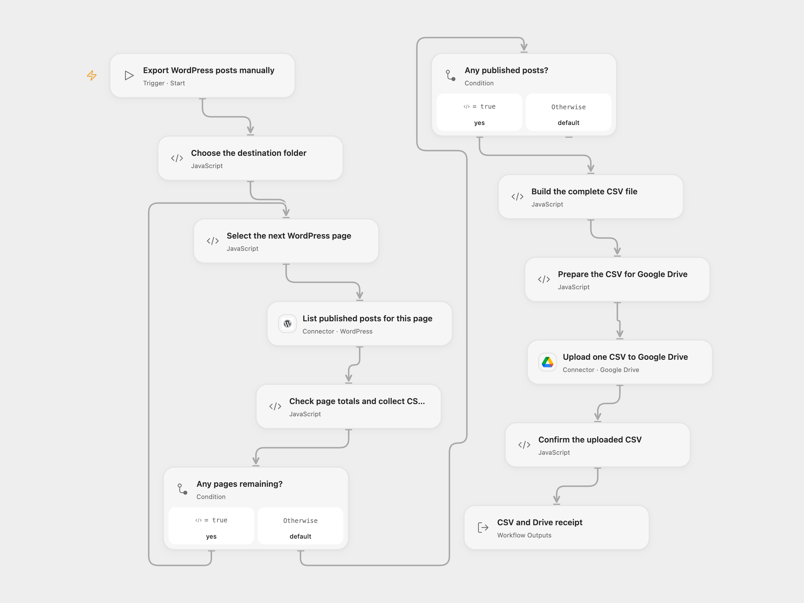

# Export Published WordPress Posts to Drive CSV

Save all published WordPress posts as one CSV with their IDs, titles, links, and rendered content.

<!-- template-actions:start -->
 
<!-- template-actions:end -->

<picture>
  <source media="(prefers-color-scheme: dark)" srcset="preview-dark.png">
  
</picture>

## Setup

1. Connect WordPress with an application password for the site you want to export.
2. Connect Google Drive in **Upload one CSV to Google Drive**. In **Choose the destination folder**, enter a writable folder ID or keep `root` for My Drive.
3. Run the workflow manually. It creates one `Wordpress-Posts.csv` file and returns the file and its Drive ID.

## Behavior

The workflow checks every page of published posts in descending publication-date order. The UTF-8 CSV contains four columns in this order: `id`, `title`, `link`, and `content`. Title and content come from WordPress's rendered fields, including any HTML. Formula-like text cells receive a leading apostrophe.

An empty site produces no file. A missing page or a total that changes during the run stops the export before upload. Open Flow accepts a complete CSV up to 2,500,000 bytes, subject to deployment limits. Each successful run creates a new file. If Drive may have created the file without returning its receipt, check the folder before running again.

In n8n

Set the site's HTTPS `/wp-json/wp/v2/posts` URL in **Read every published WordPress page** and attach an HTTP **Basic Auth** credential using the WordPress username and application password. In **Upload one CSV to Google Drive**, connect a Google Drive OAuth credential and select the destination folder. The template creates the same UTF-8 CSV and uses n8n's execution and file size limits.

Inspiration &amp; credits

Adapted from [Export WordPress Posts to CSV and Upload to Google Drive](https://github.com/Zie619/n8n-workflows/blob/ae8cf6dc5b873cbb4f74587aa9180ed3a9f70682/workflows/Wordpress/0721_Wordpress_Converttofile_Process_Triggered.json) in [Zie619/n8n-workflows](https://github.com/Zie619/n8n-workflows). Attribution: Codez & AI (original workflow) / Zie619 (collection). See the [original n8n gallery template](https://n8n.io/workflows/2889-export-wordpress-posts-to-csv-and-upload-to-google-drive/).

The collection’s [MIT notice](https://github.com/Zie619/n8n-workflows/blob/94007c1445d9258a7da116646b79473e7c7c3282/LICENSE) is pinned at a later revision. This is the collection notice at that revision; it does not establish a separate original template author's license. Our changes are listed above; see [repository licensing](../../README.md#licensing).

> MIT License
>
> Copyright (c) 2025 Zie619
>
> Permission is hereby granted, free of charge, to any person obtaining a copy
> of this software and associated documentation files (the "Software"), to deal
> in the Software without restriction, including without limitation the rights
> to use, copy, modify, merge, publish, distribute, sublicense, and/or sell
> copies of the Software, and to permit persons to whom the Software is
> furnished to do so, subject to the following conditions:
>
> The above copyright notice and this permission notice shall be included in all
> copies or substantial portions of the Software.
>
> THE SOFTWARE IS PROVIDED "AS IS", WITHOUT WARRANTY OF ANY KIND, EXPRESS OR
> IMPLIED, INCLUDING BUT NOT LIMITED TO THE WARRANTIES OF MERCHANTABILITY,
> FITNESS FOR A PARTICULAR PURPOSE AND NONINFRINGEMENT. IN NO EVENT SHALL THE
> AUTHORS OR COPYRIGHT HOLDERS BE LIABLE FOR ANY CLAIM, DAMAGES OR OTHER
> LIABILITY, WHETHER IN AN ACTION OF CONTRACT, TORT OR OTHERWISE, ARISING FROM,
> OUT OF OR IN CONNECTION WITH THE SOFTWARE OR THE USE OR OTHER DEALINGS IN THE
> SOFTWARE.

