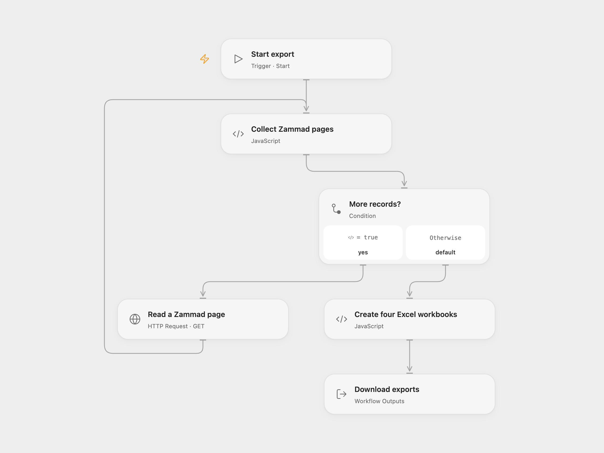

# Export Zammad Administration to XLSX

Export Zammad users, organizations, roles and groups to four Excel workbooks.

<picture>
  <source media="(prefers-color-scheme: dark)" srcset="preview-dark.png">
  
</picture>

[Open Flow JSON](templates/export-zammad-administration-to-xlsx.openflow.json) · [n8n JSON](templates/export-zammad-administration-to-xlsx.n8n.json)

## Setup and use

In Open Flow, set the HTTPS instance URL in **Collect Zammad pages**, and bind the OAuth bearer token secret Variable ZAMMAD_OAUTH_TOKEN in **Read a Zammad page**. The account needs permission to list users, organizations, roles and groups. Run manually and download the four workbooks.

In n8n, connect the Zammad API credentials to both Zammad nodes and configure Header Auth with Authorization: Bearer followed by an OAuth token in both HTTP nodes. Set the instance URL in **Basic Variables**. Run manually and download each binary output.

## Behavior

Exports contain user ID, organization ID, email, first and last names, role IDs and group permissions; the other files contain ID and name. Group permissions are serialized as JSON. Open Flow requests pages until a short page and creates a workbook for each category, including an empty workbook with headers. n8n uses its Zammad nodes for users and organizations. Pagination is not a snapshot: concurrent changes may alter results. Exports contain personal data; protect execution history and downloaded files. Large lists must fit the platform execution limits.

Inspiration &amp; credits

## Changes to the source

- Correct the name fields to text and the users filename extension; serialize group permissions as JSON. Remove embedded token configuration and use credentials.
- Open Flow paginates all four endpoints and returns separate workbook artifacts.

Adapted from [Export Zammad administration to Excel](https://github.com/Zie619/n8n-workflows/blob/ae8cf6dc5b873cbb4f74587aa9180ed3a9f70682/workflows/Manual/1503_Manual_HTTP_Export_Webhook.json) in [Zie619/n8n-workflows](https://github.com/Zie619/n8n-workflows). The source export does not identify a separate template author or license.

The collection’s [MIT notice](https://github.com/Zie619/n8n-workflows/blob/94007c1445d9258a7da116646b79473e7c7c3282/LICENSE) is pinned at a later revision. This is the collection notice at that revision; it does not establish a separate original template author's license. Our changes are listed above; see [repository licensing](../../README.md#licensing).

> MIT License
>
> Copyright (c) 2025 Zie619
>
> Permission is hereby granted, free of charge, to any person obtaining a copy
> of this software and associated documentation files (the "Software"), to deal
> in the Software without restriction, including without limitation the rights
> to use, copy, modify, merge, publish, distribute, sublicense, and/or sell
> copies of the Software, and to permit persons to whom the Software is
> furnished to do so, subject to the following conditions:
>
> The above copyright notice and this permission notice shall be included in all
> copies or substantial portions of the Software.
>
> THE SOFTWARE IS PROVIDED "AS IS", WITHOUT WARRANTY OF ANY KIND, EXPRESS OR
> IMPLIED, INCLUDING BUT NOT LIMITED TO THE WARRANTIES OF MERCHANTABILITY,
> FITNESS FOR A PARTICULAR PURPOSE AND NONINFRINGEMENT. IN NO EVENT SHALL THE
> AUTHORS OR COPYRIGHT HOLDERS BE LIABLE FOR ANY CLAIM, DAMAGES OR OTHER
> LIABILITY, WHETHER IN AN ACTION OF CONTRACT, TORT OR OTHERWISE, ARISING FROM,
> OUT OF OR IN CONNECTION WITH THE SOFTWARE OR THE USE OR OTHER DEALINGS IN THE
> SOFTWARE.

Workbook creation uses [SheetJS](https://sheetjs.com/) 0.20.2 under the [Apache 2.0 license](https://www.apache.org/licenses/LICENSE-2.0).

