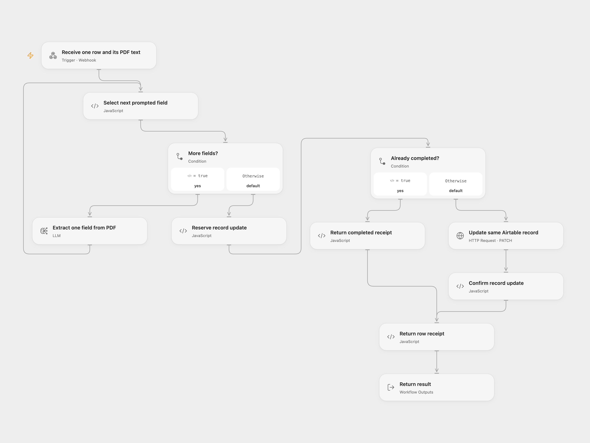

# Extract Airtable PDF Fields with Dynamic Prompts

Extract Airtable field values from record PDFs using field descriptions as prompts.

<!-- template-actions:start -->
 
<!-- template-actions:end -->

<picture>
  <source media="(prefers-color-scheme: dark)" srcset="preview-dark.png">
  
</picture>

## Setup

Configure an Airtable personal access token for schema, records and webhook management. Set your base, table and notification URL in **Set Airtable Vars** and run the manual registration flow once; it creates separate File-change and field-change webhooks. Airtable webhooks expire and must be refreshed before expiration. Protect incoming notifications using a private network or authenticated gateway.

The table needs a File attachment column and described output fields. Choose direct or relay in both **Choose mode** nodes. Restrict the Open Flow webhook using a private network or authenticated gateway; it does not authenticate callers itself. Prevent overlapping runs and use one mode.

## Behavior

Notifications are read using the saved cursor and all available pages, then each changed table, field and record is matched to its own table schema. Field events process records with a File; record events process described fields whose values are falsy. Model answers may not satisfy the field type and require review. PDF contents and prompts are sent to the selected model provider; input size limits apply. The Open Flow response times out after 60 seconds; a timed-out execution may still be running, so inspect the checkpoint and Airtable before retrying.

The cursor advances only after its events are handled. A write with an unknown outcome may have succeeded: inspect Airtable before clearing the pending record. Registration attempts have separate checkpoints; inspect Airtable before retrying an uncertain registration to avoid duplicate webhooks. Manage the existing webhook before clearing a completed registration checkpoint for a replacement. A successfully completed event and record is recorded to prevent duplicate writes on a cursor replay.

In n8n

Set the Data Table ID for registration and direct-mode write checkpoints, with item_key, status, base_id, table_id, record_id and payload text columns. In relay mode deploy Open Flow, bind AIRTABLE_TOKEN, configure its model, enable persistent State, and set its webhook URL and gateway authentication in n8n. The first PDF is downloaded and parsed in n8n. In relay mode its text and field prompts are sent to Open Flow for extraction and update of the same record. Keep n8n workflow static data and Data Table storage persistent, avoid overlapping executions and use a published active workflow.

Inspiration &amp; credits

Adapted from [AI Data Extraction with Dynamic Prompts and Airtable](https://github.com/enescingoz/awesome-n8n-templates/blob/827110332c21cbe000ab13f6d292d5adb1f1f8db/OpenAI_and_LLMs/AI%20Data%20Extraction%20with%20Dynamic%20Prompts%20and%20Airtable.json) in [enescingoz/awesome-n8n-templates](https://github.com/enescingoz/awesome-n8n-templates).

Source collection notice: © 2024–2026 Enes Cingoz, [CC BY 4.0](https://github.com/enescingoz/awesome-n8n-templates/blob/827110332c21cbe000ab13f6d292d5adb1f1f8db/LICENSE). The source export does not identify a separate template author or license. See [repository licensing](../../README.md#licensing) for the scope of OOMOL contributions and third-party material.

