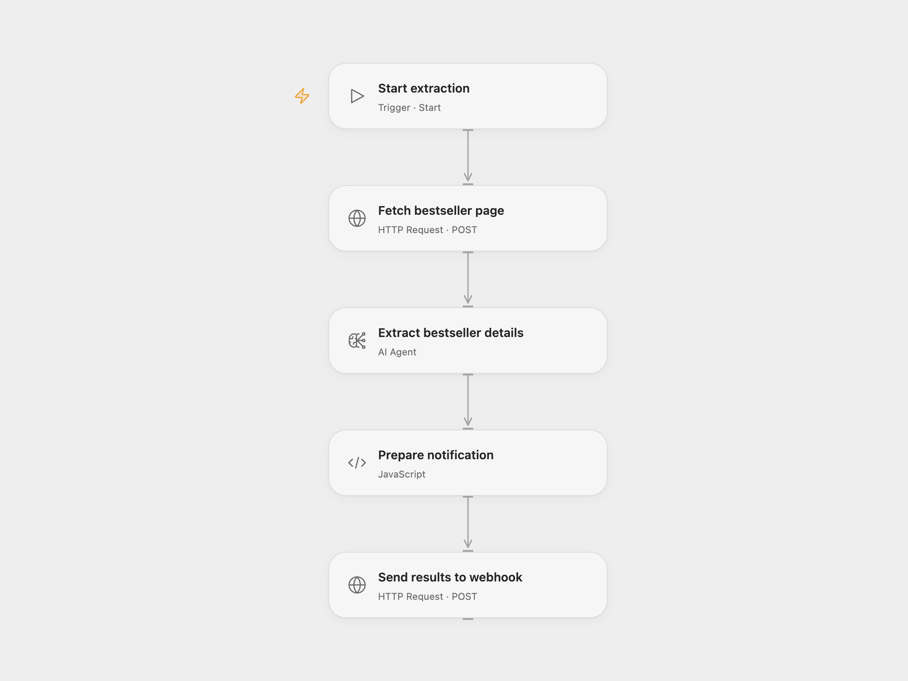

# Extract Amazon Bestsellers and Notify

Extract structured bestseller information from an Amazon page and send it to a webhook.

<picture>
  <source media="(prefers-color-scheme: dark)" srcset="preview-dark.png">
  
</picture>

[Open Flow JSON](templates/extract-amazon-bestsellers-and-notify.openflow.json) · [n8n JSON](templates/extract-amazon-bestsellers-and-notify.n8n.json)

## Setup and use

Bind secret Variable BRIGHT_DATA_TOKEN, set your Web Unlocker zone and Amazon page URL in **Fetch bestseller page**, configure the model, and set the destination URL in **Send results to webhook**. In n8n configure Bright Data Header Auth with Authorization: Bearer followed by your API token, connect the Gemini model, and set the zone, Amazon URL and webhook URL. Run one format manually.

## Behavior

The workflow sends the page HTML to the model, extracts the category and ranked product details, and POSTs the structured result as summary to the destination. The model may miss or invent details; review the results. Bright Data and model usage may incur charges. A failed or uncertain notification may have arrived; inspect the destination before retrying.

Inspiration &amp; credits

## Changes to the source

- Replace account-specific destinations with configuration and explicitly POST the structured result.

Adapted from [Amazon bestseller extraction with Bright Data](https://github.com/Zie619/n8n-workflows/blob/ae8cf6dc5b873cbb4f74587aa9180ed3a9f70682/workflows/Manual/1445_Manual_Stickynote_Automation_Webhook.json) in [Zie619/n8n-workflows](https://github.com/Zie619/n8n-workflows). The source export does not identify a separate template author or license.

The collection’s [MIT notice](https://github.com/Zie619/n8n-workflows/blob/94007c1445d9258a7da116646b79473e7c7c3282/LICENSE) is pinned at a later revision. This is the collection notice at that revision; it does not establish a separate original template author's license. Our changes are listed above; see [repository licensing](../../README.md#licensing).

> MIT License
>
> Copyright (c) 2025 Zie619
>
> Permission is hereby granted, free of charge, to any person obtaining a copy
> of this software and associated documentation files (the "Software"), to deal
> in the Software without restriction, including without limitation the rights
> to use, copy, modify, merge, publish, distribute, sublicense, and/or sell
> copies of the Software, and to permit persons to whom the Software is
> furnished to do so, subject to the following conditions:
>
> The above copyright notice and this permission notice shall be included in all
> copies or substantial portions of the Software.
>
> THE SOFTWARE IS PROVIDED "AS IS", WITHOUT WARRANTY OF ANY KIND, EXPRESS OR
> IMPLIED, INCLUDING BUT NOT LIMITED TO THE WARRANTIES OF MERCHANTABILITY,
> FITNESS FOR A PARTICULAR PURPOSE AND NONINFRINGEMENT. IN NO EVENT SHALL THE
> AUTHORS OR COPYRIGHT HOLDERS BE LIABLE FOR ANY CLAIM, DAMAGES OR OTHER
> LIABILITY, WHETHER IN AN ACTION OF CONTRACT, TORT OR OTHERWISE, ARISING FROM,
> OUT OF OR IN CONNECTION WITH THE SOFTWARE OR THE USE OR OTHER DEALINGS IN THE
> SOFTWARE.

