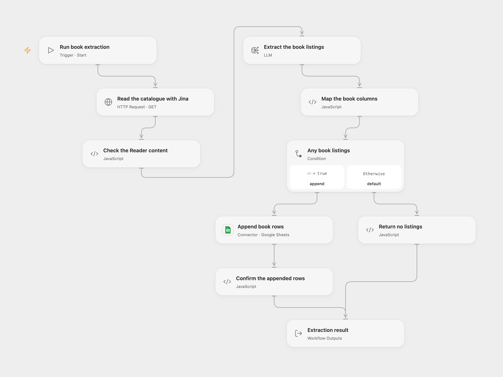

# Extract Book Listings to Google Sheets

Read a catalogue page with Jina Reader, extract books with AI and append the results to a Google Sheet.

<picture>
  <source media="(prefers-color-scheme: dark)" srcset="preview-dark.png">
  
</picture>

[Open Flow JSON](templates/extract-book-listings-to-google-sheets.openflow.json) · [n8n JSON](templates/extract-book-listings-to-google-sheets.n8n.json)

## Setup

Store a Jina API key in the secret Variable JINA_READER_API_KEY, select a structured-output model, and connect Google Sheets. In **Read the catalogue with Jina**, keep the https://r.jina.ai/ prefix and replace only the page URL after it, for example https://r.jina.ai/https://example.com/catalogue. The Jina key is sent to the configured host. Set the spreadsheet ID and range in **Append book rows**. Columns A–E must be name, price, availability, image and link, in that order.

In n8n set the Jina Authorization header credential, OpenAI model credential and Google Sheets credential; select the same spreadsheet and columns. Keep the Reader URL on r.jina.ai and its Accept: application/json header. Run one format to avoid duplicate rows.

## Behavior

A manual run sends the page URL to Jina Reader and asks the model to extract a list of books. The mapping writes title to name, image_url to image and product_url to link; unknown values become empty cells. The source's unmapped column names are explicitly aligned. Review extracted values and links against the source page.

Open Flow appends all extracted rows in one request using RAW values; n8n processes the resulting items through its Sheets node using USER_ENTERED, so Google Sheets may interpret formulas or dates. An empty list adds no rows. A rejected or uncertain write may have added rows; inspect the sheet before replaying. Neither format deduplicates earlier runs. Page content and result must fit the model context and deployment budgets.

Source and license

Adapted from [AI Powered Web Scraping with Jina, Google Sheets and OpenAI _ the EASY way](https://github.com/enescingoz/awesome-n8n-templates/blob/827110332c21cbe000ab13f6d292d5adb1f1f8db/OpenAI_and_LLMs/AI%20Powered%20Web%20Scraping%20with%20Jina%2C%20Google%20Sheets%20and%20OpenAI%20_%20the%20EASY%20way.json) in [enescingoz/awesome-n8n-templates](https://github.com/enescingoz/awesome-n8n-templates).

Source collection notice: © 2024–2026 Enes Cingoz, [CC BY 4.0](https://github.com/enescingoz/awesome-n8n-templates/blob/827110332c21cbe000ab13f6d292d5adb1f1f8db/LICENSE). The source export does not identify a separate template author or license. See [repository licensing](../../README.md#licensing) for the scope of OOMOL contributions and third-party material.

