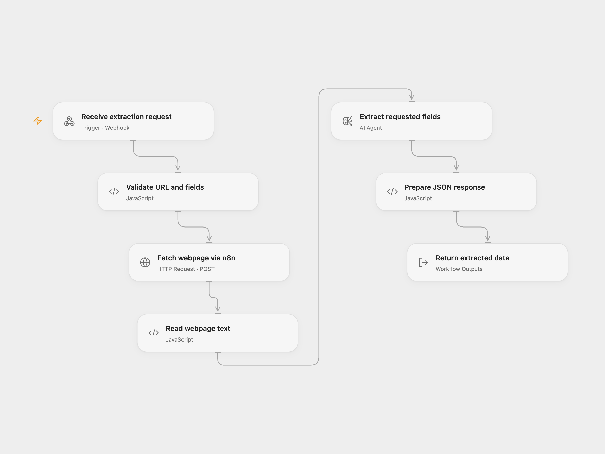

# Extract Data from a Webpage

Extract requested fields and a structured summary from a webpage.

<picture>
  <source media="(prefers-color-scheme: dark)" srcset="preview-dark.png">
  
</picture>

[Open Flow JSON](templates/extract-data-from-a-webpage.openflow.json) · [n8n JSON](templates/extract-data-from-a-webpage.n8n.json)

## Setup and use

Import n8n, configure the model and a Header Auth credential on **Fetch relay**, and set its URL and matching N8N_FETCH_RELAY_TOKEN in Open Flow. Deploy the Open Flow webhook. For direct n8n mode configure its model credential. Restrict both entry points and the relay to trusted callers; they can request external URLs. Use one mode.

POST JSON with url and optional extract_fields and name. Fields default to price,features,description. The workflow follows redirects, strips scripts, styles and tags, and sends the first 4,000 characters of text to the model. It returns title, description, extractedData, statistics and sentiment as JSON. Page text is sent to the model and the result should be checked against the source. Failed or empty fetches do not produce an extraction. The n8n model retries as configured in the source; Open Flow reports model failures without automatic retry.

Inspiration &amp; credits

Adapted from [DataForge Lite — Single URL AI Scraper](https://github.com/enescingoz/awesome-n8n-templates/blob/827110332c21cbe000ab13f6d292d5adb1f1f8db/AI_Research_RAG_and_Data_Analysis/DataForge%20Lite%20-%20AI%20URL%20Data%20Extractor.json) in [enescingoz/awesome-n8n-templates](https://github.com/enescingoz/awesome-n8n-templates).

Source collection notice: © 2024–2026 Enes Cingoz, [CC BY 4.0](https://github.com/enescingoz/awesome-n8n-templates/blob/827110332c21cbe000ab13f6d292d5adb1f1f8db/LICENSE). The source export does not identify a separate template author or license. See [repository licensing](../../README.md#licensing) for the scope of OOMOL contributions and third-party material.

