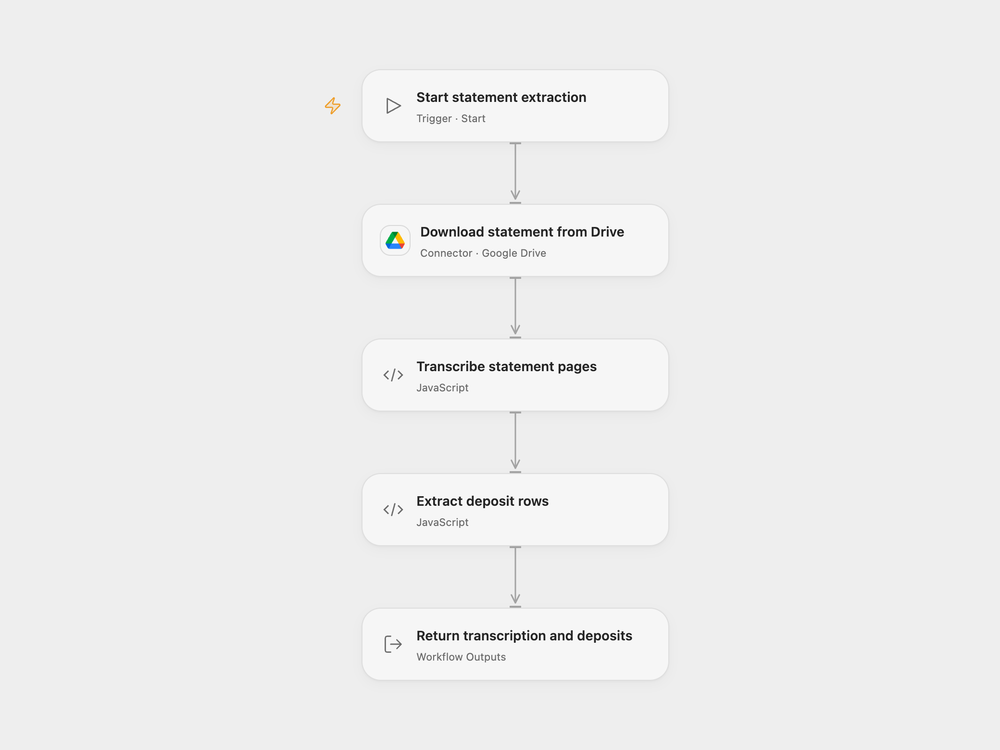

# Extract Deposit Rows from a Bank Statement

Transcribe each page of a bank statement and extract deposit rows with a vision model.

<picture>
  <source media="(prefers-color-scheme: dark)" srcset="preview-dark.png">
  
</picture>

[Open Flow JSON](templates/extract-deposits-from-bank-statement.openflow.json) · [n8n JSON](templates/extract-deposits-from-bank-statement.n8n.json)

## Setup

Connect Google Drive and set the PDF file ID in **Download statement from Drive**. Create the Secret Variable GEMINI_API_KEY and bind it to both Gemini nodes. Allow the actual Connector file-transit hostname in **Transcribe statement pages** in place of example.com. Configure the PDF-capable Gemini model if needed.

In n8n, set the Drive file ID and credentials, connect the Gemini model credentials, and set the Stirling PDF server URL in **Split PDF into Images**. The source supports a self-hosted Stirling server. Use one format.

## Behavior

The workflow reads a PDF, transcribes every page visually to Markdown, then asks Gemini to extract deposit rows with date, description and amount. It supports scanned and text PDFs. Open Flow sends each page as a separate PDF to Gemini; n8n converts pages to images first. The PDF must be at most 50 MiB and 1000 pages. Large Connector transit downloads must support HTTP byte ranges and a stable validator. Runtime and model limits apply.

Vision and extraction can make mistakes. Review the transcription and rows against the statement before relying on them. The statement is sent to Gemini and, in n8n, to the configured Stirling server. Restrict access to those services, transit URLs and execution history. Gemini Files uploads are temporary; if an upload result is unknown, inspect the Files API before retrying.

Inspiration &amp; credits

## Changes to the source

- Remove the example Drive file ID and replace the retired Gemini 1.5 model. Open Flow sends PDF pages directly to Gemini rather than converting them to JPEG. Preserve numeric page order.

Adapted from [Extract deposit rows from a bank statement](https://github.com/Zie619/n8n-workflows/blob/ae8cf6dc5b873cbb4f74587aa9180ed3a9f70682/workflows/Code/0580_Code_Editimage_Import_Webhook.json) in [Zie619/n8n-workflows](https://github.com/Zie619/n8n-workflows). The source export does not identify a separate template author or license.

The collection’s [MIT notice](https://github.com/Zie619/n8n-workflows/blob/94007c1445d9258a7da116646b79473e7c7c3282/LICENSE) is pinned at a later revision. This is the collection notice at that revision; it does not establish a separate original template author's license. Our changes are listed above; see [repository licensing](../../README.md#licensing).

> MIT License
>
> Copyright (c) 2025 Zie619
>
> Permission is hereby granted, free of charge, to any person obtaining a copy
> of this software and associated documentation files (the "Software"), to deal
> in the Software without restriction, including without limitation the rights
> to use, copy, modify, merge, publish, distribute, sublicense, and/or sell
> copies of the Software, and to permit persons to whom the Software is
> furnished to do so, subject to the following conditions:
>
> The above copyright notice and this permission notice shall be included in all
> copies or substantial portions of the Software.
>
> THE SOFTWARE IS PROVIDED "AS IS", WITHOUT WARRANTY OF ANY KIND, EXPRESS OR
> IMPLIED, INCLUDING BUT NOT LIMITED TO THE WARRANTIES OF MERCHANTABILITY,
> FITNESS FOR A PARTICULAR PURPOSE AND NONINFRINGEMENT. IN NO EVENT SHALL THE
> AUTHORS OR COPYRIGHT HOLDERS BE LIABLE FOR ANY CLAIM, DAMAGES OR OTHER
> LIABILITY, WHETHER IN AN ACTION OF CONTRACT, TORT OR OTHERWISE, ARISING FROM,
> OUT OF OR IN CONNECTION WITH THE SOFTWARE OR THE USE OR OTHER DEALINGS IN THE
> SOFTWARE.

pdf-lib 1.17.1 and its bundled dependencies are included under MIT, zlib and Apache 2.0 licenses; full notices are in the workflow module.

