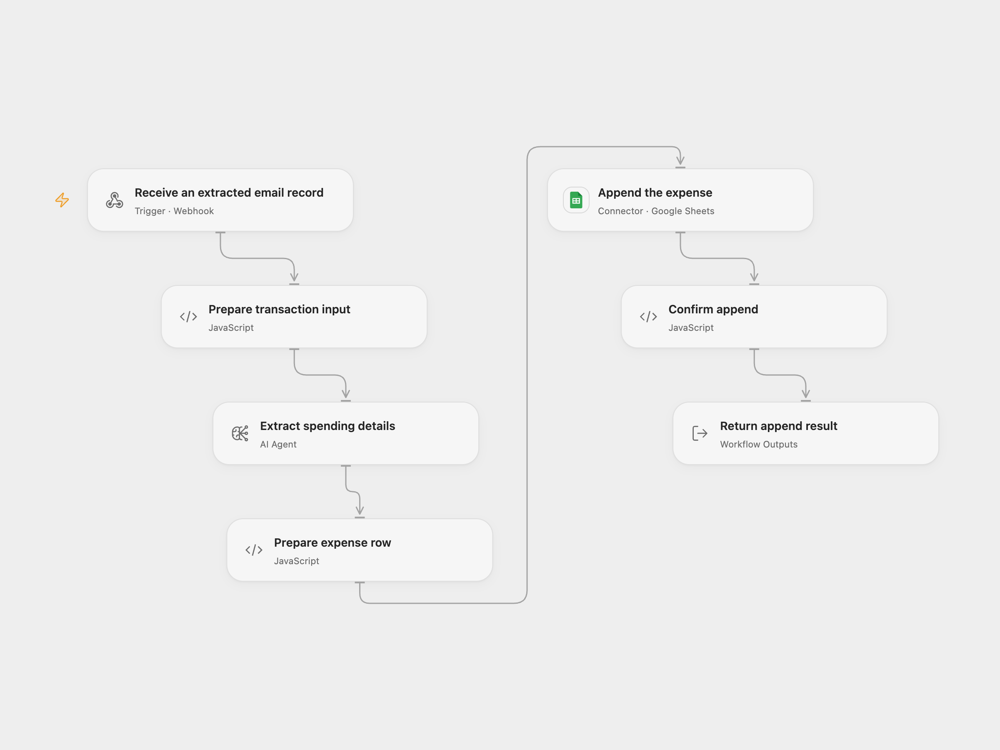

# Extract Email Spending to Sheets

Extract invoice and card transaction details from labeled Gmail messages into a Google Sheet.

<!-- template-actions:start -->
 
<!-- template-actions:end -->

<picture>
  <source media="(prefers-color-scheme: dark)" srcset="preview-dark.png">
  
</picture>

## Setup and use

Configure both Gmail triggers with your own label IDs and Gmail credentials. Configure the sender filters, PDF password if needed and the Google Sheet. The supplied source filters and PDF password are examples to replace. In Open Flow connect Google Sheets, set spreadsheet ID and A1 range, and configure a model. The sheet columns are date, service, details, amount, category, currency, payment and source. Set all three **Use Open Flow?** conditions to true and configure all three forwarding URLs.

## Behavior

Multi-transaction notices produce one request per extracted table entry. The selected workflow extracts fields and appends rows. Model output can be inaccurate; review the sheet against the source messages. Message text and extracted PDF content are shared with the model. Avoid assigning both labels to the same message unless duplicate rows are intended. The Open Flow webhook does not authenticate senders; restrict access.

An unknown append result may already have created a row; inspect the sheet before retrying. A processing or relay failure can occur after Gmail polling has advanced; inspect execution history and recover the original message manually.

In n8n

Import the supplied n8n workflow and configure both Gmail triggers with your own label IDs and Gmail credentials. For n8n-only mode leave them false and connect its models and Sheets nodes. n8n polls each label, extracts the first PDF attachment where present, and routes a multi-transaction HTML notice, single card notice or invoice. PDF passwords in node settings and sensitive transaction details may be retained in n8n execution data.

Inspiration &amp; credits

## Changes to the source

- Remove personal labels, sheet, card identifiers and PDF password. Add Open Flow relay mode. Disable automatic retries on sheet writes.

Adapted from [Extract spending history from Gmail to Google Sheets](https://github.com/enescingoz/awesome-n8n-templates/blob/827110332c21cbe000ab13f6d292d5adb1f1f8db/Gmail_and_Email_Automation/Extract%20spending%20history%20from%20gmail%20to%20google%20sheet.json) in [enescingoz/awesome-n8n-templates](https://github.com/enescingoz/awesome-n8n-templates).

Source collection notice: © 2024–2026 Enes Cingoz, [CC BY 4.0](https://github.com/enescingoz/awesome-n8n-templates/blob/827110332c21cbe000ab13f6d292d5adb1f1f8db/LICENSE). The source export does not identify a separate template author or license. See [repository licensing](../../README.md#licensing) for the scope of OOMOL contributions and third-party material.

