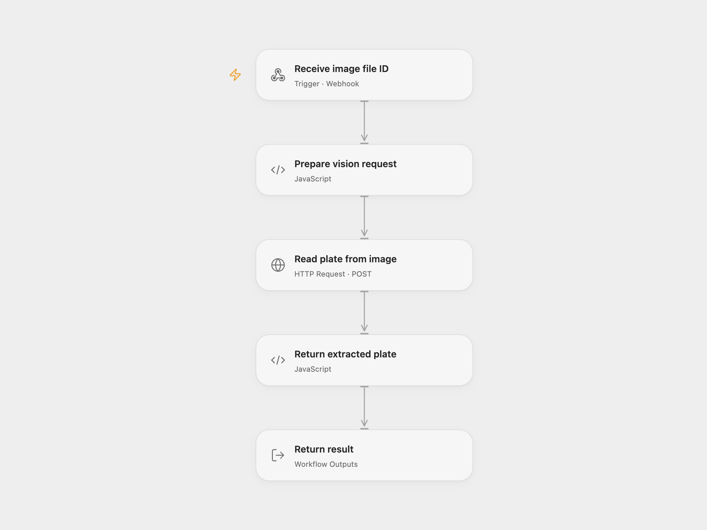

# Extract Front Vehicle License Plate

Extract the front-most vehicle license plate from an uploaded image.

<!-- template-actions:start -->
 
<!-- template-actions:end -->

<picture>
  <source media="(prefers-color-scheme: dark)" srcset="preview-dark.png">
  
</picture>

## Setup

Import the n8n workflow and upload a JPG or PNG through the form. Direct mode uses the original OpenRouter vision model and credentials.

For Open Flow set **Choose vision mode** to relay, configure the Open Flow webhook URL and OpenAI Header Auth in **Upload image artifact** as Authorization: Bearer followed by your OpenAI key. Bind the same account's OPENAI_API_KEY in Open Flow, and select a Data Table with item_key and status text columns. Restrict the Open Flow webhook to trusted n8n. Use one mode.

## Behavior

The vision model reads the license plate of the front-most vehicle and displays the result on the form completion page. It may misread characters or return UNREADABLE; a person should verify the image. Relay mode uploads the original binary to OpenAI Files with purpose vision and passes only its file ID to Open Flow for the Responses API; image bytes do not pass through a Code port. The uploaded image remains in the OpenAI account until deleted according to that account's file retention settings. Images, results and execution history can contain personal information; protect them.

If the artifact upload or relay result is unknown, inspect the OpenAI Files account and n8n execution before retrying. Reconcile the pending Data Table row and manually remove any unneeded artifact; delete the row only after confirming no upload occurred.

See the [OpenAI image input documentation](https://platform.openai.com/docs/guides/images-vision).

Inspiration &amp; credits

Use an OpenAI file artifact for binary-safe relay and keep the original direct vision path.

Adapted from [Image to license plate number](https://github.com/Zie619/n8n-workflows/blob/ae8cf6dc5b873cbb4f74587aa9180ed3a9f70682/workflows/Form/1441_Form_Automation_Triggered.json) in [Zie619/n8n-workflows](https://github.com/Zie619/n8n-workflows). The source export does not identify a separate template author or license.

The collection’s [MIT notice](https://github.com/Zie619/n8n-workflows/blob/94007c1445d9258a7da116646b79473e7c7c3282/LICENSE) is pinned at a later revision. This is the collection notice at that revision; it does not establish a separate original template author's license. Our changes are listed above; see [repository licensing](../../README.md#licensing).

> MIT License
>
> Copyright (c) 2025 Zie619
>
> Permission is hereby granted, free of charge, to any person obtaining a copy
> of this software and associated documentation files (the "Software"), to deal
> in the Software without restriction, including without limitation the rights
> to use, copy, modify, merge, publish, distribute, sublicense, and/or sell
> copies of the Software, and to permit persons to whom the Software is
> furnished to do so, subject to the following conditions:
>
> The above copyright notice and this permission notice shall be included in all
> copies or substantial portions of the Software.
>
> THE SOFTWARE IS PROVIDED "AS IS", WITHOUT WARRANTY OF ANY KIND, EXPRESS OR
> IMPLIED, INCLUDING BUT NOT LIMITED TO THE WARRANTIES OF MERCHANTABILITY,
> FITNESS FOR A PARTICULAR PURPOSE AND NONINFRINGEMENT. IN NO EVENT SHALL THE
> AUTHORS OR COPYRIGHT HOLDERS BE LIABLE FOR ANY CLAIM, DAMAGES OR OTHER
> LIABILITY, WHETHER IN AN ACTION OF CONTRACT, TORT OR OTHERWISE, ARISING FROM,
> OUT OF OR IN CONNECTION WITH THE SOFTWARE OR THE USE OR OTHER DEALINGS IN THE
> SOFTWARE.

