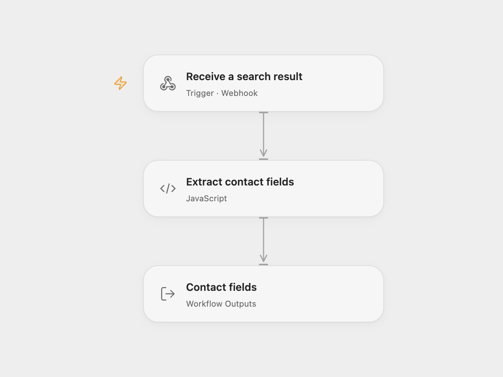

# Extract Icypeas Search Notifications

Receive an Icypeas search notification and extract its first email and contact name.

<picture>
  <source media="(prefers-color-scheme: dark)" srcset="preview-dark.png">
  
</picture>

[Open Flow JSON](templates/extract-icypeas-search-notifications.openflow.json) · [n8n JSON](templates/extract-icypeas-search-notifications.n8n.json)

## Setup

Publish or activate one format and configure its webhook URL as the Icypeas notification for each processed search item. See [Icypeas webhook setup](https://api-doc.icypeas.com/reference/webhook-search-item). The workflow expects an email-search or domain-search result containing `data.results.firstname`, `lastname`, and at least one entry in `emails` with an `email` value.

## Behavior

Each POST maps the first email address, first name and last name to output fields. Later email addresses are not selected. The webhook immediately acknowledges receipt with HTTP 200; the response does not confirm successful extraction. This example does not verify the notification signature; restrict access to the webhook and execution history, which may contain personal data. It does not send the extracted data elsewhere.

Inspiration &amp; credits

## Changes to the source

- Give the webhook a descriptive path in n8n and expose the selected fields as Open Flow outputs.

Adapted from [Real-time listening and processing of search results with Icypeas](https://github.com/Zie619/n8n-workflows/blob/ae8cf6dc5b873cbb4f74587aa9180ed3a9f70682/workflows/Stickynote/0368_Stickynote_Webhook_Automate_Webhook.json) in [Zie619/n8n-workflows](https://github.com/Zie619/n8n-workflows). The matching [n8n listing](https://n8n.io/workflows/2017-listen-and-process-search-results-from-icypeas-in-real-time/) credits Corentin Ribeyre. No separate original template license was identified.

The collection’s [MIT notice](https://github.com/Zie619/n8n-workflows/blob/94007c1445d9258a7da116646b79473e7c7c3282/LICENSE) is pinned at a later revision. This is the collection notice at that revision; it does not establish a separate original template author's license. Our changes are listed above; see [repository licensing](../../README.md#licensing).

> MIT License
>
> Copyright (c) 2025 Zie619
>
> Permission is hereby granted, free of charge, to any person obtaining a copy
> of this software and associated documentation files (the "Software"), to deal
> in the Software without restriction, including without limitation the rights
> to use, copy, modify, merge, publish, distribute, sublicense, and/or sell
> copies of the Software, and to permit persons to whom the Software is
> furnished to do so, subject to the following conditions:
>
> The above copyright notice and this permission notice shall be included in all
> copies or substantial portions of the Software.
>
> THE SOFTWARE IS PROVIDED "AS IS", WITHOUT WARRANTY OF ANY KIND, EXPRESS OR
> IMPLIED, INCLUDING BUT NOT LIMITED TO THE WARRANTIES OF MERCHANTABILITY,
> FITNESS FOR A PARTICULAR PURPOSE AND NONINFRINGEMENT. IN NO EVENT SHALL THE
> AUTHORS OR COPYRIGHT HOLDERS BE LIABLE FOR ANY CLAIM, DAMAGES OR OTHER
> LIABILITY, WHETHER IN AN ACTION OF CONTRACT, TORT OR OTHERWISE, ARISING FROM,
> OUT OF OR IN CONNECTION WITH THE SOFTWARE OR THE USE OR OTHER DEALINGS IN THE
> SOFTWARE.

