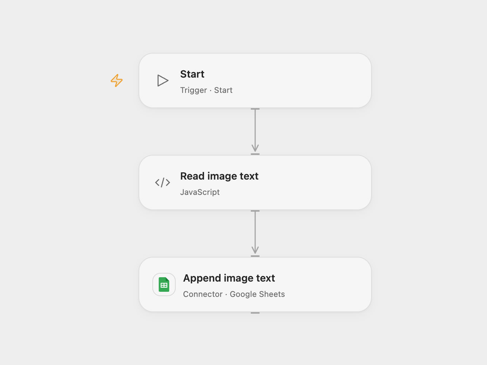

# Extract Image Text to Google Sheets

Extract text from an image with Amazon Rekognition and append the result to Google Sheets.

<picture>
  <source media="(prefers-color-scheme: dark)" srcset="preview-dark.png">
  
</picture>

[Open Flow JSON](templates/extract-image-text-to-google-sheets.openflow.json) · [n8n JSON](templates/extract-image-text-to-google-sheets.n8n.json)

## Setup

Create a sheet with columns `img_name`, `img_link`, `img_txt`, and `lowerText` in that order. Set its spreadsheet ID and range in **Append image text** and connect Google Sheets. In **Read image text**, set a public HTTPS PNG or JPEG image URL and AWS region. Add that image hostname and the corresponding regional Rekognition endpoint to the node's allowed HTTP hosts. Bind secret Variables for the AWS access key ID and secret access key, and a session token when using temporary credentials. Grant Rekognition DetectText permission. The host limits each HTTP body to 1 MiB.

In n8n, set the image URL in **HTTP Request**, connect AWS and Google Sheets credentials, and set the spreadsheet and sheet in **Google Sheets1** with the same header names. Run one format manually.

## Behavior

The workflow downloads the image, recognizes its text, and appends the filename, URL, selected text and lowercase text. As in the source, the selected text uses detections at indices 1 through 5; missing detections are omitted. Recognition can be incomplete or inaccurate. A failed download or recognition stops before the append. If the append outcome is unknown, inspect the sheet before retrying. Restrict access to the image, output and execution history as needed.

Inspiration &amp; credits

## Changes to the source

- Replace the sample image, spreadsheet ID and credentials with configuration; add a manual start. Omit missing detections and separate selected text with spaces. Open Flow signs the AWS request without exposing credentials in intermediate outputs.

Adapted from [Image text detection to Google Sheets](https://github.com/Zie619/n8n-workflows/blob/ae8cf6dc5b873cbb4f74587aa9180ed3a9f70682/workflows/Awsrekognition/0150_Awsrekognition_GoogleSheets_Automation_Webhook.json) in [Zie619/n8n-workflows](https://github.com/Zie619/n8n-workflows). The source export does not identify a separate template author or license.

The collection’s [MIT notice](https://github.com/Zie619/n8n-workflows/blob/94007c1445d9258a7da116646b79473e7c7c3282/LICENSE) is pinned at a later revision. This is the collection notice at that revision; it does not establish a separate original template author's license. Our changes are listed above; see [repository licensing](../../README.md#licensing).

> MIT License
>
> Copyright (c) 2025 Zie619
>
> Permission is hereby granted, free of charge, to any person obtaining a copy
> of this software and associated documentation files (the "Software"), to deal
> in the Software without restriction, including without limitation the rights
> to use, copy, modify, merge, publish, distribute, sublicense, and/or sell
> copies of the Software, and to permit persons to whom the Software is
> furnished to do so, subject to the following conditions:
>
> The above copyright notice and this permission notice shall be included in all
> copies or substantial portions of the Software.
>
> THE SOFTWARE IS PROVIDED "AS IS", WITHOUT WARRANTY OF ANY KIND, EXPRESS OR
> IMPLIED, INCLUDING BUT NOT LIMITED TO THE WARRANTIES OF MERCHANTABILITY,
> FITNESS FOR A PARTICULAR PURPOSE AND NONINFRINGEMENT. IN NO EVENT SHALL THE
> AUTHORS OR COPYRIGHT HOLDERS BE LIABLE FOR ANY CLAIM, DAMAGES OR OTHER
> LIABILITY, WHETHER IN AN ACTION OF CONTRACT, TORT OR OTHERWISE, ARISING FROM,
> OUT OF OR IN CONNECTION WITH THE SOFTWARE OR THE USE OR OTHER DEALINGS IN THE
> SOFTWARE.

