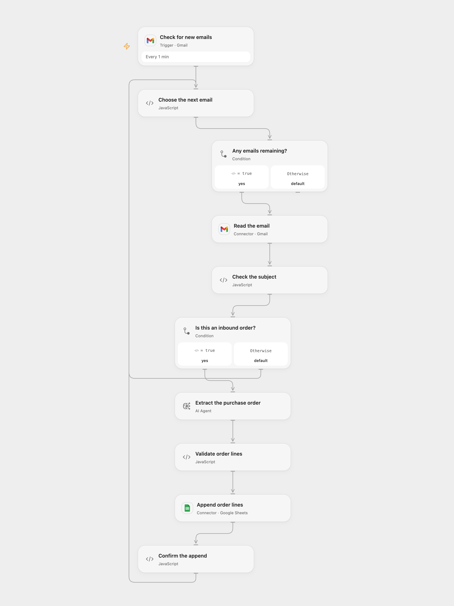

# Extract Inbound Orders to Google Sheets

Extract purchase order lines from matching Gmail messages and append them to Google Sheets.

<picture>
  <source media="(prefers-color-scheme: dark)" srcset="preview-dark.png">
  
</picture>

[Open Flow JSON](templates/extract-inbound-orders-to-google-sheets.openflow.json) · [n8n JSON](templates/extract-inbound-orders-to-google-sheets.n8n.json)

## Setup

Connect the same Gmail account to **Check for new emails** and **Read the email**. Configure the model in **Extract the purchase order**. Connect Google Sheets in **Append order lines**, set the spreadsheet ID and A1 range, and create columns in this order: PO_NUMBER, EXPECTED_DELIVERY DATE, SKU_ID, QUANTITY. In n8n connect Gmail, Google Sheets and OpenAI, and select the destination spreadsheet and sheet. Activate one format.

## Behavior

Every minute new emails whose subject contains the case-sensitive phrase Inbound Order are sent to the model. Each extracted line is appended with its purchase order and delivery date. Other emails do not write. The model can misread or invent details, so review the rows before relying on them. Limit access to email contents and execution history. Long messages may exceed model limits.

Open Flow checks up to 25 messages per poll and processes each email in the poll page in sequence and validates extracted values before one append per email. If an append fails, earlier emails may already have been written. An uncertain append may have succeeded; inspect the sheet before retrying. Polling does not guarantee exactly-once delivery.

Inspiration &amp; credits

## Changes to the source

- Replace the private spreadsheet with configuration, use RAW cell values and validate order lines before writing. n8n processes every input order rather than only the first item of a batch.
- Open Flow uses a single-round Agent and excludes drafts, spam and trash; n8n retains its source trigger filters.

Adapted from [AI agent for logistics order processing with GPT-4o, Gmail and Google Sheet](https://github.com/Zie619/n8n-workflows/blob/ae8cf6dc5b873cbb4f74587aa9180ed3a9f70682/workflows/Googlesheets/0814_GoogleSheets_Gmail_Send_Triggered.json) in [Zie619/n8n-workflows](https://github.com/Zie619/n8n-workflows). The matching [n8n community listing](https://n8n.io/workflows/3344-ai-agent-for-logistics-order-processing-with-gpt-4o-gmail-and-google-sheet/) credits Samir Saci. The original template does not state a separate license.

The collection’s [MIT notice](https://github.com/Zie619/n8n-workflows/blob/94007c1445d9258a7da116646b79473e7c7c3282/LICENSE) is pinned at a later revision. This is the collection notice at that revision; it does not establish a separate original template author's license. Our changes are listed above; see [repository licensing](../../README.md#licensing).

> MIT License
>
> Copyright (c) 2025 Zie619
>
> Permission is hereby granted, free of charge, to any person obtaining a copy
> of this software and associated documentation files (the "Software"), to deal
> in the Software without restriction, including without limitation the rights
> to use, copy, modify, merge, publish, distribute, sublicense, and/or sell
> copies of the Software, and to permit persons to whom the Software is
> furnished to do so, subject to the following conditions:
>
> The above copyright notice and this permission notice shall be included in all
> copies or substantial portions of the Software.
>
> THE SOFTWARE IS PROVIDED "AS IS", WITHOUT WARRANTY OF ANY KIND, EXPRESS OR
> IMPLIED, INCLUDING BUT NOT LIMITED TO THE WARRANTIES OF MERCHANTABILITY,
> FITNESS FOR A PARTICULAR PURPOSE AND NONINFRINGEMENT. IN NO EVENT SHALL THE
> AUTHORS OR COPYRIGHT HOLDERS BE LIABLE FOR ANY CLAIM, DAMAGES OR OTHER
> LIABILITY, WHETHER IN AN ACTION OF CONTRACT, TORT OR OTHERWISE, ARISING FROM,
> OUT OF OR IN CONNECTION WITH THE SOFTWARE OR THE USE OR OTHER DEALINGS IN THE
> SOFTWARE.

