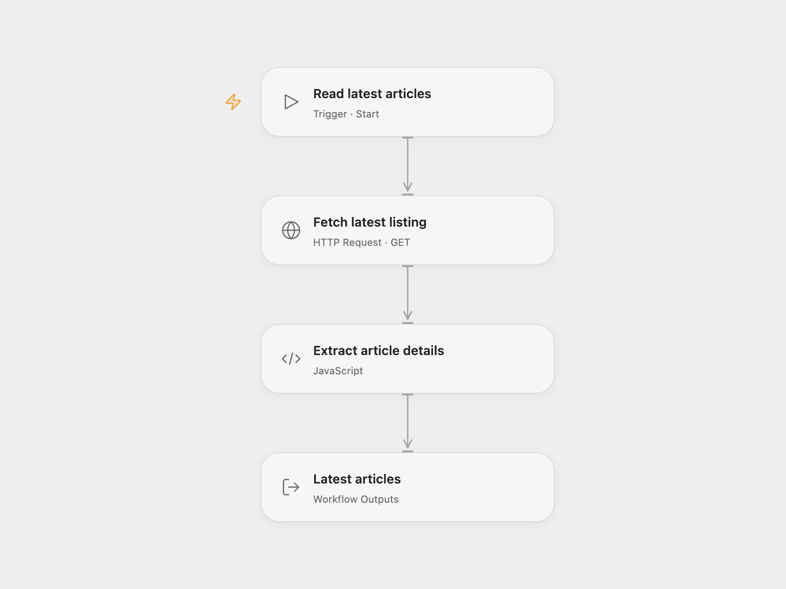

# Extract Latest TechCrunch Articles

Read the latest TechCrunch listing and extract each article’s text and metadata.

<picture>
  <source media="(prefers-color-scheme: dark)" srcset="preview-dark.png">
  
</picture>

[Open Flow JSON](templates/extract-latest-techcrunch-articles.openflow.json) · [n8n JSON](templates/extract-latest-techcrunch-articles.n8n.json)

## Setup and use

Run the workflow manually. It reads the public TechCrunch latest listing and each linked article.

## Behavior

For each entry in the first listing, the workflow returns its URL, image, publication date, title and article text. The current listing contains 20 entries. Results and page structure may change; the site can restrict access. Open Flow reads article pages concurrently, with a 1 MiB response limit per request. A failed article request fails the run. Respect TechCrunch’s terms and applicable rights when using article content.

Inspiration &amp; credits

## Changes to the source

- Open Flow returns the extracted articles as a list and reads article pages concurrently.

Adapted from [Scrape Latest 20 TechCrunch Articles](https://github.com/Zie619/n8n-workflows/blob/ae8cf6dc5b873cbb4f74587aa9180ed3a9f70682/workflows/Manual/1546_Manual_Splitout_Automation_Webhook.json) in [Zie619/n8n-workflows](https://github.com/Zie619/n8n-workflows). The source export does not identify a separate template author or license.

The collection’s [MIT notice](https://github.com/Zie619/n8n-workflows/blob/94007c1445d9258a7da116646b79473e7c7c3282/LICENSE) is pinned at a later revision. This is the collection notice at that revision; it does not establish a separate original template author's license. Our changes are listed above; see [repository licensing](../../README.md#licensing).

> MIT License
>
> Copyright (c) 2025 Zie619
>
> Permission is hereby granted, free of charge, to any person obtaining a copy
> of this software and associated documentation files (the "Software"), to deal
> in the Software without restriction, including without limitation the rights
> to use, copy, modify, merge, publish, distribute, sublicense, and/or sell
> copies of the Software, and to permit persons to whom the Software is
> furnished to do so, subject to the following conditions:
>
> The above copyright notice and this permission notice shall be included in all
> copies or substantial portions of the Software.
>
> THE SOFTWARE IS PROVIDED "AS IS", WITHOUT WARRANTY OF ANY KIND, EXPRESS OR
> IMPLIED, INCLUDING BUT NOT LIMITED TO THE WARRANTIES OF MERCHANTABILITY,
> FITNESS FOR A PARTICULAR PURPOSE AND NONINFRINGEMENT. IN NO EVENT SHALL THE
> AUTHORS OR COPYRIGHT HOLDERS BE LIABLE FOR ANY CLAIM, DAMAGES OR OTHER
> LIABILITY, WHETHER IN AN ACTION OF CONTRACT, TORT OR OTHERWISE, ARISING FROM,
> OUT OF OR IN CONNECTION WITH THE SOFTWARE OR THE USE OR OTHER DEALINGS IN THE
> SOFTWARE.

The bundled htmlparser2 is available under the MIT license and entities under the BSD 2-Clause license; their full notices are included in the workflow module.

