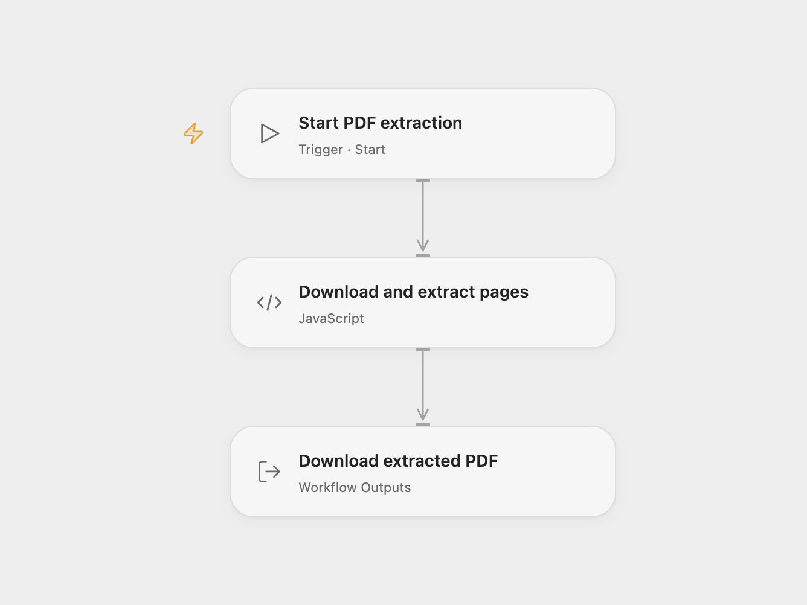

# Extract PDF Pages from a URL

Download a PDF and extract a selected page range into a new PDF.

<picture>
  <source media="(prefers-color-scheme: dark)" srcset="preview-dark.png">
  
</picture>

[Open Flow JSON](templates/extract-pdf-pages-from-url.openflow.json) · [n8n JSON](templates/extract-pdf-pages-from-url.n8n.json)

## Setup and use

Run the workflow to download the example PDF and extract pages 2–3. In Open Flow, set the PDF URL and page range in **Download and extract pages**. Add the URL's hostname to that node's allowed HTTP hosts when changing the URL. Large PDFs must support HTTP byte ranges; the server should provide an ETag or Last-Modified validator so the ranges refer to the same version. Download the resulting `output.pdf` artifact.

For n8n, install the [CustomJS PDF Toolkit community node](https://www.npmjs.com/package/@custom-js/n8n-nodes-pdf-toolkit), connect a CustomJS credential and set the URL and page range in **HTTP Request** and **Extract Pages From PDF1**. The PDF is sent to CustomJS for processing. Use one format.

## Behavior

The workflow copies the selected pages in their original order into a new PDF. Page numbering starts at 1. A missing PDF or an invalid range fails the run. The source URL and document contents are available to the services and execution environment involved; use documents you are permitted to process. Runtime request and artifact size limits apply.

Inspiration &amp; credits

## Changes to the source

- Open Flow extracts pages locally with pdf-lib and downloads large PDFs in HTTP ranges.

Adapted from [Extract pages from a PDF URL](https://github.com/Zie619/n8n-workflows/blob/ae8cf6dc5b873cbb4f74587aa9180ed3a9f70682/workflows/Manual/1971_Manual_HTTP_Automate_Webhook.json) in [Zie619/n8n-workflows](https://github.com/Zie619/n8n-workflows). The source export does not identify a separate template author or license.

The collection’s [MIT notice](https://github.com/Zie619/n8n-workflows/blob/94007c1445d9258a7da116646b79473e7c7c3282/LICENSE) is pinned at a later revision. This is the collection notice at that revision; it does not establish a separate original template author's license. Our changes are listed above; see [repository licensing](../../README.md#licensing).

> MIT License
>
> Copyright (c) 2025 Zie619
>
> Permission is hereby granted, free of charge, to any person obtaining a copy
> of this software and associated documentation files (the "Software"), to deal
> in the Software without restriction, including without limitation the rights
> to use, copy, modify, merge, publish, distribute, sublicense, and/or sell
> copies of the Software, and to permit persons to whom the Software is
> furnished to do so, subject to the following conditions:
>
> The above copyright notice and this permission notice shall be included in all
> copies or substantial portions of the Software.
>
> THE SOFTWARE IS PROVIDED "AS IS", WITHOUT WARRANTY OF ANY KIND, EXPRESS OR
> IMPLIED, INCLUDING BUT NOT LIMITED TO THE WARRANTIES OF MERCHANTABILITY,
> FITNESS FOR A PARTICULAR PURPOSE AND NONINFRINGEMENT. IN NO EVENT SHALL THE
> AUTHORS OR COPYRIGHT HOLDERS BE LIABLE FOR ANY CLAIM, DAMAGES OR OTHER
> LIABILITY, WHETHER IN AN ACTION OF CONTRACT, TORT OR OTHERWISE, ARISING FROM,
> OUT OF OR IN CONNECTION WITH THE SOFTWARE OR THE USE OR OTHER DEALINGS IN THE
> SOFTWARE.

pdf-lib 1.17.1 and its bundled dependencies are included under MIT, zlib and Apache 2.0 licenses. Their complete notices are included in the workflow module.

