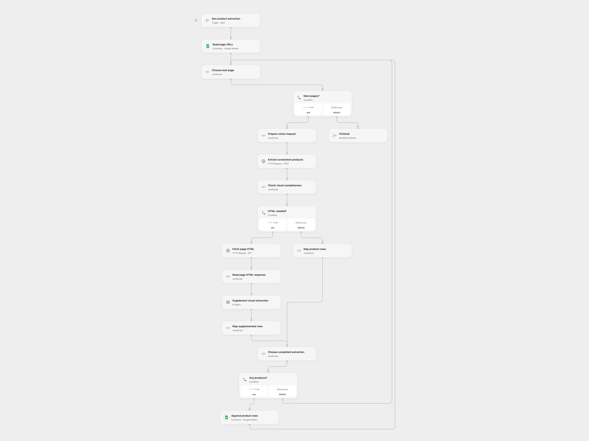

# Extract Products from Page Screenshots

Read page URLs from Google Sheets, extract product details from screenshots and append the results.

<!-- template-actions:start -->
 
<!-- template-actions:end -->

<picture>
  <source media="(prefers-color-scheme: dark)" srcset="preview-dark.png">
  
</picture>

## Setup and use

Create a spreadsheet with **List of URLs** column A headed url and **Results** columns page URL, product title, price, brand, promotion and percentage.

Configure the ScrapingBee query-auth credential with key name api_key for both screenshot and HTML fallback requests, including the embedded tool workflow, and configure Gemini.

## Behavior

Each URL is rendered as a full-page ScrapingBee screenshot. The Gemini agent extracts product title, price, brand and promotion details, and can request the page HTML as Markdown when the image is incomplete. If it reports missing details, Open Flow fetches HTML with ScrapingBee and asks its configured model to supplement the visual results; Open Flow writes the resulting rows. The relay does not authenticate callers; restrict access to trusted senders. Page data is shared with ScrapingBee and Gemini. A lost Sheets append response may represent written rows; inspect the sheet before retrying.

In n8n

In Open Flow bind SCRAPINGBEE_API_KEY as a secret Variable, configure the fallback Agent, connect Google Sheets, set the spreadsheet ID on both Sheets nodes, and set the deployed n8n webhook URL on **Extract screenshot products**. Import and activate the supplied n8n workflow. Set the same spreadsheet in the n8n Sheets nodes. Run either the n8n manual entry or Open Flow entry to avoid duplicate rows. The n8n relay retains screenshot bytes and performs the visual extraction.

Inspiration &amp; credits

## Changes to the source

- Embed the source HTML fallback as the n8n direct agent's tool. In Open Flow move the conditional HTML fallback to native HTTP and Agent nodes, using raw HTML rather than Markdown; keep screenshot vision in n8n and preserve each URL with its product rows. Correct the source's title column label and replace account-specific settings.

Adapted from [Vision-Based AI Agent Scraper - with Google Sheets, ScrapingBee, and Gemini](https://github.com/enescingoz/awesome-n8n-templates/blob/827110332c21cbe000ab13f6d292d5adb1f1f8db/Google_Drive_and_Google_Sheets/%E2%9C%A8%20Vision-Based%20AI%20Agent%20Scraper%20-%20with%20Google%20Sheets%2C%20ScrapingBee%2C%20and%20Gemini.json) in [enescingoz/awesome-n8n-templates](https://github.com/enescingoz/awesome-n8n-templates).

Source collection notice: © 2024–2026 Enes Cingoz, [CC BY 4.0](https://github.com/enescingoz/awesome-n8n-templates/blob/827110332c21cbe000ab13f6d292d5adb1f1f8db/LICENSE). The source export does not identify a separate template author or license. See [repository licensing](../../README.md#licensing) for the scope of OOMOL contributions and third-party material.

