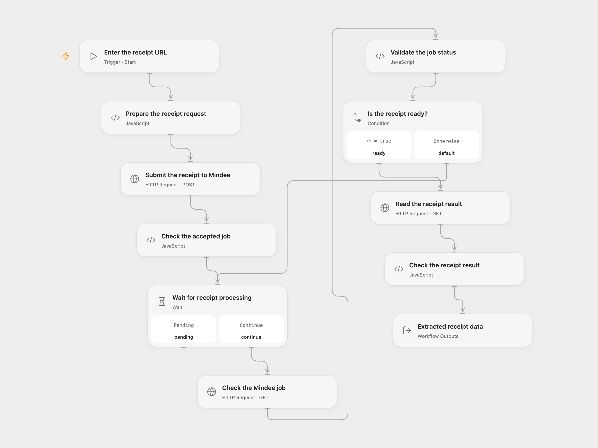

# Extract Receipt Data from an Image URL

Extract structured receipt data from a directly accessible image URL.

<picture>
  <source media="(prefers-color-scheme: dark)" srcset="preview-dark.png">
  
</picture>

[Open Flow JSON](templates/extract-receipt-from-image-url.openflow.json) · [n8n JSON](templates/extract-receipt-from-image-url.n8n.json)

## Setup

Create a Mindee V2 Receipt model and copy its model ID. In Open Flow, set the ID in **Prepare the receipt request**, create a secret Variable named `MINDEE_API_KEY`, and bind it to the Authorization input of **Submit the receipt to Mindee**, **Check the Mindee job** and **Read the receipt result**. Run with a receipt image URL.

In n8n, set the image URL and model ID in **Prepare the receipt request**. Create an HTTP Header Auth credential with name `Authorization` and your Mindee V2 API key as its value, and select it on all three Mindee HTTP nodes. Use one format per extraction.

The image must be available at a direct HTTPS URL that Mindee can fetch without authentication or redirects. Anyone with that URL may be able to view the receipt, so use an appropriately scoped link. A login-only or expiring URL may fail. Receipt contents are sent to Mindee for processing.

## Behavior

A manual run submits one image URL to the configured Receipt model, waits three seconds between job checks, and returns the complete V2 extraction response when its job finishes. The model determines the returned fields and recognition quality. Open Flow limits each HTTP response to 4 MiB and Code inputs and outputs to 1 MiB; an oversized response stops the run. A missing or invalid job, failed processing, mismatched result or 200 pending checks stops the run. The workflow does not resubmit a failed or uncertain request; an unknown submission may already have created a job, so inspect Mindee before retrying.

## Changes to the source

- Replace the legacy Mindee receipt node with its current asynchronous V2 Receipt model. Mindee fetches a user-supplied URL directly instead of the workflow downloading binary bytes. Results use the V2 response shape and may differ from the original model.
- Require a model ID and check the returned job and result belong together.

Source and license

Adapted from [Extract information from an image of a receipt](https://github.com/Zie619/n8n-workflows/blob/ae8cf6dc5b873cbb4f74587aa9180ed3a9f70682/workflows/Manual/1128_Manual_HTTP_Automation_Webhook.json) in [Zie619/n8n-workflows](https://github.com/Zie619/n8n-workflows). The matching [n8n community listing](https://n8n.io/workflows/702-extract-information-from-an-image-of-a-receipt/) credits Harshil Agrawal. The original template does not state a separate license.

The collection’s [MIT notice](https://github.com/Zie619/n8n-workflows/blob/94007c1445d9258a7da116646b79473e7c7c3282/LICENSE) is pinned at a later revision. This is the collection notice at that revision; it does not establish a separate original template author's license. Our changes are listed above; see [repository licensing](../../README.md#licensing).

> MIT License
>
> Copyright (c) 2025 Zie619
>
> Permission is hereby granted, free of charge, to any person obtaining a copy
> of this software and associated documentation files (the "Software"), to deal
> in the Software without restriction, including without limitation the rights
> to use, copy, modify, merge, publish, distribute, sublicense, and/or sell
> copies of the Software, and to permit persons to whom the Software is
> furnished to do so, subject to the following conditions:
>
> The above copyright notice and this permission notice shall be included in all
> copies or substantial portions of the Software.
>
> THE SOFTWARE IS PROVIDED "AS IS", WITHOUT WARRANTY OF ANY KIND, EXPRESS OR
> IMPLIED, INCLUDING BUT NOT LIMITED TO THE WARRANTIES OF MERCHANTABILITY,
> FITNESS FOR A PARTICULAR PURPOSE AND NONINFRINGEMENT. IN NO EVENT SHALL THE
> AUTHORS OR COPYRIGHT HOLDERS BE LIABLE FOR ANY CLAIM, DAMAGES OR OTHER
> LIABILITY, WHETHER IN AN ACTION OF CONTRACT, TORT OR OTHERWISE, ARISING FROM,
> OUT OF OR IN CONNECTION WITH THE SOFTWARE OR THE USE OR OTHER DEALINGS IN THE
> SOFTWARE.

