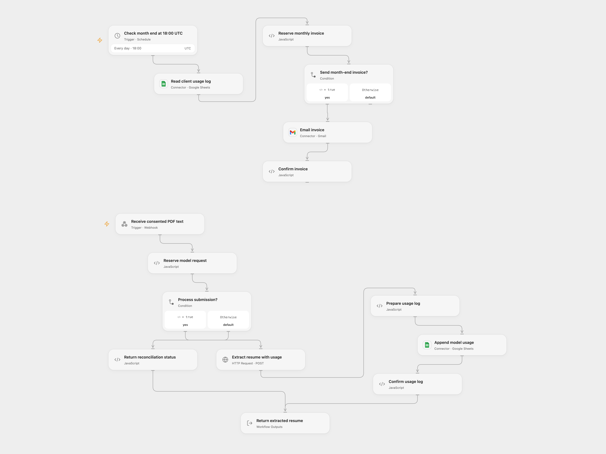

# Extract Resumes and Invoice Model Usage

Extract resume data, log model token usage, and email a monthly client invoice.

<!-- template-actions:start -->
 
<!-- template-actions:end -->

<picture>
  <source media="(prefers-color-scheme: dark)" srcset="preview-dark.png">
  
</picture>

## Setup

Import the bundled n8n workflow and configure its PDF form. Use extractable-text PDFs; scanned PDFs need OCR. For Open Flow set the relay URL in **Forward PDF text to Open Flow**, select relay mode, bind `OPENAI_API_KEY`, connect Google Sheets and Gmail, and set the same client ID, workflow ID, spreadsheet ID and range in both branches. Set the recipient and input/output rates per million tokens in **Prepare usage log**. Use a Sheet1 table with headers date, workflow_id, execution_id, client_id, client_name, input_tokens, output_tokens, total_tokens, input_cost, output_cost and total_cost, in that order. Enable persistent State and avoid overlapping runs. Restrict access to the Open Flow webhook, which has no built-in authentication.

For direct n8n mode configure Header Auth with Authorization: Bearer and your OpenAI API key, connect Sheets, set client ID and rates in **Configure service**, set the same client ID in **Get Client Logs** and **Calculate monthly invoice**, select the same Data Table for checkpoints, and configure the invoice recipient and Gmail credential. Select one mode and one format.

## Behavior

The consented PDF is converted to text and sent to OpenAI for structured resume extraction. The returned prompt and completion token counts are multiplied by the configured rates and appended to the client usage log. Rates are examples; set rates matching your agreement. Calculated amounts are estimates and may differ from provider charges. Resume content and usage data appear in service and execution histories. The Open Flow Code ports each have a 1 MiB limit; its HTTP request has a 30-second budget and the form waits up to 60 seconds.

At 18:00 UTC on the last day of each month, the workflow sums the configured client's current-month usage and emails a 20% tax invoice when records exist. Review the rates and update the 20% tax calculation in the invoice nodes if needed. A lost model, log or invoice response can represent a completed action. Inspect the provider, sheet and Gmail before retrying. For Open Flow enter the pending key in the corresponding reserve node and select confirmed after manually completing missing steps, or absent only if no action occurred, then rerun and clear the fields. In n8n reconcile the Data Table pending row and complete missing steps manually before marking done.

Inspiration &amp; credits

Use returned model usage, checkpoint external writes, and run invoices on the actual last day.

Adapted from [Tracking token usage and costs per client](https://github.com/Zie619/n8n-workflows/blob/ae8cf6dc5b873cbb4f74587aa9180ed3a9f70682/workflows/Filter/0830_Filter_Summarize_Send_Scheduled.json) in [Zie619/n8n-workflows](https://github.com/Zie619/n8n-workflows). The source export does not identify a separate template author or license.

The collection’s [MIT notice](https://github.com/Zie619/n8n-workflows/blob/94007c1445d9258a7da116646b79473e7c7c3282/LICENSE) is pinned at a later revision. This is the collection notice at that revision; it does not establish a separate original template author's license. Our changes are listed above; see [repository licensing](../../README.md#licensing).

> MIT License
>
> Copyright (c) 2025 Zie619
>
> Permission is hereby granted, free of charge, to any person obtaining a copy
> of this software and associated documentation files (the "Software"), to deal
> in the Software without restriction, including without limitation the rights
> to use, copy, modify, merge, publish, distribute, sublicense, and/or sell
> copies of the Software, and to permit persons to whom the Software is
> furnished to do so, subject to the following conditions:
>
> The above copyright notice and this permission notice shall be included in all
> copies or substantial portions of the Software.
>
> THE SOFTWARE IS PROVIDED "AS IS", WITHOUT WARRANTY OF ANY KIND, EXPRESS OR
> IMPLIED, INCLUDING BUT NOT LIMITED TO THE WARRANTIES OF MERCHANTABILITY,
> FITNESS FOR A PARTICULAR PURPOSE AND NONINFRINGEMENT. IN NO EVENT SHALL THE
> AUTHORS OR COPYRIGHT HOLDERS BE LIABLE FOR ANY CLAIM, DAMAGES OR OTHER
> LIABILITY, WHETHER IN AN ACTION OF CONTRACT, TORT OR OTHERWISE, ARISING FROM,
> OUT OF OR IN CONNECTION WITH THE SOFTWARE OR THE USE OR OTHER DEALINGS IN THE
> SOFTWARE.

