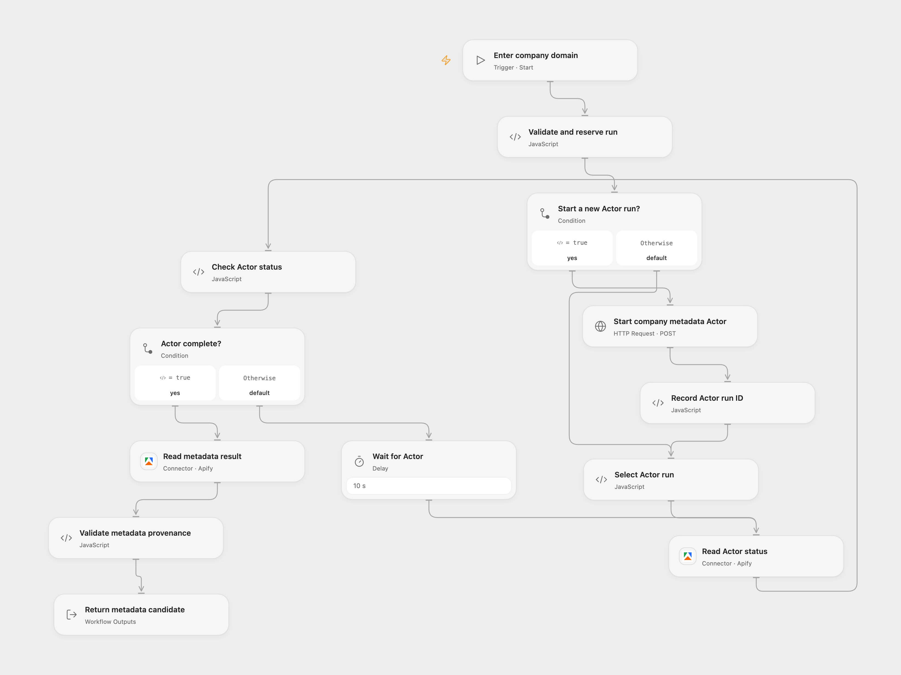

# Extract Source-Backed Company Metadata

Extract website metadata candidates for one company domain with provenance.

<!-- template-actions:start -->
 
<!-- template-actions:end -->

<picture>
  <source media="(prefers-color-scheme: dark)" srcset="preview-dark.png">
  
</picture>

## Setup

Connect Apify and set APIFY_TOKEN to a token for the same account. Enter one bare domain and a unique request ID. Enable persistent State and prevent concurrent runs with the same ID.

## Behavior

The Actor reads public website metadata and returns a single candidate only if the domain, integration source and scrape provenance match. Review candidates against authoritative sources before using them. The request retains the source limit of one result and maximum total charge of US$0.02; check current Actor pricing before use.

Open Flow starts the Actor asynchronously and resumes polling a recorded run ID for the same request. If start outcome is unknown, inspect Apify before resolving the pending State. No automatic launch retry is configured.

In n8n

In n8n, configure a Header Auth credential for Apify and set the domain, request ID and a Data Table with item_key and status columns. n8n uses the source synchronous endpoint; inspect Apify and its pending Data Table record if the response is uncertain before retrying.

Inspiration &amp; credits

Adapted from [Extract source-backed company website metadata with Apify](https://github.com/enescingoz/awesome-n8n-templates/blob/827110332c21cbe000ab13f6d292d5adb1f1f8db/Other_Integrations_and_Use_Cases/Extract%20source-backed%20company%20website%20metadata%20with%20Apify.json) in [enescingoz/awesome-n8n-templates](https://github.com/enescingoz/awesome-n8n-templates).

Source collection notice: © 2024–2026 Enes Cingoz, [CC BY 4.0](https://github.com/enescingoz/awesome-n8n-templates/blob/827110332c21cbe000ab13f6d292d5adb1f1f8db/LICENSE). The source export does not identify a separate template author or license. See [repository licensing](../../README.md#licensing) for the scope of OOMOL contributions and third-party material.

