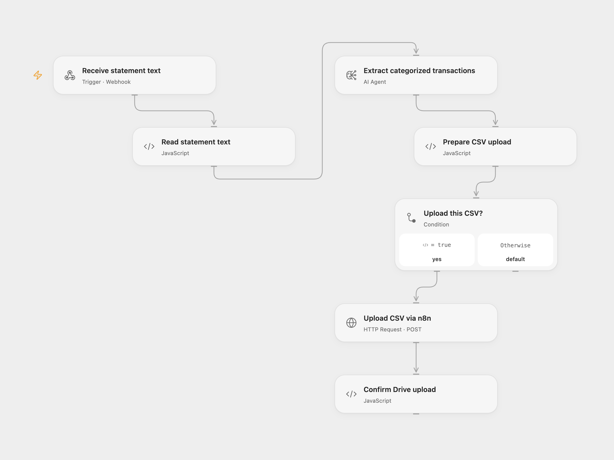

# Extract Statement Transactions to Drive CSV

Extract and categorize bank statement transactions from PDFs or images, then save CSV files to Google Drive.

<picture>
  <source media="(prefers-color-scheme: dark)" srcset="preview-dark.png">
  
</picture>

[Open Flow JSON](templates/extract-statement-transactions-to-drive-csv.openflow.json) · [n8n JSON](templates/extract-statement-transactions-to-drive-csv.n8n.json)

## Setup

Import the n8n workflow and connect Google Drive and a vision-capable Gemini model. Configure the watched folder in **Get PDF or Images**, and the destination folder in both Drive upload nodes. Use one Data Table with text columns item_key and status in every checkpoint node. Prevent overlapping runs.

For Open Flow set **Choose processing mode** to relay, configure **Forward statement text** with the Open Flow webhook URL, enable **CSV upload webhook**, and configure its Header Auth credential as Authorization: Bearer followed by a secret. Set the upload webhook URL in **Prepare CSV upload** and bind the secret variable N8N_RELAY_TOKEN. Configure an AI model and persistent State. Restrict access to the Open Flow webhook at your deployment boundary; it has no built-in authentication. For direct n8n leave the mode as direct, keep the upload webhook disabled, and connect the Gemini model. Use one mode only.

## Behavior

New PDF or image files in the watched folder are processed one at a time. n8n extracts text from PDFs or transcribes an image with the vision model. The AI converts the complete text to transaction rows and assigns categories; the CSV is saved to the destination Drive folder. PDFs must contain extractable text; scanned PDFs require OCR. Model output can omit or misread transactions: review every CSV against the original statement. Financial data is sent to the configured models and appears in execution histories. Protect access and retention. Open Flow requires the complete text and enclosing data to fit its 1 MiB per-Code input/output limit.

If a Drive upload has an unknown outcome, inspect the destination before retrying. In Open Flow enter the pending key in **Prepare CSV upload** and set resolution to confirmed if uploaded or absent if not, replay the same file event, then clear the fields. In n8n inspect its pending Data Table row, mark it done if the file exists, or delete it only after confirming no file was created.

Inspiration &amp; credits

Add authenticated binary upload relay and per-file checkpoints, process each trigger item and retain both PDF and image paths. The source links to [Rumjahn’s workflow article](https://rumjahn.com/how-to-create-an-a-i-agent-to-analyze-matomo-analytics-using-n8n-for-free/).

Adapted from [Extract text from PDF and image using Vertex AI (Gemini) into CSV](https://github.com/Zie619/n8n-workflows/blob/ae8cf6dc5b873cbb4f74587aa9180ed3a9f70682/workflows/Extractfromfile/1978_Extractfromfile_Converttofile_Automation_Webhook.json) in [Zie619/n8n-workflows](https://github.com/Zie619/n8n-workflows). The source export does not identify a separate template author or license.

The collection’s [MIT notice](https://github.com/Zie619/n8n-workflows/blob/94007c1445d9258a7da116646b79473e7c7c3282/LICENSE) is pinned at a later revision. This is the collection notice at that revision; it does not establish a separate original template author's license. Our changes are listed above; see [repository licensing](../../README.md#licensing).

> MIT License
>
> Copyright (c) 2025 Zie619
>
> Permission is hereby granted, free of charge, to any person obtaining a copy
> of this software and associated documentation files (the "Software"), to deal
> in the Software without restriction, including without limitation the rights
> to use, copy, modify, merge, publish, distribute, sublicense, and/or sell
> copies of the Software, and to permit persons to whom the Software is
> furnished to do so, subject to the following conditions:
>
> The above copyright notice and this permission notice shall be included in all
> copies or substantial portions of the Software.
>
> THE SOFTWARE IS PROVIDED "AS IS", WITHOUT WARRANTY OF ANY KIND, EXPRESS OR
> IMPLIED, INCLUDING BUT NOT LIMITED TO THE WARRANTIES OF MERCHANTABILITY,
> FITNESS FOR A PARTICULAR PURPOSE AND NONINFRINGEMENT. IN NO EVENT SHALL THE
> AUTHORS OR COPYRIGHT HOLDERS BE LIABLE FOR ANY CLAIM, DAMAGES OR OTHER
> LIABILITY, WHETHER IN AN ACTION OF CONTRACT, TORT OR OTHERWISE, ARISING FROM,
> OUT OF OR IN CONNECTION WITH THE SOFTWARE OR THE USE OR OTHER DEALINGS IN THE
> SOFTWARE.

