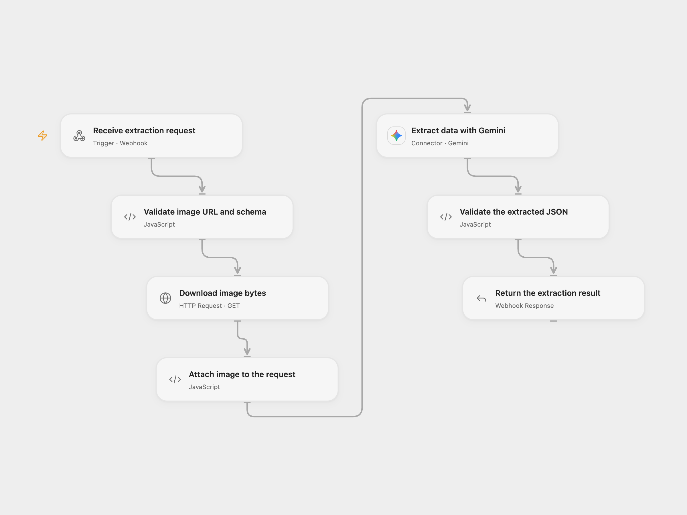

# Extract Structured Data from Images with Gemini

Send an image URL and your output fields to a webhook. Gemini extracts matching data and returns it in the HTTP response.

<!-- template-actions:start -->
[](https://openflow.run/templates/extract-structured-data-from-images-with-gemini/) [](templates/extract-structured-data-from-images-with-gemini.n8n.json)
<!-- template-actions:end -->

<picture>
  <source media="(prefers-color-scheme: dark)" srcset="preview-dark.png">
  
</picture>

## Setup

1. Connect Gemini in **Extract data with Gemini**. In **Validate image URL and schema**, set your Google Cloud Storage bucket name. Use the direct object URL `https://storage.googleapis.com/BUCKET/OBJECT`, with a signed GET query if the image is private.
2. Create the secret variable `IMAGE_WEBHOOK_KEY`. In **Receive extraction request**, set **Header** authentication with header name `X-Image-Webhook-Key` and select the secret. Publish with **Enable Calls** off and verify that a POST without the secret returns HTTP 401. Enable calls and publish after checking the authentication.
3. Send a POST to the webhook with the secret header, `Content-Type: application/json`, and a body like this.

```json
{
  "image_url": "https://storage.googleapis.com/example-inventory/label.png",
  "Requirement": "Read the SKU and quantity printed on this inventory label.",
  "properties": {
    "sku": { "type": "string" },
    "quantity": { "type": "integer" }
  },
  "required": ["sku", "quantity"]
}
```

## Behavior

The workflow downloads a PNG or JPEG of up to 2 MiB and verifies its format before attaching the bytes to the Gemini request. It accepts a direct URL in the configured bucket and rejects redirects.

Supply string, number, integer, boolean, array, or object property definitions. Arrays declare `items`, and nested objects declare `properties` and may list `required`. Use `nullable: true` to allow null for a field. You can add descriptions and use `enum` for strings or numbers. Only the declared fields can appear in the result. Omit `required` to make each declared field optional.

The request waits up to 60 seconds. A successful response has a `result` string containing JSON, for example `{"result":"{\"sku\":\"BIN-17\",\"quantity\":4}"}`. Parse `result` as JSON to use the fields. A download error, incomplete model response or result that fails the schema stops the request without an extraction result. The source used GET with a JSON body; this endpoint receives the same fields with POST.

<details>
<summary>In n8n</summary>

Bind a **Header Auth** credential for `X-Image-Webhook-Key` to **Receive extraction request** and a separate **Header Auth** credential with name `x-goog-api-key` and the Gemini API key to **Extract data with Gemini**. In **Validate image URL and schema**, set your bucket name, verify authentication, and set `enableCalls` to `true`. Activate the workflow and send a GET with the JSON body to its webhook URL, as in the original workflow. Clients that support sending a body on GET, such as cURL with `--request GET --data-binary`, can call this endpoint.

</details>

<details>
<summary>Inspiration &amp; credits</summary>

Adapted from [Image-Based Data Extraction API using Gemini AI](https://github.com/Zie619/n8n-workflows/blob/ae8cf6dc5b873cbb4f74587aa9180ed3a9f70682/workflows/Webhook/1770_Webhook_Extractfromfile_Automation_Webhook.json) in [Zie619/n8n-workflows](https://github.com/Zie619/n8n-workflows). Attribution: Srinivasan KB (original workflow) / Zie619 (collection). See the [original n8n gallery template](https://n8n.io/workflows/3149-image-based-data-extraction-api-using-gemini-ai/).

The collection’s [MIT notice](https://github.com/Zie619/n8n-workflows/blob/94007c1445d9258a7da116646b79473e7c7c3282/LICENSE) is pinned at a later revision. This is the collection notice at that revision; it does not establish a separate original template author's license. Our changes are listed above; see [repository licensing](../../README.md#licensing).

> MIT License
>
> Copyright (c) 2025 Zie619
>
> Permission is hereby granted, free of charge, to any person obtaining a copy
> of this software and associated documentation files (the "Software"), to deal
> in the Software without restriction, including without limitation the rights
> to use, copy, modify, merge, publish, distribute, sublicense, and/or sell
> copies of the Software, and to permit persons to whom the Software is
> furnished to do so, subject to the following conditions:
>
> The above copyright notice and this permission notice shall be included in all
> copies or substantial portions of the Software.
>
> THE SOFTWARE IS PROVIDED "AS IS", WITHOUT WARRANTY OF ANY KIND, EXPRESS OR
> IMPLIED, INCLUDING BUT NOT LIMITED TO THE WARRANTIES OF MERCHANTABILITY,
> FITNESS FOR A PARTICULAR PURPOSE AND NONINFRINGEMENT. IN NO EVENT SHALL THE
> AUTHORS OR COPYRIGHT HOLDERS BE LIABLE FOR ANY CLAIM, DAMAGES OR OTHER
> LIABILITY, WHETHER IN AN ACTION OF CONTRACT, TORT OR OTHERWISE, ARISING FROM,
> OUT OF OR IN CONNECTION WITH THE SOFTWARE OR THE USE OR OTHER DEALINGS IN THE
> SOFTWARE.

</details>
