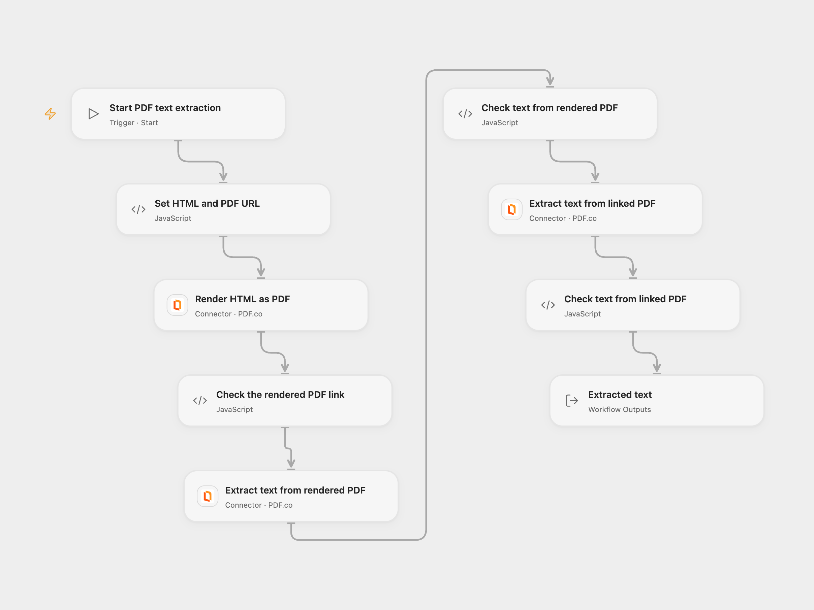

# Extract Text from HTML and a PDF URL

Render HTML as a PDF, then extract its text and the text of a second PDF from a download URL.

<!-- template-actions:start -->
 
<!-- template-actions:end -->

<picture>
  <source media="(prefers-color-scheme: dark)" srcset="preview-dark.png">
  
</picture>

## Setup

1. In **Set HTML and PDF URL**, enter your HTML and a direct PDF download link that PDF.co can reach. The defaults use sample HTML and a public W3C test document.
2. Select the same PDF.co connection in **Render HTML as PDF**, **Extract text from rendered PDF**, and **Extract text from linked PDF**.
3. Run the workflow manually and open **Extracted text**.

## Behavior

The workflow renders your HTML as a PDF and extracts text from that PDF using its temporary link. It also extracts text from the PDF at your configured URL. The result includes `htmlText` and `urlText`. Both strings preserve the text and line breaks returned by the service.

A conversion or extraction error stops the run. If the linked PDF fails, you can still inspect the first result in **Check text from rendered PDF**. The documents must fit PDF.co's limits for synchronous extraction and inline results.

In n8n

On a self-hosted instance, install `@custom-js/n8n-nodes-pdf-toolkit` version `1.58.0`. Assign the same CustomJS API credential in **Render HTML as PDF**, **Extract text from rendered PDF**, and **Extract text from linked PDF**. Edit **Set HTML and PDF URL** and run manually. The first extraction receives the rendered binary PDF, subject to the CustomJS 6 MB request limit. CustomJS retrieves the linked PDF directly. Open **Extracted text** for `htmlText` and `urlText`.

Inspiration &amp; credits

## Changes to the source

- Use PDF.co Actions with inline text results in Open Flow. The n8n import retains the CustomJS binary and URL extraction modes.
- Use a public test document and return the two extraction results as separately named outputs.
- [Original n8n listing by CustomJS](https://n8n.io/workflows/3871-convert-html-to-pdf-and-extract-text-from-pdfs-with-customjs-api/) and [PDF.co PDF-to-text API guide](https://pdf.co/tutorials/how-to-use-custom-profiles-parameter-converting-pdf-to-text).

Adapted from [Convert HTML to PDF and extract text from PDFs with CustomJS API](https://github.com/Zie619/n8n-workflows/blob/ae8cf6dc5b873cbb4f74587aa9180ed3a9f70682/workflows/Manual/1545_Manual_Code_Automation_Triggered.json) in [Zie619/n8n-workflows](https://github.com/Zie619/n8n-workflows). Attribution: CustomJS (original workflow); Zie619 / n8n-workflows (collection).

The collection’s [MIT notice](https://github.com/Zie619/n8n-workflows/blob/94007c1445d9258a7da116646b79473e7c7c3282/LICENSE) is pinned at a later revision. This is the collection notice at that revision; it does not establish a separate original template author's license. Our changes are listed above; see [repository licensing](../../README.md#licensing).

> MIT License
>
> Copyright (c) 2025 Zie619
>
> Permission is hereby granted, free of charge, to any person obtaining a copy
> of this software and associated documentation files (the "Software"), to deal
> in the Software without restriction, including without limitation the rights
> to use, copy, modify, merge, publish, distribute, sublicense, and/or sell
> copies of the Software, and to permit persons to whom the Software is
> furnished to do so, subject to the following conditions:
>
> The above copyright notice and this permission notice shall be included in all
> copies or substantial portions of the Software.
>
> THE SOFTWARE IS PROVIDED "AS IS", WITHOUT WARRANTY OF ANY KIND, EXPRESS OR
> IMPLIED, INCLUDING BUT NOT LIMITED TO THE WARRANTIES OF MERCHANTABILITY,
> FITNESS FOR A PARTICULAR PURPOSE AND NONINFRINGEMENT. IN NO EVENT SHALL THE
> AUTHORS OR COPYRIGHT HOLDERS BE LIABLE FOR ANY CLAIM, DAMAGES OR OTHER
> LIABILITY, WHETHER IN AN ACTION OF CONTRACT, TORT OR OTHERWISE, ARISING FROM,
> OUT OF OR IN CONNECTION WITH THE SOFTWARE OR THE USE OR OTHER DEALINGS IN THE
> SOFTWARE.

