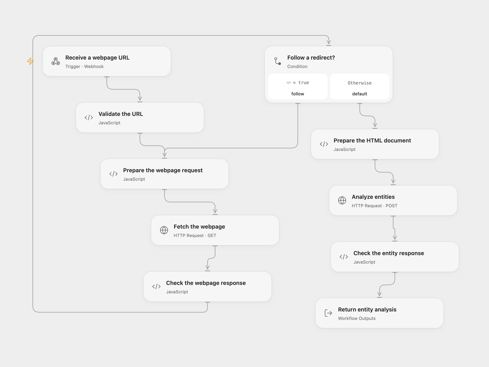

# Extract Webpage Entities with Google Language

Fetch a webpage and return its named entities using Google Cloud Natural Language.

<picture>
  <source media="(prefers-color-scheme: dark)" srcset="preview-dark.png">
  
</picture>

[Open Flow JSON](templates/extract-webpage-entities-with-google-language.openflow.json) · [n8n JSON](templates/extract-webpage-entities-with-google-language.n8n.json)

## Setup

Enable Cloud Natural Language API in Google Cloud and create a restricted API key. In Open Flow create a secret Variable `GOOGLE_LANGUAGE_API_KEY` and bind it to **Analyze entities**. In n8n select an HTTP Header Auth credential named `X-Goog-Api-Key` with the API key as its value on **Google Entities**. Enable one format and send a POST JSON body such as `{"url":"https://example.com"}` to its webhook. The endpoint has no authentication; restrict access to trusted callers.

## Behavior

The workflow fetches the webpage, takes at most the first 100,000 JavaScript characters of its HTML, and sends that HTML to Google's V1 entity analysis API. It returns Google's full JSON response, including entity types, mentions and salience when provided. Google receives the page content. Unsupported content or service errors fail the run.

Open Flow follows up to 21 HTTP redirects, accepts only HTTP(S) targets without credentials, limits each response to 4 MiB and each request to 30 seconds. Its Code input limit can reject a large page before the 100,000-character trim. Its webhook waits up to 60 seconds. n8n uses its HTTP node defaults. Restrict webhook access and destination URLs to pages you intend to fetch.

Inspiration &amp; credits

## Changes to the source

- Configure the Google API key as a secret header instead of placing it in the query URL; validate the webpage URL and entity response.

Adapted from [Google Page Entity Extraction Template](https://github.com/Zie619/n8n-workflows/blob/ae8cf6dc5b873cbb4f74587aa9180ed3a9f70682/workflows/Code/0980_Code_Webhook_Automation_Webhook.json) in [Zie619/n8n-workflows](https://github.com/Zie619/n8n-workflows). The source export does not identify a separate template author or license.

The collection’s [MIT notice](https://github.com/Zie619/n8n-workflows/blob/94007c1445d9258a7da116646b79473e7c7c3282/LICENSE) is pinned at a later revision. This is the collection notice at that revision; it does not establish a separate original template author's license. Our changes are listed above; see [repository licensing](../../README.md#licensing).

> MIT License
>
> Copyright (c) 2025 Zie619
>
> Permission is hereby granted, free of charge, to any person obtaining a copy
> of this software and associated documentation files (the "Software"), to deal
> in the Software without restriction, including without limitation the rights
> to use, copy, modify, merge, publish, distribute, sublicense, and/or sell
> copies of the Software, and to permit persons to whom the Software is
> furnished to do so, subject to the following conditions:
>
> The above copyright notice and this permission notice shall be included in all
> copies or substantial portions of the Software.
>
> THE SOFTWARE IS PROVIDED "AS IS", WITHOUT WARRANTY OF ANY KIND, EXPRESS OR
> IMPLIED, INCLUDING BUT NOT LIMITED TO THE WARRANTIES OF MERCHANTABILITY,
> FITNESS FOR A PARTICULAR PURPOSE AND NONINFRINGEMENT. IN NO EVENT SHALL THE
> AUTHORS OR COPYRIGHT HOLDERS BE LIABLE FOR ANY CLAIM, DAMAGES OR OTHER
> LIABILITY, WHETHER IN AN ACTION OF CONTRACT, TORT OR OTHERWISE, ARISING FROM,
> OUT OF OR IN CONNECTION WITH THE SOFTWARE OR THE USE OR OTHER DEALINGS IN THE
> SOFTWARE.

