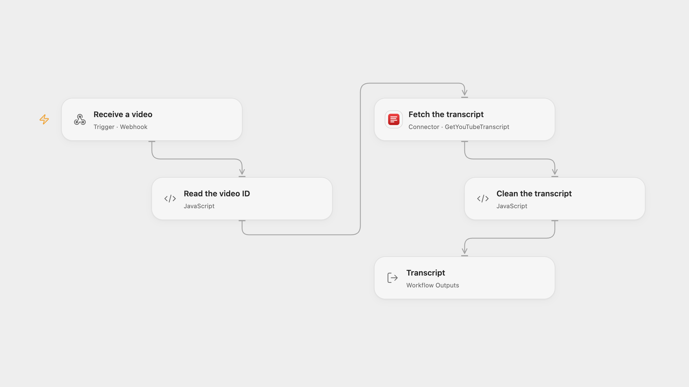

# Extract a YouTube Video Transcript

Retrieve and clean the full available transcript for a submitted YouTube video.

<picture>
  <source media="(prefers-color-scheme: dark)" srcset="preview-dark.png">
  
</picture>

[Open Flow JSON](templates/extract-youtube-video-transcript.openflow.json) · [n8n JSON](templates/extract-youtube-video-transcript.n8n.json)

## Setup

Connect GetYouTubeTranscript in **Fetch the transcript**. Configure a form or client to POST JSON such as {"video":"https://www.youtube.com/watch?v=jNQXAC9IVRw"} to the Open Flow webhook. In n8n use the hosted form and configure HTTP Header Auth with Authorization set to Bearer followed by your GetYouTubeTranscript API key in **Fetch the transcript**. Change the form path if it conflicts. Activate one format.

## Behavior

Submit a YouTube watch, Shorts, embed or completed live-recording URL, or an 11-character video ID. The workflow retrieves the available transcript and cleans excess whitespace and spaces before punctuation. The result appears in the workflow run; the form or webhook acknowledgment does not contain the transcript. The service chooses the caption language according to its defaults. Private, inaccessible or captionless videos and request failures stop the run. Service and execution-size limits apply; the workflow does not truncate transcript text.

Inspiration &amp; credits

## Changes to the source

- Replace its fixed video ID with the submitted video and verify the returned video ID. Both formats use GetYouTubeTranscript; Open Flow accepts JSON instead of the hosted form.
- Replace the example API key with a connection or credential and keep the result as a workflow output.

Adapted from [YouTube Video Transcript Extraction](https://github.com/Zie619/n8n-workflows/blob/ae8cf6dc5b873cbb4f74587aa9180ed3a9f70682/workflows/Form/1767_Form_HTTP_Automation_Webhook.json) in [Zie619/n8n-workflows](https://github.com/Zie619/n8n-workflows). The source export does not identify a separate template author or license.

The collection’s [MIT notice](https://github.com/Zie619/n8n-workflows/blob/94007c1445d9258a7da116646b79473e7c7c3282/LICENSE) is pinned at a later revision. This is the collection notice at that revision; it does not establish a separate original template author's license. Our changes are listed above; see [repository licensing](../../README.md#licensing).

> MIT License
>
> Copyright (c) 2025 Zie619
>
> Permission is hereby granted, free of charge, to any person obtaining a copy
> of this software and associated documentation files (the "Software"), to deal
> in the Software without restriction, including without limitation the rights
> to use, copy, modify, merge, publish, distribute, sublicense, and/or sell
> copies of the Software, and to permit persons to whom the Software is
> furnished to do so, subject to the following conditions:
>
> The above copyright notice and this permission notice shall be included in all
> copies or substantial portions of the Software.
>
> THE SOFTWARE IS PROVIDED "AS IS", WITHOUT WARRANTY OF ANY KIND, EXPRESS OR
> IMPLIED, INCLUDING BUT NOT LIMITED TO THE WARRANTIES OF MERCHANTABILITY,
> FITNESS FOR A PARTICULAR PURPOSE AND NONINFRINGEMENT. IN NO EVENT SHALL THE
> AUTHORS OR COPYRIGHT HOLDERS BE LIABLE FOR ANY CLAIM, DAMAGES OR OTHER
> LIABILITY, WHETHER IN AN ACTION OF CONTRACT, TORT OR OTHERWISE, ARISING FROM,
> OUT OF OR IN CONNECTION WITH THE SOFTWARE OR THE USE OR OTHER DEALINGS IN THE
> SOFTWARE.

