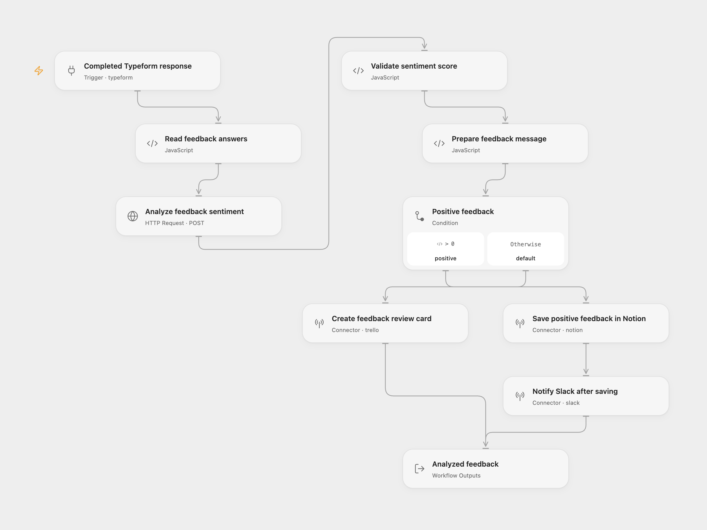

# Feedback Sentiment Routing

Save positive Typeform feedback in Notion and notify Slack, or create a Trello card for neutral and negative feedback.

<picture>
  <source media="(prefers-color-scheme: dark)" srcset="preview-dark.png">
  
</picture>

[Open Flow JSON](templates/feedback-sentiment-routing.openflow.json) · [n8n JSON](templates/feedback-sentiment-routing.n8n.json)

## Setup

Connect **Completed Typeform response** to Typeform and set your form ID. Select a secret Variable containing a Google Cloud API key on the **Analyze feedback sentiment** authentication input. Enable the Cloud Natural Language API and billing in that key’s Google Cloud project, and restrict the key to that API. The key is sent in the `x-goog-api-key` header.

For n8n, choose a Typeform credential and form in **Typeform Trigger**, and a Google Cloud Natural Language OAuth2 credential in **Google Cloud Natural Language**. The n8n trigger keeps the full submission so the question definitions and answers can be matched by field ID.

Use text questions titled **Name** and **Any suggestions for us?**. On **Save positive feedback in Notion**, set `parent.data_source_id` to a data source shared with your Notion connection. It must have a title property named `Name` and a rich-text property named `Feedback`. Select a writable Slack channel and Trello list in their action nodes.

In n8n, select a database containing exactly one data source, and set its database ID and credential on **Notion**. The native n8n node uses the legacy database API, which cannot create a row in a database with multiple data sources. Open Flow selects the data source ID directly. Set the channel and credential on **Slack**, and the list and credential on **Trello**. Keep the same property names.

## Behavior

A score greater than zero creates one Notion row containing the submitted name and feedback. After that succeeds, Slack receives an attachment with the name, score, and feedback. Zero and negative scores create one Trello card containing those values. No Notion or Slack write runs on that branch.

Each completed form runs one sentiment analysis step against Google Cloud Natural Language v1, using plain text, automatic language detection, and UTF-16 sentence offsets. Blank answers, ambiguous question titles, or an invalid service response stop the run before a destination write. No workflow-level retries or delivery deduplication are configured. A later failed write can leave an earlier write completed; inspect the destination before rerunning the same submission.

Feedback text is sent to Google for sentiment analysis. The name and feedback are sent to the chosen Notion and Slack destinations or to Trello, according to the score.

Inspiration &amp; credits

## Changes to the source

- Replace the original private form and destination identifiers with configuration placeholders.
- Match full Typeform answers to question definitions by field ID and reject missing or ambiguous required text answers. Leading or trailing whitespace in question titles is ignored.
- Make the original numeric threshold explicit and validate the service’s score before choosing a branch.
- Use a secret Google API key in Open Flow; the n8n version keeps its native Google OAuth2 credential. Both call the same v1 sentiment endpoint.

Adapted from [Add positive feedback messages to a table in Notion](https://github.com/enescingoz/awesome-n8n-templates/blob/827110332c21cbe000ab13f6d292d5adb1f1f8db/Notion/Add%20positive%20feedback%20messages%20to%20a%20table%20in%20Notion.json) in [enescingoz/awesome-n8n-templates](https://github.com/enescingoz/awesome-n8n-templates).

Source collection notice: © 2024–2026 Enes Cingoz, [CC BY 4.0](https://github.com/enescingoz/awesome-n8n-templates/blob/827110332c21cbe000ab13f6d292d5adb1f1f8db/LICENSE). The source export does not identify a separate template author or license. See [repository licensing](../../README.md#licensing) for the scope of OOMOL contributions and third-party material.

