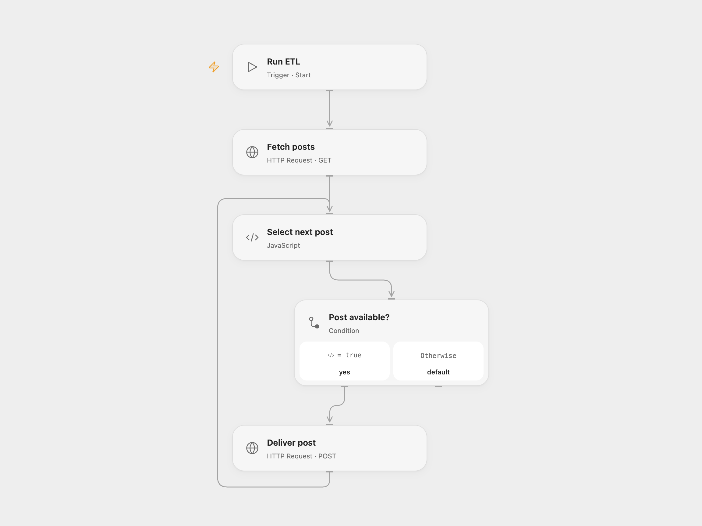

# Fetch, Transform and Deliver Posts

Fetch posts, select three fields from the first ten, and deliver each item to an HTTP endpoint.

<picture>
  <source media="(prefers-color-scheme: dark)" srcset="preview-dark.png">
  
</picture>

[Open Flow JSON](templates/fetch-transform-and-deliver-posts.openflow.json) · [n8n JSON](templates/fetch-transform-and-deliver-posts.n8n.json)

## Setup and use

Import one format, set **Fetch posts** to your JSON array source and **Deliver post** to your destination. The default JSONPlaceholder and httpbin URLs demonstrate the workflow; httpbin echoes data and does not store it. Run manually.

## Behavior

The workflow selects the first ten posts and sends each as a separate JSON object containing id, title and userId. If a destination response is lost, the item may already have been accepted. Check the destination before rerunning.

Inspiration &amp; credits

## Changes to the source

- Handle the source HTTP node's separate items in n8n and iterate sequentially in Open Flow.

Adapted from [Rapid HTTP ETL](https://github.com/Zie619/n8n-workflows/blob/94007c1445d9258a7da116646b79473e7c7c3282/workflows/Templates/9002_Rapid_ETL_HTTP_Transform_Deliver_Manual.json) in [Zie619/n8n-workflows](https://github.com/Zie619/n8n-workflows). The source export does not identify a separate template author or license.

The collection’s [MIT notice](https://github.com/Zie619/n8n-workflows/blob/94007c1445d9258a7da116646b79473e7c7c3282/LICENSE) is pinned at a later revision. This is the collection notice at that revision; it does not establish a separate original template author's license. Our changes are listed above; see [repository licensing](../../README.md#licensing).

> MIT License
>
> Copyright (c) 2025 Zie619
>
> Permission is hereby granted, free of charge, to any person obtaining a copy
> of this software and associated documentation files (the "Software"), to deal
> in the Software without restriction, including without limitation the rights
> to use, copy, modify, merge, publish, distribute, sublicense, and/or sell
> copies of the Software, and to permit persons to whom the Software is
> furnished to do so, subject to the following conditions:
>
> The above copyright notice and this permission notice shall be included in all
> copies or substantial portions of the Software.
>
> THE SOFTWARE IS PROVIDED "AS IS", WITHOUT WARRANTY OF ANY KIND, EXPRESS OR
> IMPLIED, INCLUDING BUT NOT LIMITED TO THE WARRANTIES OF MERCHANTABILITY,
> FITNESS FOR A PARTICULAR PURPOSE AND NONINFRINGEMENT. IN NO EVENT SHALL THE
> AUTHORS OR COPYRIGHT HOLDERS BE LIABLE FOR ANY CLAIM, DAMAGES OR OTHER
> LIABILITY, WHETHER IN AN ACTION OF CONTRACT, TORT OR OTHERWISE, ARISING FROM,
> OUT OF OR IN CONNECTION WITH THE SOFTWARE OR THE USE OR OTHER DEALINGS IN THE
> SOFTWARE.

