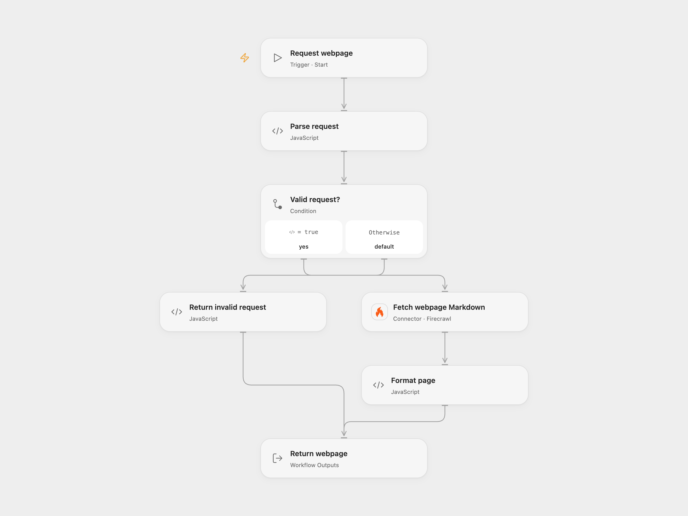

# Fetch Webpage as Markdown

Fetch a webpage and return its Markdown content, optionally replacing links and image URLs.

<!-- template-actions:start -->
[](https://openflow.run/templates/fetch-webpage-markdown/) [](templates/fetch-webpage-markdown.n8n.json)
<!-- template-actions:end -->

<picture>
  <source media="(prefers-color-scheme: dark)" srcset="preview-dark.png">
  
</picture>

## Setup and use

Connect Firecrawl in Open Flow. Call the workflow with a query string such as ?url=https%3A%2F%2Fexample.com&method=full. The optional maxlimit defaults to 70000 characters.

## Behavior

The worker returns page_content and page_length. full preserves links and images; simplified replaces their destinations with NOURL and NOIMG. When content reaches maxlimit it returns an error message instead. Firecrawl fetches the page and produces Markdown; its rendering and supported sites can differ from a direct HTML request. Only fetch pages you are permitted to access. The source chat interface is excluded.

<details>
<summary>In n8n</summary>

In n8n configure the HTTP Request node with a header credential named Authorization whose value is Bearer followed by a space and your Firecrawl key.

</details>

<details>
<summary>Inspiration &amp; credits</summary>

Adapted from [AI agent that can scrape webpages](https://github.com/enescingoz/awesome-n8n-templates/blob/827110332c21cbe000ab13f6d292d5adb1f1f8db/OpenAI_and_LLMs/AI%20agent%20that%20can%20scrape%20webpages.json) in [enescingoz/awesome-n8n-templates](https://github.com/enescingoz/awesome-n8n-templates).

Source collection notice: © 2024–2026 Enes Cingoz, [CC BY 4.0](https://github.com/enescingoz/awesome-n8n-templates/blob/827110332c21cbe000ab13f6d292d5adb1f1f8db/LICENSE). The source export does not identify a separate template author or license. See [repository licensing](../../README.md#licensing) for the scope of OOMOL contributions and third-party material.

Changes from source: Publish the independently callable page-fetch worker, replace direct HTML conversion with Firecrawl Markdown and exclude the chat interface.

Collection license notice:

```text
Creative Commons Attribution 4.0 International License

Copyright (c) 2024-2026 Enes Cingoz

You are free to:

  Share - copy and redistribute the material in any medium or format
  Adapt - remix, transform, and build upon the material for any purpose,
  even commercially.

Under the following terms:

  Attribution - You must give appropriate credit, provide a link to the
  license, and indicate if changes were made. You may do so in any
  reasonable manner, but not in any way that suggests the licensor
  endorses you or your use.

  No additional restrictions - You may not apply legal terms or
  technological measures that legally restrict others from doing
  anything the license permits.

Notices:

  You do not have to comply with the license for elements of the
  material in the public domain or where your use is permitted by an
  applicable exception or limitation.

  No warranties are given. The license may not give you all of the
  permissions necessary for your intended use. For example, other rights
  such as publicity, privacy, or moral rights may limit how you use the
  material.

For the full license text, see:
https://creativecommons.org/licenses/by/4.0/legalcode
```

</details>
