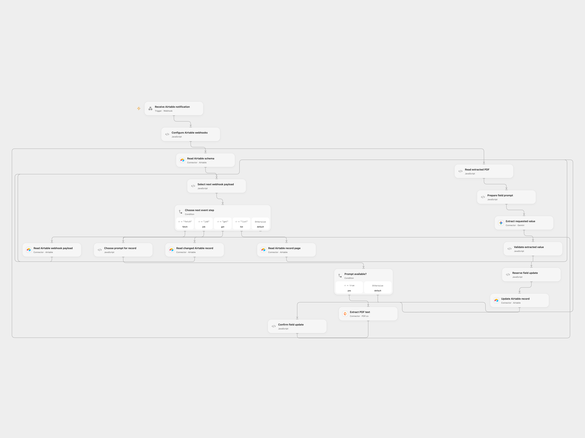

# Fill Airtable Fields from PDF Prompts

Use Airtable field descriptions as prompts to extract values from attached PDF files.

<!-- template-actions:start -->
 
<!-- template-actions:end -->

<picture>
  <source media="(prefers-color-scheme: dark)" srcset="preview-dark.png">
  
</picture>

## Setup

Connect Airtable, PDF.co and Gemini; enable persistent State. For Open Flow register equivalent webhooks and enter their IDs and the base and table IDs in **Configure Airtable webhooks**. The record webhook must watch updates to the File field only; the field webhook watches field creation and updates. Both must filter source to client. API writes use publicApi and do not trigger these subscriptions. The input attachment column is named File. Add prompts as field descriptions. Avoid overlapping executions. Configure the two webhooks once and inspect Airtable before retrying an uncertain registration to avoid duplicates.

## Behavior

Record changes fill missing prompted fields. Field creation or changes apply that field to all records with a PDF attachment. The attachment URL and text are sent to PDF.co and the model. Check generated values before relying on them.

If an Airtable update is uncertain, inspect the record, enter its pending key and confirmed or absent in **Choose prompt for record**, and retry the same notification. Clear these fields after recovery. Disable concurrent runs for the same webhook. Airtable retains payloads for one week and webhooks expire unless refreshed; arrange periodic webhook refresh. PDF.co receives the attachment URL and the full extracted text is sent to the model. Hosted Code payload size limits apply; oversized PDFs or collections stop the run.

In n8n

In n8n set the base, table, public notification URL and File field in **Set Airtable Vars**, run the setup flow once, and enter both returned webhook IDs with the base and table IDs in **Configure notification**. Select a Data Table with item_key and status text columns for every n8n checkpoint. In n8n inspect the pending Data Table row and the record; mark the row done if the write succeeded or delete it only if absent, then retry.

Inspiration &amp; credits

Read all webhook payloads and records, retain the cursor and use PDF.co for hosted PDF extraction.

Adapted from [AI data extraction with dynamic prompts and Airtable](https://github.com/Zie619/n8n-workflows/blob/ae8cf6dc5b873cbb4f74587aa9180ed3a9f70682/workflows/Code/0696_Code_Webhook_Create_Webhook.json) in [Zie619/n8n-workflows](https://github.com/Zie619/n8n-workflows). The [n8n listing](https://n8n.io/workflows/2771-ai-data-extraction-with-dynamic-prompts-and-airtable/) credits Jimleuk; no separate original template license was found.

The collection’s [MIT notice](https://github.com/Zie619/n8n-workflows/blob/94007c1445d9258a7da116646b79473e7c7c3282/LICENSE) is pinned at a later revision. This is the collection notice at that revision; it does not establish a separate original template author's license. Our changes are listed above; see [repository licensing](../../README.md#licensing).

> MIT License
>
> Copyright (c) 2025 Zie619
>
> Permission is hereby granted, free of charge, to any person obtaining a copy
> of this software and associated documentation files (the "Software"), to deal
> in the Software without restriction, including without limitation the rights
> to use, copy, modify, merge, publish, distribute, sublicense, and/or sell
> copies of the Software, and to permit persons to whom the Software is
> furnished to do so, subject to the following conditions:
>
> The above copyright notice and this permission notice shall be included in all
> copies or substantial portions of the Software.
>
> THE SOFTWARE IS PROVIDED "AS IS", WITHOUT WARRANTY OF ANY KIND, EXPRESS OR
> IMPLIED, INCLUDING BUT NOT LIMITED TO THE WARRANTIES OF MERCHANTABILITY,
> FITNESS FOR A PARTICULAR PURPOSE AND NONINFRINGEMENT. IN NO EVENT SHALL THE
> AUTHORS OR COPYRIGHT HOLDERS BE LIABLE FOR ANY CLAIM, DAMAGES OR OTHER
> LIABILITY, WHETHER IN AN ACTION OF CONTRACT, TORT OR OTHERWISE, ARISING FROM,
> OUT OF OR IN CONNECTION WITH THE SOFTWARE OR THE USE OR OTHER DEALINGS IN THE
> SOFTWARE.

