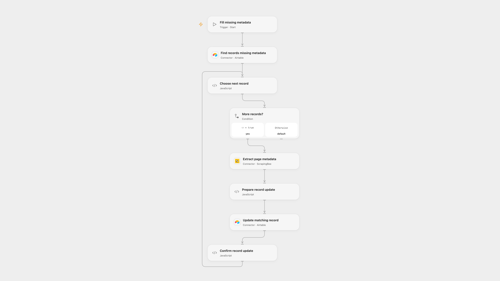

# Fill Airtable SEO Metadata from Webpages

Read page titles and meta descriptions from public webpages and update the matching Airtable records.

<picture>
  <source media="(prefers-color-scheme: dark)" srcset="preview-dark.png">
  
</picture>

[Open Flow JSON](templates/fill-airtable-seo-metadata-from-webpages.openflow.json) · [n8n JSON](templates/fill-airtable-seo-metadata-from-webpages.n8n.json)

## Setup

Create an Airtable table with fields **url**, **title tag** and **meta desc**. Connect Airtable in **Find records missing metadata** and **Update matching record**, and set the same base and table IDs in both. Connect ScrapingBee in **Extract page metadata**. In n8n connect Airtable in both nodes and select the same base and table. Run one format with URLs you are authorized to inspect.

## Behavior

Each manual run selects up to 10 records whose URL is nonempty and whose title tag and meta desc are both blank. For each, it extracts the first title and description and updates that record. A failed request stops the run; already updated records remain. Open Flow also stops before updating when page metadata is missing. An uncertain write may have succeeded, so inspect the record before retrying. No automatic write retry is added.

Open Flow uses ScrapingBee to fetch public pages without JavaScript rendering; the service receives each URL and its result can differ from a direct n8n HTTP request. n8n reads pages directly and uses its HTML node. Authentication, page access, redirects and execution limits may affect results.

Inspiration &amp; credits

## Changes to the source

- Replace private Airtable identifiers with configuration and keep the first-10 filter. Open Flow uses ScrapingBee CSS extraction; n8n retains direct HTTP and HTML extraction.
- Check extraction and record association before updates in Open Flow.

Adapted from [Extract Title tag and Meta description from url for SEO analysis with Airtable](https://github.com/Zie619/n8n-workflows/blob/ae8cf6dc5b873cbb4f74587aa9180ed3a9f70682/workflows/Manual/0495_Manual_HTTP_Update_Webhook.json) in [Zie619/n8n-workflows](https://github.com/Zie619/n8n-workflows). The matching [n8n listing](https://n8n.io/workflows/2267-extract-title-tag-and-meta-description-from-url-for-seo-analysis-with-airtable/) credits Giacomo Lanzi. The original template does not state a separate license.

The collection’s [MIT notice](https://github.com/Zie619/n8n-workflows/blob/94007c1445d9258a7da116646b79473e7c7c3282/LICENSE) is pinned at a later revision. This is the collection notice at that revision; it does not establish a separate original template author's license. Our changes are listed above; see [repository licensing](../../README.md#licensing).

> MIT License
>
> Copyright (c) 2025 Zie619
>
> Permission is hereby granted, free of charge, to any person obtaining a copy
> of this software and associated documentation files (the "Software"), to deal
> in the Software without restriction, including without limitation the rights
> to use, copy, modify, merge, publish, distribute, sublicense, and/or sell
> copies of the Software, and to permit persons to whom the Software is
> furnished to do so, subject to the following conditions:
>
> The above copyright notice and this permission notice shall be included in all
> copies or substantial portions of the Software.
>
> THE SOFTWARE IS PROVIDED "AS IS", WITHOUT WARRANTY OF ANY KIND, EXPRESS OR
> IMPLIED, INCLUDING BUT NOT LIMITED TO THE WARRANTIES OF MERCHANTABILITY,
> FITNESS FOR A PARTICULAR PURPOSE AND NONINFRINGEMENT. IN NO EVENT SHALL THE
> AUTHORS OR COPYRIGHT HOLDERS BE LIABLE FOR ANY CLAIM, DAMAGES OR OTHER
> LIABILITY, WHETHER IN AN ACTION OF CONTRACT, TORT OR OTHERWISE, ARISING FROM,
> OUT OF OR IN CONNECTION WITH THE SOFTWARE OR THE USE OR OTHER DEALINGS IN THE
> SOFTWARE.

