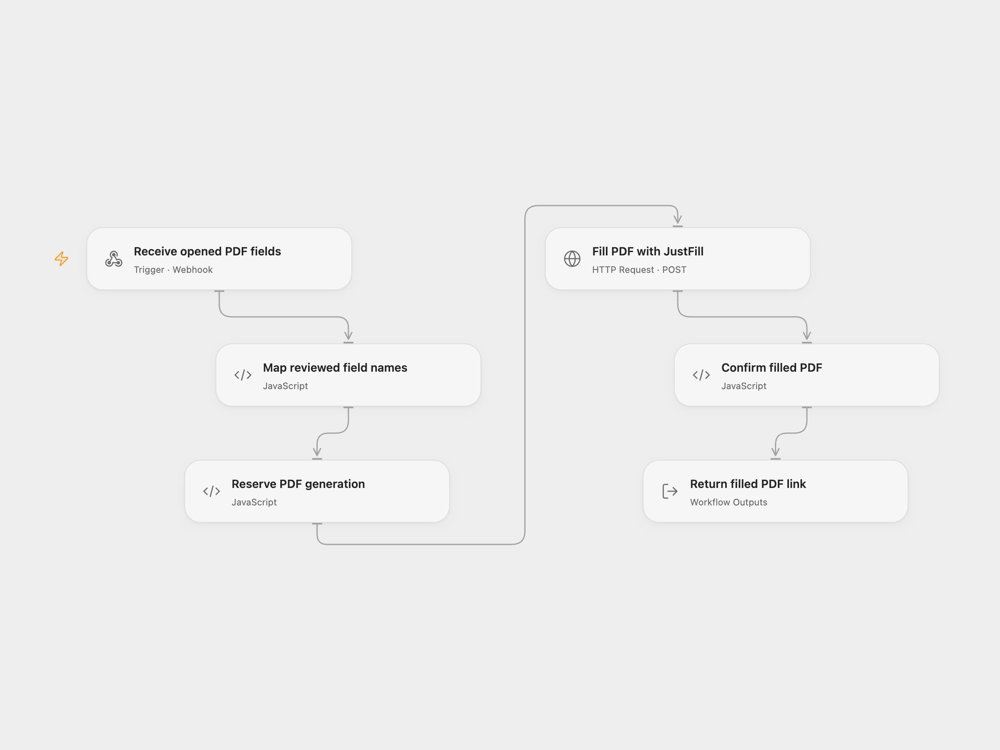

# Fill a Reviewed PDF Form with JustFill

Fill a reviewed PDF template with exact field names and return a temporary download link.

<!-- template-actions:start -->
 
<!-- template-actions:end -->

<picture>
  <source media="(prefers-color-scheme: dark)" srcset="preview-dark.png">
  
</picture>

## Setup

Enter a unique request ID for each submission and prevent concurrent submissions with that ID.

## Behavior

Upload a PDF with a saved, reviewed field layout and provide a non-empty JSON object keyed by field names. The workflow uploads the original PDF, opens it, maps normalized exact names to field IDs, and fills the document. Unknown, ambiguous, duplicate or nested values stop the run. The form redirects to a temporary download URL; inspect output mode, warnings and the document before sharing. JustFill processes the PDF and uses the account allowance; output can be watermarked.

Mark a confirmed successful submission done; remove a pending record only after confirming no operation occurred and deciding to retry. Do not automatically repeat generation.

In n8n

Configure a JustFill API key using Header Auth in n8n and JUSTFILL_API_KEY in Open Flow for the same account. Import the n8n form, choose one mode and restrict access. Configure a Data Table with item_key and status columns, and enable persistent State in Open Flow. If upload, workspace creation or PDF generation has an unknown result, inspect the account and pending Data Table or State before retrying. Open Flow uses n8n for binary upload and opening the PDF; its direct HTTP request is subject to platform timeout and body limits.

Inspiration &amp; credits

Adapted from [Fill PDF with JustFill](https://github.com/enescingoz/awesome-n8n-templates/blob/827110332c21cbe000ab13f6d292d5adb1f1f8db/PDF_and_Document_Processing/Fill%20PDF%20with%20JustFill.json) in [enescingoz/awesome-n8n-templates](https://github.com/enescingoz/awesome-n8n-templates).

Source collection notice: © 2024–2026 Enes Cingoz, [CC BY 4.0](https://github.com/enescingoz/awesome-n8n-templates/blob/827110332c21cbe000ab13f6d292d5adb1f1f8db/LICENSE). The source export does not identify a separate template author or license. See [repository licensing](../../README.md#licensing) for the scope of OOMOL contributions and third-party material.

