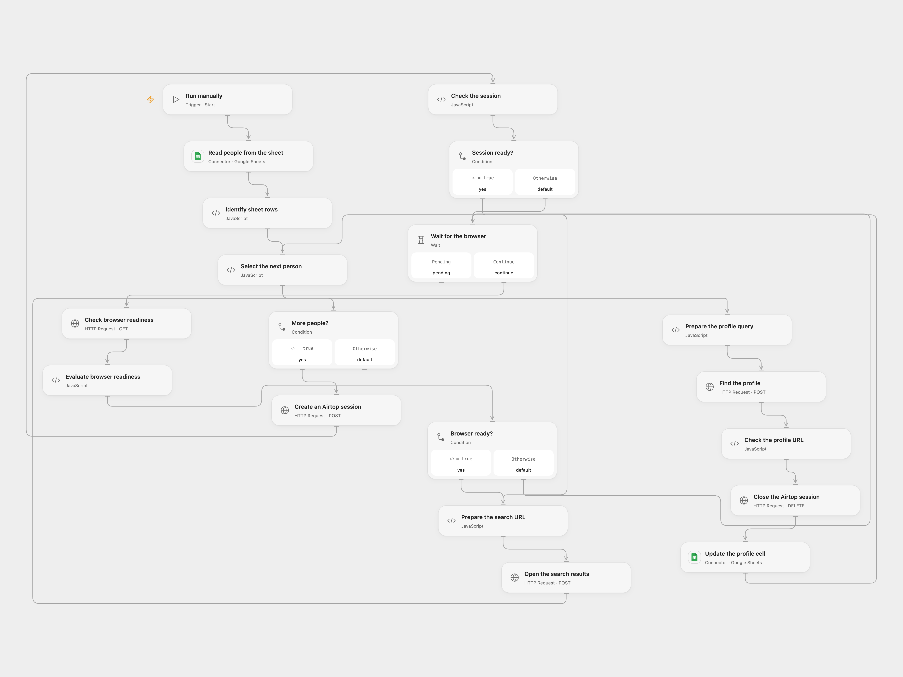

# Find LinkedIn Profiles for Sheet Rows

Search for LinkedIn profiles using person descriptions in a Google Sheet and update the corresponding rows.

<picture>
  <source media="(prefers-color-scheme: dark)" srcset="preview-dark.png">
  
</picture>

[Open Flow JSON](templates/find-linkedin-profiles-for-sheet-rows.openflow.json) · [n8n JSON](templates/find-linkedin-profiles-for-sheet-rows.n8n.json)

## Setup

Connect Google Sheets and create an Airtop API key. The sheet needs unique headers `Person Info` and `Linkedin URL`. In Open Flow, configure the spreadsheet ID on **Read people from the sheet** and **Update the profile cell**, the sheet name in the full-column A1 range on **Read people from the sheet**, and the same sheet name on **Identify sheet rows**. Keep the range starting at column A and including the header row and both required columns. Create a secret Variable AIRTOP_API_KEY and bind it to every Airtop request. In n8n, connect Airtop and Google Sheets and select the spreadsheet and sheet on the Sheets nodes. Run one format.

## Behavior

For each nonempty person description, search Google with Airtop and write the returned LinkedIn profile URL to the same row. An empty result clears the URL cell. Results are AI-generated and can identify the wrong person, so review them before use. Do not reorder rows or run overlapping copies during execution. Errors stop the run; earlier cells may already have changed. An uncertain write may have succeeded, so inspect the sheet before retrying. Open Flow searches and writes each row in sequence and changes only the URL cell. n8n completes the Airtop node before its update node and writes the mapped row fields as well. Open Flow checks session readiness up to 60 times at five-second intervals; its HTTP requests use a 30-second timeout and a 4 MiB response limit. It closes each session after a successful query; an earlier error may leave a session until its idle timeout.

Inspiration &amp; credits

## Changes to the source

- Replace the private spreadsheet with configuration, and correct the URL column name to match the sheet schema. Open Flow uses Airtop's official HTTP API because the catalog has no Airtop Provider. Both formats skip empty descriptions and reject nonempty results that are not LinkedIn profile URLs; Open Flow processes rows sequentially.

Adapted from [Find LinkedIn profile URLs](https://github.com/Zie619/n8n-workflows/blob/ae8cf6dc5b873cbb4f74587aa9180ed3a9f70682/workflows/Manual/1912_Manual_GoogleSheets_Automation_Triggered.json) in [Zie619/n8n-workflows](https://github.com/Zie619/n8n-workflows). The matching [n8n listing](https://n8n.io/workflows/3477-automated-linkedin-profile-discovery-with-airtop-and-google-search/) credits Airtop. No separate original template license was found.

The collection’s [MIT notice](https://github.com/Zie619/n8n-workflows/blob/94007c1445d9258a7da116646b79473e7c7c3282/LICENSE) is pinned at a later revision. This is the collection notice at that revision; it does not establish a separate original template author's license. Our changes are listed above; see [repository licensing](../../README.md#licensing).

> MIT License
>
> Copyright (c) 2025 Zie619
>
> Permission is hereby granted, free of charge, to any person obtaining a copy
> of this software and associated documentation files (the "Software"), to deal
> in the Software without restriction, including without limitation the rights
> to use, copy, modify, merge, publish, distribute, sublicense, and/or sell
> copies of the Software, and to permit persons to whom the Software is
> furnished to do so, subject to the following conditions:
>
> The above copyright notice and this permission notice shall be included in all
> copies or substantial portions of the Software.
>
> THE SOFTWARE IS PROVIDED "AS IS", WITHOUT WARRANTY OF ANY KIND, EXPRESS OR
> IMPLIED, INCLUDING BUT NOT LIMITED TO THE WARRANTIES OF MERCHANTABILITY,
> FITNESS FOR A PARTICULAR PURPOSE AND NONINFRINGEMENT. IN NO EVENT SHALL THE
> AUTHORS OR COPYRIGHT HOLDERS BE LIABLE FOR ANY CLAIM, DAMAGES OR OTHER
> LIABILITY, WHETHER IN AN ACTION OF CONTRACT, TORT OR OTHERWISE, ARISING FROM,
> OUT OF OR IN CONNECTION WITH THE SOFTWARE OR THE USE OR OTHER DEALINGS IN THE
> SOFTWARE.

