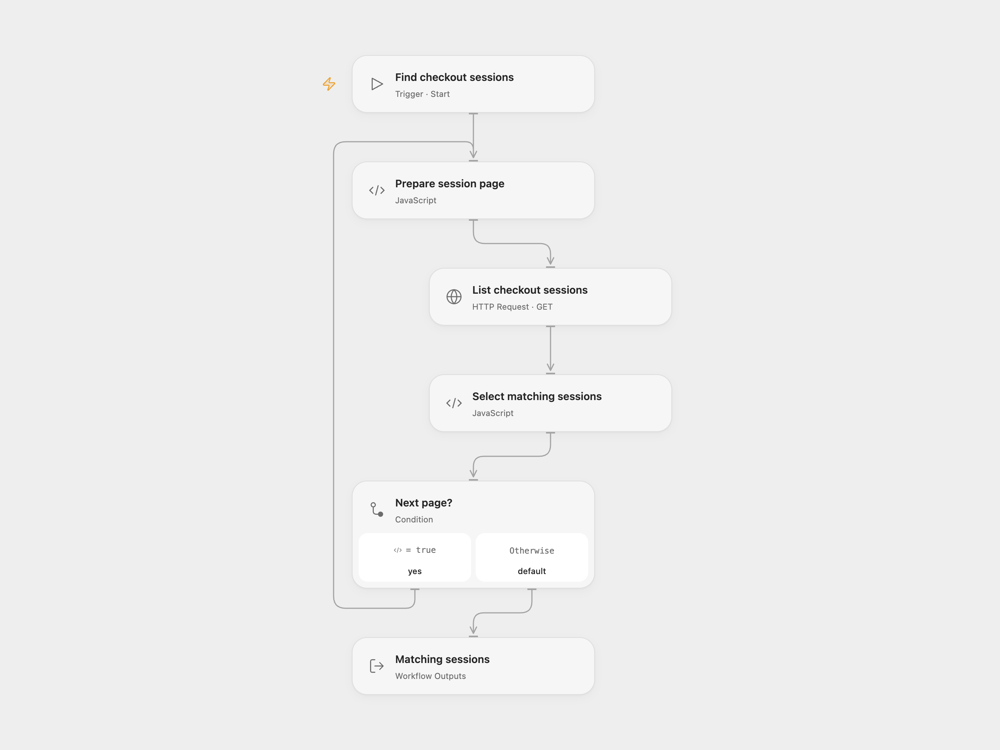

# Find Stripe Checkout Sessions with Custom Fields

Find recent Stripe Checkout sessions with both nickname and job title filled.

<picture>
  <source media="(prefers-color-scheme: dark)" srcset="preview-dark.png">
  
</picture>

[Open Flow JSON](templates/find-stripe-checkout-sessions-with-custom-fields.openflow.json) · [n8n JSON](templates/find-stripe-checkout-sessions-with-custom-fields.n8n.json)

## Setup and use

Bind a Stripe secret key with Checkout Session read access as secret Variable STRIPE_SECRET_KEY in **List checkout sessions**. In n8n connect its Stripe credential. Run one format manually.

## Behavior

The workflow reads every Stripe Checkout Session created from midnight UTC 20 days ago through midnight UTC today, and returns complete sessions with nonempty nickname and job_title custom fields. The source note says seven days, but its query uses 20; this template follows the query. Session records can include customer information and may appear in execution history.

Inspiration &amp; credits

## Changes to the source

- Add a manual trigger and correct the 20-day date expression. The source splits each custom field and requires its single key to equal both names, which cannot match. Both formats instead select sessions containing both filled fields. Open Flow returns the complete sessions as a list.

Adapted from [Find Checkout Sessions with custom fields](https://github.com/Zie619/n8n-workflows/blob/ae8cf6dc5b873cbb4f74587aa9180ed3a9f70682/workflows/Http/0549_HTTP_Filter_Monitor_Webhook.json) in [Zie619/n8n-workflows](https://github.com/Zie619/n8n-workflows). The source export does not identify a separate template author or license.

The collection’s [MIT notice](https://github.com/Zie619/n8n-workflows/blob/94007c1445d9258a7da116646b79473e7c7c3282/LICENSE) is pinned at a later revision. This is the collection notice at that revision; it does not establish a separate original template author's license. Our changes are listed above; see [repository licensing](../../README.md#licensing).

> MIT License
>
> Copyright (c) 2025 Zie619
>
> Permission is hereby granted, free of charge, to any person obtaining a copy
> of this software and associated documentation files (the "Software"), to deal
> in the Software without restriction, including without limitation the rights
> to use, copy, modify, merge, publish, distribute, sublicense, and/or sell
> copies of the Software, and to permit persons to whom the Software is
> furnished to do so, subject to the following conditions:
>
> The above copyright notice and this permission notice shall be included in all
> copies or substantial portions of the Software.
>
> THE SOFTWARE IS PROVIDED "AS IS", WITHOUT WARRANTY OF ANY KIND, EXPRESS OR
> IMPLIED, INCLUDING BUT NOT LIMITED TO THE WARRANTIES OF MERCHANTABILITY,
> FITNESS FOR A PARTICULAR PURPOSE AND NONINFRINGEMENT. IN NO EVENT SHALL THE
> AUTHORS OR COPYRIGHT HOLDERS BE LIABLE FOR ANY CLAIM, DAMAGES OR OTHER
> LIABILITY, WHETHER IN AN ACTION OF CONTRACT, TORT OR OTHERWISE, ARISING FROM,
> OUT OF OR IN CONNECTION WITH THE SOFTWARE OR THE USE OR OTHER DEALINGS IN THE
> SOFTWARE.

