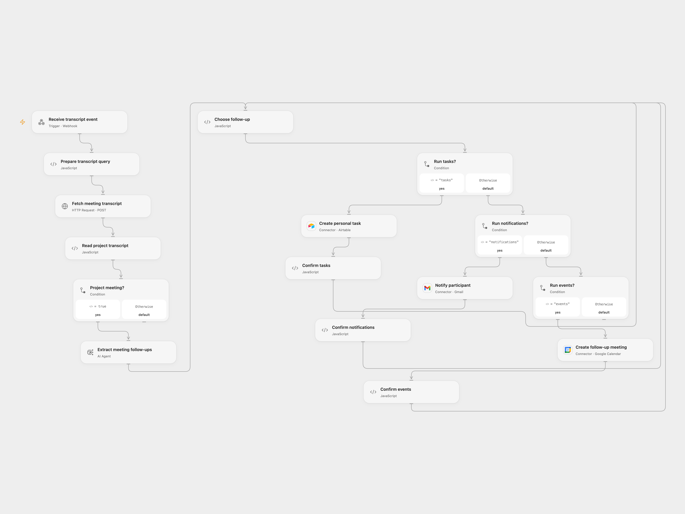

# Create Fireflies Project Follow-ups in Airtable

Turn project meeting transcripts into personal tasks, participant updates and follow-up meetings.

<picture>
  <source media="(prefers-color-scheme: dark)" srcset="preview-dark.png">
  
</picture>

[Open Flow JSON](templates/fireflies-project-follow-ups-to-airtable.openflow.json) · [n8n JSON](templates/fireflies-project-follow-ups-to-airtable.n8n.json)

## Setup

Configure Fireflies, Airtable, Gmail, Google Calendar and an AI model. Set your name and email, Airtable base/table and calendar ID. Enable persistent State and prevent overlapping runs for the same meeting. Configure the existing [Fireflies Webhooks V1](https://docs.fireflies.ai/graphql-api/webhooks) payload with meetingId; V1 is deprecated. Restrict webhook access to trusted senders. The V2 meeting_id payload and signature are not handled by this template. Use the supplied n8n workflow or Open Flow, not both. Set a Data Table with item_key, status and payload text columns in n8n. The Airtable Project field must accept a linked project name through typecast.

## Behavior

The workflow retrieves the transcript and acts only when its title contains “project”. It creates tasks for the configured person, emails each participant only their own action items and schedules a follow-up only when the transcript supplies an explicit time and participant. The AI can make mistakes; review results and the resulting tasks, messages and invitations. Transcript content is sent to the model. Code inputs and outputs must fit 1 MiB.

If a write has an unknown outcome, inspect Airtable, Gmail or Calendar. In **Choose follow-up**, enter the pending key and confirmed or absent, replay the meeting and clear those fields. In n8n inspect the corresponding pending Data Table row, mark done only when confirmed or delete only after confirming no write occurred.

Inspiration &amp; credits

Use a saved follow-up plan, participant checks and individual write checkpoints.

Adapted from [AI Agent for project management and meetings with Airtable and Fireflies](https://github.com/Zie619/n8n-workflows/blob/ae8cf6dc5b873cbb4f74587aa9180ed3a9f70682/workflows/Gmailtool/1248_Gmailtool_Splitout_Automation_Webhook.json) in [Zie619/n8n-workflows](https://github.com/Zie619/n8n-workflows). The source export does not identify a separate template author or license.

The collection’s [MIT notice](https://github.com/Zie619/n8n-workflows/blob/94007c1445d9258a7da116646b79473e7c7c3282/LICENSE) is pinned at a later revision. This is the collection notice at that revision; it does not establish a separate original template author's license. Our changes are listed above; see [repository licensing](../../README.md#licensing).

> MIT License
>
> Copyright (c) 2025 Zie619
>
> Permission is hereby granted, free of charge, to any person obtaining a copy
> of this software and associated documentation files (the "Software"), to deal
> in the Software without restriction, including without limitation the rights
> to use, copy, modify, merge, publish, distribute, sublicense, and/or sell
> copies of the Software, and to permit persons to whom the Software is
> furnished to do so, subject to the following conditions:
>
> The above copyright notice and this permission notice shall be included in all
> copies or substantial portions of the Software.
>
> THE SOFTWARE IS PROVIDED "AS IS", WITHOUT WARRANTY OF ANY KIND, EXPRESS OR
> IMPLIED, INCLUDING BUT NOT LIMITED TO THE WARRANTIES OF MERCHANTABILITY,
> FITNESS FOR A PARTICULAR PURPOSE AND NONINFRINGEMENT. IN NO EVENT SHALL THE
> AUTHORS OR COPYRIGHT HOLDERS BE LIABLE FOR ANY CLAIM, DAMAGES OR OTHER
> LIABILITY, WHETHER IN AN ACTION OF CONTRACT, TORT OR OTHERWISE, ARISING FROM,
> OUT OF OR IN CONNECTION WITH THE SOFTWARE OR THE USE OR OTHER DEALINGS IN THE
> SOFTWARE.

