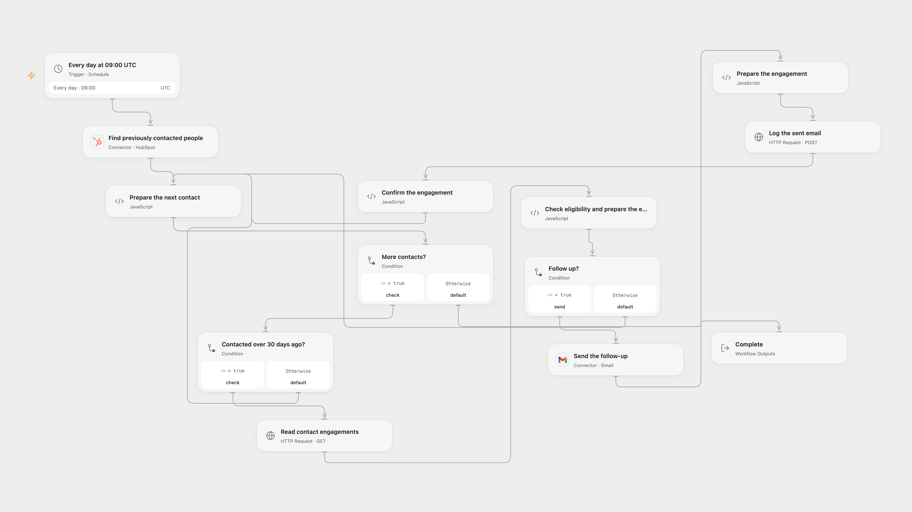

# Follow Up HubSpot Contacts with Gmail

Follow up older HubSpot contacts and log each sent email.

<picture>
  <source media="(prefers-color-scheme: dark)" srcset="preview-dark.png">
  
</picture>

[Open Flow JSON](templates/follow-up-hubspot-contacts-with-gmail.openflow.json) · [n8n JSON](templates/follow-up-hubspot-contacts-with-gmail.n8n.json)

## Setup

Connect HubSpot and Gmail to the intended accounts. In Open Flow, store a HubSpot private app token as the secret Variable HUBSPOT_PRIVATE_APP_TOKEN for both HubSpot HTTP nodes. Grant the token `crm.objects.contacts.read`, `crm.objects.contacts.write` and `sales-email-read`, with access to the same HubSpot account as the HubSpot connection. Enter the Gmail sender address and edit the subject and message in **Check eligibility and prepare the email**. In n8n, connect HubSpot OAuth on the search node, set an HTTP Header Auth credential containing `Authorization: Bearer YOUR_HUBSPOT_TOKEN` on both HTTP nodes, connect Gmail, and set the sender and message in the matching Code node. The OAuth connection and token must address the same HubSpot account. Enable only one format and avoid overlapping runs.

## Behavior

At 09:00 UTC each day, search up to the first 100 contacts with a known last-contacted date, oldest first. For each contact last contacted over 30 days ago, read its HubSpot engagement associations. Exactly one association with no next page qualifies the contact. Send a Gmail message, then log an email engagement associated with that contact. Zero, multiple or paginated associations do not send. The association check counts all engagement types, not just email. Open Flow starts on the minute boundary; n8n uses a fixed second within the minute.

The original n8n schedule used the instance timezone; adjust UTC if needed. This checks only the first 100 search results each run and search indexing can delay changes. Concurrent contact updates can change eligibility after the check. Missing contact details or invalid API responses stop processing. A send or engagement write can succeed even when its response is lost. If a send succeeded but logging failed or was uncertain, a later run can send again; inspect Gmail and HubSpot before retrying. Earlier contacts may already have been processed when a later one fails.

## Changes to the source

- Replace private sender and message text with editable settings, and carry the original contact through the association response.
- Send first and log the confirmed email second. The source branched both actions from the same input without that guarantee. Require a complete single-association response before sending.
- Use HubSpot's current email engagement endpoint and UTC instead of the source instance timezone.

Source and license

Adapted from [Follow up with HubSpot contacts](https://github.com/Zie619/n8n-workflows/blob/ae8cf6dc5b873cbb4f74587aa9180ed3a9f70682/workflows/Schedule/0422_Schedule_HTTP_Send_Webhook.json) in [Zie619/n8n-workflows](https://github.com/Zie619/n8n-workflows). The matching [n8n listing](https://n8n.io/workflows/2118-send-follow-ups-using-gmail-to-hubspot-contacts/) credits Mutasem. No separate original template license was found.

The collection’s [MIT notice](https://github.com/Zie619/n8n-workflows/blob/94007c1445d9258a7da116646b79473e7c7c3282/LICENSE) is pinned at a later revision. This is the collection notice at that revision; it does not establish a separate original template author's license. Our changes are listed above; see [repository licensing](../../README.md#licensing).

> MIT License
>
> Copyright (c) 2025 Zie619
>
> Permission is hereby granted, free of charge, to any person obtaining a copy
> of this software and associated documentation files (the "Software"), to deal
> in the Software without restriction, including without limitation the rights
> to use, copy, modify, merge, publish, distribute, sublicense, and/or sell
> copies of the Software, and to permit persons to whom the Software is
> furnished to do so, subject to the following conditions:
>
> The above copyright notice and this permission notice shall be included in all
> copies or substantial portions of the Software.
>
> THE SOFTWARE IS PROVIDED "AS IS", WITHOUT WARRANTY OF ANY KIND, EXPRESS OR
> IMPLIED, INCLUDING BUT NOT LIMITED TO THE WARRANTIES OF MERCHANTABILITY,
> FITNESS FOR A PARTICULAR PURPOSE AND NONINFRINGEMENT. IN NO EVENT SHALL THE
> AUTHORS OR COPYRIGHT HOLDERS BE LIABLE FOR ANY CLAIM, DAMAGES OR OTHER
> LIABILITY, WHETHER IN AN ACTION OF CONTRACT, TORT OR OTHERWISE, ARISING FROM,
> OUT OF OR IN CONNECTION WITH THE SOFTWARE OR THE USE OR OTHER DEALINGS IN THE
> SOFTWARE.

