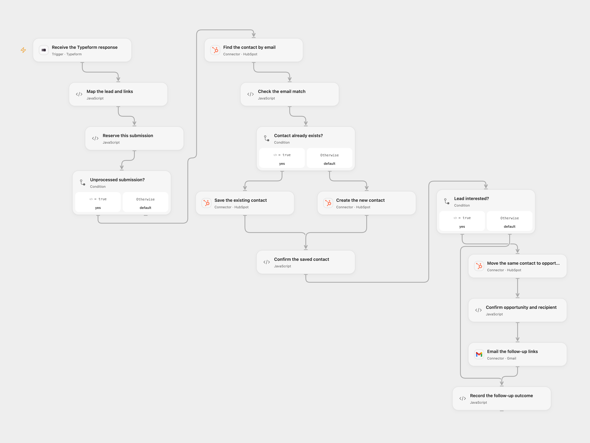

# Follow Up with Typeform Leads

Save Typeform leads in HubSpot and email scheduling and presentation links to respondents who say they are interested.

<!-- template-actions:start -->
 
<!-- template-actions:end -->

<picture>
  <source media="(prefers-color-scheme: dark)" srcset="preview-dark.png">
  
</picture>

## Setup

1. Connect Typeform in **Receive the Typeform response** and enter the form ID. Enter the same ID in **Map the lead and links**, along with the field IDs for first name, last name, department, company, email, and interest. Use an Email question and a Yes/No interest question. The department answer is saved to HubSpot's Industry field. For an enumerated Industry property, use the internal option value as the Typeform answer.
2. Replace the scheduling and presentation URLs in **Map the lead and links**. Use the same HubSpot connection in **Find the contact by email**, **Save the existing contact**, **Create the new contact**, and **Move the same contact to opportunity**.
3. Connect Gmail in **Email the follow-up links**, then publish the workflow. Open Flow registers the signed Typeform webhook.

## Behavior

A complete submission creates a contact or updates the contact with the matching email. A Yes answer moves that same contact to Opportunity and sends the two links to the submitted address. A No answer only saves the contact. HubSpot must confirm the stage before Gmail sends. If the stage change is rejected, the email is skipped.

The workflow reserves each Typeform submission ID before making changes. Duplicate deliveries are skipped. An interrupted run can leave a pending reservation. Check HubSpot and Gmail before clearing that reservation for an intentional retry.

In n8n

Set the expected form ID, six field IDs, and both links in **Map the lead and links**. Replace the placeholder expression in **Compute the Typeform signature** with your Typeform webhook signing secret. Register the production URL of **Receive the Typeform response** as a Typeform webhook for complete responses, with the same signing secret. The HTTP acknowledgment confirms receipt.

Bind the same HubSpot Bearer Auth credential in **Find the contact by email**, **Save the existing contact**, **Create the new contact**, and **Move the same contact to opportunity**. The token requires contact read and write access. Connect Gmail in **Email the follow-up links**.

Create a Data Table with text columns `response_key` and `status`. Select it in **Skip reserved submissions**, **Reserve this submission**, and **Record the follow-up outcome**. On self-hosted n8n in regular mode, set `N8N_CONCURRENCY_PRODUCTION_LIMIT=1` so lookup and insert run in one production slot. Keep one active workflow for this form and table. Keep manual replays outside active deliveries.

Inspiration &amp; credits

## Changes to the source

- Map Typeform field IDs and validate that the email belongs to the contact before advancing its stage.
- Preserve both follow-up links and reserve each complete response before sending any email.

Adapted from [Typeform lead follow-up](https://github.com/Zie619/n8n-workflows/blob/ae8cf6dc5b873cbb4f74587aa9180ed3a9f70682/workflows/Noop/0094_Noop_Gmail_Create_Triggered.json) in [Zie619/n8n-workflows](https://github.com/Zie619/n8n-workflows). Attribution: Zie619 / n8n-workflows.

The collection’s [MIT notice](https://github.com/Zie619/n8n-workflows/blob/94007c1445d9258a7da116646b79473e7c7c3282/LICENSE) is pinned at a later revision. This is the collection notice at that revision; it does not establish a separate original template author's license. Our changes are listed above; see [repository licensing](../../README.md#licensing).

> MIT License
>
> Copyright (c) 2025 Zie619
>
> Permission is hereby granted, free of charge, to any person obtaining a copy
> of this software and associated documentation files (the "Software"), to deal
> in the Software without restriction, including without limitation the rights
> to use, copy, modify, merge, publish, distribute, sublicense, and/or sell
> copies of the Software, and to permit persons to whom the Software is
> furnished to do so, subject to the following conditions:
>
> The above copyright notice and this permission notice shall be included in all
> copies or substantial portions of the Software.
>
> THE SOFTWARE IS PROVIDED "AS IS", WITHOUT WARRANTY OF ANY KIND, EXPRESS OR
> IMPLIED, INCLUDING BUT NOT LIMITED TO THE WARRANTIES OF MERCHANTABILITY,
> FITNESS FOR A PARTICULAR PURPOSE AND NONINFRINGEMENT. IN NO EVENT SHALL THE
> AUTHORS OR COPYRIGHT HOLDERS BE LIABLE FOR ANY CLAIM, DAMAGES OR OTHER
> LIABILITY, WHETHER IN AN ACTION OF CONTRACT, TORT OR OTHERWISE, ARISING FROM,
> OUT OF OR IN CONNECTION WITH THE SOFTWARE OR THE USE OR OTHER DEALINGS IN THE
> SOFTWARE.

