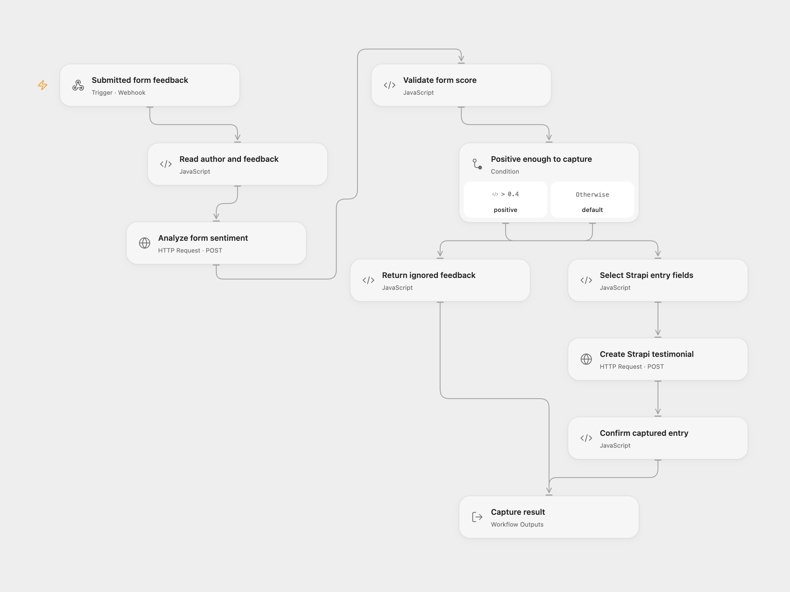

# Form Testimonial Capture

Save positive form feedback as a Strapi entry. Google Cloud Natural Language analyzes the submitted text, and only scores greater than `0.4` create an entry.

<picture>
  <source media="(prefers-color-scheme: dark)" srcset="preview-dark.png">
  
</picture>

[Open Flow JSON](templates/form-testimonial-capture.openflow.json) · [n8n JSON](templates/form-testimonial-capture.n8n.json)

## Setup

Create a Strapi 5 collection with plural API ID `posts` and fields `Content` (text), `Author` (text), `Created` (date-time), and `URL` (optional text). Use an API token allowed to create entries. The create request uses Strapi’s default publication behavior. In Strapi 5, a create without a status parameter publishes immediately when Draft & Publish is enabled. Connect the collection only when positive submissions may be published under those settings.

In Open Flow, set **Create Strapi testimonial** to the direct HTTPS REST endpoint for your collection, for example `https://cms.example.com/api/posts`. It must accept the request directly without a redirect. Select a secret Variable containing the Strapi token in its Bearer authentication input. On **Analyze form sentiment**, select a secret Variable containing a Google Cloud API key. Enable Cloud Natural Language and billing in that Google Cloud project; restrict the key to that API.

In n8n, choose the Google Cloud Natural Language OAuth2 credential. On **Store Form Submission in Strapi**, select API Token authentication and a Strapi API Token credential with the instance base URL. Choose **API Version 4** in that credential: this mode sends the `/api/posts` endpoint and `{data: ...}` create envelope used by the current Strapi REST API. The template sends only scalar entry fields and does not use version-specific relation or update operations.

Publish and enable the workflow, then configure your form to POST JSON to its webhook. Put author first and feedback second in `data.fields`, as in the source form:

```json
{
  "data": {
    "fields": [
      { "value": "Ada" },
      { "value": "The event helped our team solve a recurring problem." }
    ]
  }
}
```

## Behavior

The webhook acknowledges receipt with HTTP 200. The execution analyzes the exact feedback text using Google Cloud Natural Language v1 with automatic language detection. A score greater than `0.4` creates one entry with the submitted author, feedback, a UTC receipt timestamp, and an empty source URL. A score equal to or below `0.4` writes nothing.

Execution output has `status: captured` with the created entry or `status: ignored` with no entry, plus the score. The immediate webhook acknowledgment does not confirm that storage succeeded. Invalid input, failed sentiment analysis, or a failed or unconfirmed Strapi write stops the execution. No workflow-level retries or duplicate-submission checks are configured. Inspect Strapi before rerunning an uncertain write.

Feedback is sent to Google. Captured feedback and the submitted author are sent to Strapi. Use the score as a sorting signal and review testimonials before reuse.

## Changes to the source

- Adapt the independent form-submission component. The source’s separate scheduled X search is not part of this template.
- Validate the author and feedback fields and keep their values available after sentiment analysis.
- Select only `Content`, `Author`, `Created`, and `URL` before the Strapi write, so sentiment fields do not become unknown collection properties.
- Use supported API-key authentication for Google in Open Flow and the native Google OAuth2 credential in n8n.
- Use the current Strapi REST create envelope and API-token authentication in both formats.
- Confirm the returned Strapi entry and provide explicit captured or ignored execution results.

## Source and license

Adapted from [Automate testimonials in Strapi with n8n](https://github.com/enescingoz/awesome-n8n-templates/blob/827110332c21cbe000ab13f6d292d5adb1f1f8db/Other_Integrations_and_Use_Cases/Automate%20testimonials%20in%20Strapi%20with%20n8n.json) in [enescingoz/awesome-n8n-templates](https://github.com/enescingoz/awesome-n8n-templates).

Source collection notice: © 2024–2026 Enes Cingoz, [CC BY 4.0](https://github.com/enescingoz/awesome-n8n-templates/blob/827110332c21cbe000ab13f6d292d5adb1f1f8db/LICENSE). The source export does not identify a separate template author or license. See [repository licensing](../../README.md#licensing) for the scope of OOMOL contributions and third-party material.
