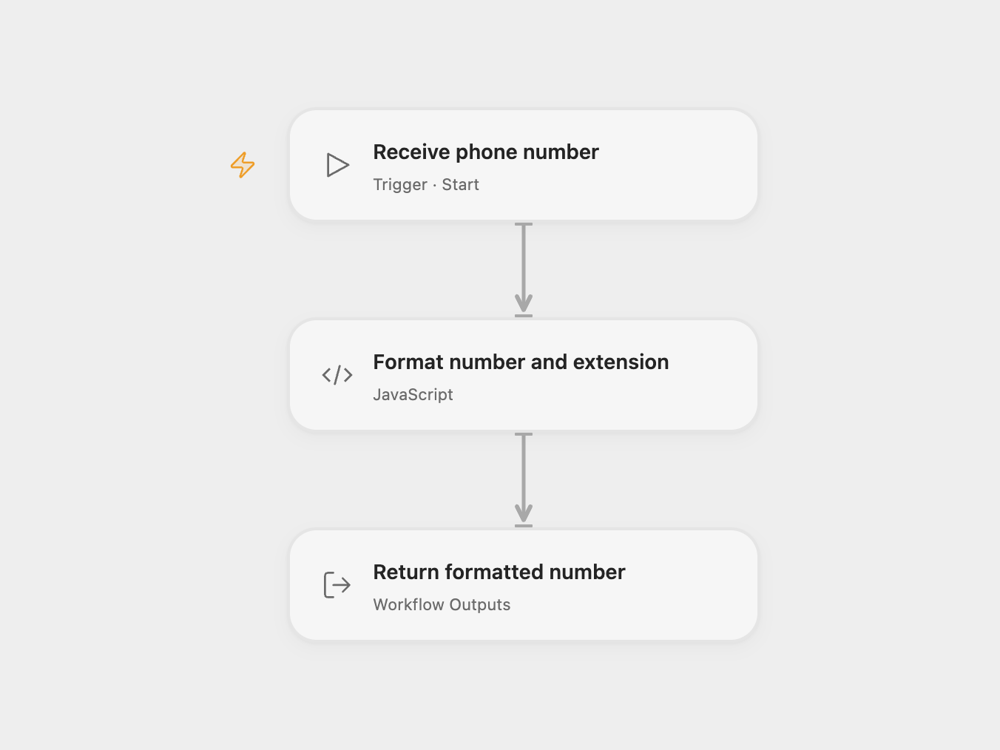

# Format a US Phone Number

Call this workflow to normalize a US phone number and return its dialing formats and extension.

<!-- template-actions:start -->
 
<!-- template-actions:end -->

<picture>
  <source media="(prefers-color-scheme: dark)" srcset="preview-dark.png">
  
</picture>

## Setup

Import and publish **Format a US Phone Number**. In the workflow that needs a phone number, add **Call Workflow**, select **Format a US Phone Number**, and map `Phone Number` from the calling workflow. Use a string if the input includes punctuation or an extension. Refresh the call’s interface after republishing the formatter.

## Behavior

The formatter accepts ten digits or a country-code-1 number, with common spacing, parentheses and hyphens. An extension may follow `x`, `ext` or `#`. For compatibility it also accepts extra extension digits after a full leading-1 number. It formats digits without checking whether a carrier has assigned the number.

| Output | Example for `+1 (202) 555-0147 x9` |
| --- | --- |
| Phone Number (Input) | `+1 (202) 555-0147 x9` |
| Phone Number | `12025550147` |
| Phone Number (E-164) | `+12025550147` |
| Phone Number (National) | `(202) 555-0147` |
| Phone Number (Full National) | `1 (202) 555-0147` |
| Phone Number (International) | `00-1-202-555-0147` |
| Extension | `9` |
| Extension (String) | `9` |

Missing or invalid input returns zero in the numeric fields and empty formatted strings. The original string or numeric input is returned as text. With a valid number and no extension, `Extension` is zero and `Extension (String)` is empty.

In n8n

Import **Format a US Phone Number**. In the parent workflow, add **Execute Sub-workflow**, select the imported workflow and map `Phone Number`. Keep **Wait for Sub-Workflow Completion** enabled to receive the formatted result. Each input item produces one item in the same order. [n8n sub-workflows](https://docs.n8n.io/flow-logic/subworkflows/)

Inspiration &amp; credits

Adapted from [US phone number formatting sub-workflow](https://github.com/Zie619/n8n-workflows/blob/ae8cf6dc5b873cbb4f74587aa9180ed3a9f70682/workflows/Executeworkflow/1918_Executeworkflow_Automation_Triggered.json) in [Zie619/n8n-workflows](https://github.com/Zie619/n8n-workflows). Attribution: Zie619 / n8n-workflows.

The collection’s [MIT notice](https://github.com/Zie619/n8n-workflows/blob/94007c1445d9258a7da116646b79473e7c7c3282/LICENSE) is pinned at a later revision. This is the collection notice at that revision; it does not establish a separate original template author's license. Our changes are listed above; see [repository licensing](../../README.md#licensing).

> MIT License
>
> Copyright (c) 2025 Zie619
>
> Permission is hereby granted, free of charge, to any person obtaining a copy
> of this software and associated documentation files (the "Software"), to deal
> in the Software without restriction, including without limitation the rights
> to use, copy, modify, merge, publish, distribute, sublicense, and/or sell
> copies of the Software, and to permit persons to whom the Software is
> furnished to do so, subject to the following conditions:
>
> The above copyright notice and this permission notice shall be included in all
> copies or substantial portions of the Software.
>
> THE SOFTWARE IS PROVIDED "AS IS", WITHOUT WARRANTY OF ANY KIND, EXPRESS OR
> IMPLIED, INCLUDING BUT NOT LIMITED TO THE WARRANTIES OF MERCHANTABILITY,
> FITNESS FOR A PARTICULAR PURPOSE AND NONINFRINGEMENT. IN NO EVENT SHALL THE
> AUTHORS OR COPYRIGHT HOLDERS BE LIABLE FOR ANY CLAIM, DAMAGES OR OTHER
> LIABILITY, WHETHER IN AN ACTION OF CONTRACT, TORT OR OTHERWISE, ARISING FROM,
> OUT OF OR IN CONNECTION WITH THE SOFTWARE OR THE USE OR OTHER DEALINGS IN THE
> SOFTWARE.

The cleanup and formatting steps now use one parser. International dialing labels, numeric return fields and the callable interface retain their source names. Malformed inputs return the empty format consistently.

