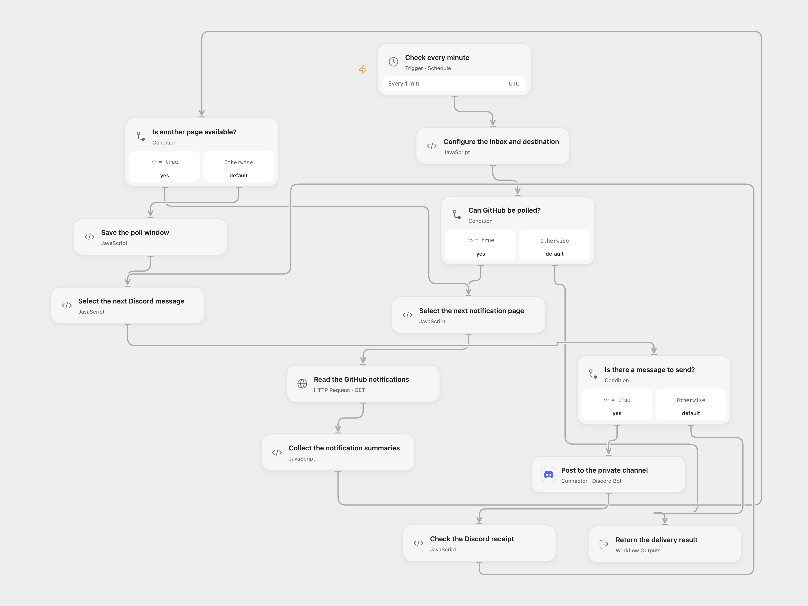

# Forward GitHub Notifications to Discord

Send unread GitHub notification summaries to a private Discord channel.

<!-- template-actions:start -->
 
<!-- template-actions:end -->

<picture>
  <source media="(prefers-color-scheme: dark)" srcset="preview-dark.png">
  
</picture>

## Setup

1. Create a GitHub personal access token (classic) with the `notifications` scope. Bind it as the secret variable `GITHUB_NOTIFICATIONS_PAT` in **Read the GitHub notifications**. The endpoint requires a classic token. [GitHub notifications API](https://docs.github.com/en/rest/activity/notifications#list-notifications-for-the-authenticated-user)
2. Connect a Discord bot with permission to send to a private channel. Enter its channel ID in **Configure the inbox and destination**. Use a channel whose members may see the GitHub notification titles and links. Enter your Discord user ID in the optional mention field.
3. Keep persistent State enabled and publish one active copy for the inbox and channel. Avoid simultaneous runs of the same workflow. Use a fresh workflow for a different GitHub inbox.

## Behavior

The first run looks back one minute. Later runs keep that inbox's last read boundary, check every minute, and wait at least as long as GitHub's poll interval. An empty or unchanged inbox sends no message. The workflow reads up to 20 pages of 50 notifications per poll. A larger or incomplete result stops before sending and leaves the window open for review.

Messages show each unread notification's reason, title, and link when available. The workflow uses the subject URL included in the notification and does not fetch issue or pull request content. It separates long reports into messages, disables link previews, and permits only the configured mention on the first message.

A complete read advances the poll window before sending so an uncertain Discord write does not replay automatically. A failed send can omit some messages. Check the channel and the GitHub inbox when delivery is unclear.

In n8n

Use a self-hosted regular-mode instance with `N8N_CONCURRENCY_PRODUCTION_LIMIT=1` and keep one active copy. Persistent workflow data is saved on successful production runs. Set the channel ID and optional mention in **Configure the inbox and destination**. Attach a Bearer Auth credential with the classic GitHub token in **Read the GitHub notifications**. Attach a Header Auth credential with name `Authorization` and value `Bot <your token>` to **Post to the private channel**. Delivery status distinguishes confirmed and unconfirmed messages. This template disables execution data retention to avoid retaining inbox contents. Avoid concurrent manual runs.

Inspiration &amp; credits

## Changes to the source

Replace Basic Auth with a scoped token, paginate complete poll windows, and honor GitHub's requested interval. Safely format notification titles and allow only the configured Discord mention.

Adapted from [GitHub notification summaries to Discord](https://github.com/Zie619/n8n-workflows/blob/ae8cf6dc5b873cbb4f74587aa9180ed3a9f70682/workflows/Http/0966_HTTP_Discord_Import_Scheduled.json) in [Zie619/n8n-workflows](https://github.com/Zie619/n8n-workflows). Attribution: Zie619 / n8n-workflows.

The collection’s [MIT notice](https://github.com/Zie619/n8n-workflows/blob/94007c1445d9258a7da116646b79473e7c7c3282/LICENSE) is pinned at a later revision. This is the collection notice at that revision; it does not establish a separate original template author's license. Our changes are listed above; see [repository licensing](../../README.md#licensing).

> MIT License
>
> Copyright (c) 2025 Zie619
>
> Permission is hereby granted, free of charge, to any person obtaining a copy
> of this software and associated documentation files (the "Software"), to deal
> in the Software without restriction, including without limitation the rights
> to use, copy, modify, merge, publish, distribute, sublicense, and/or sell
> copies of the Software, and to permit persons to whom the Software is
> furnished to do so, subject to the following conditions:
>
> The above copyright notice and this permission notice shall be included in all
> copies or substantial portions of the Software.
>
> THE SOFTWARE IS PROVIDED "AS IS", WITHOUT WARRANTY OF ANY KIND, EXPRESS OR
> IMPLIED, INCLUDING BUT NOT LIMITED TO THE WARRANTIES OF MERCHANTABILITY,
> FITNESS FOR A PARTICULAR PURPOSE AND NONINFRINGEMENT. IN NO EVENT SHALL THE
> AUTHORS OR COPYRIGHT HOLDERS BE LIABLE FOR ANY CLAIM, DAMAGES OR OTHER
> LIABILITY, WHETHER IN AN ACTION OF CONTRACT, TORT OR OTHERWISE, ARISING FROM,
> OUT OF OR IN CONNECTION WITH THE SOFTWARE OR THE USE OR OTHER DEALINGS IN THE
> SOFTWARE.

