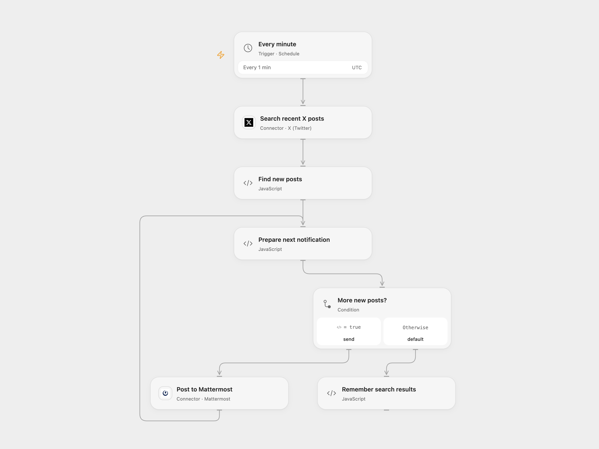

# Forward X Search Results to Mattermost

Monitor a recent X search and post new results to a Mattermost channel.

<picture>
  <source media="(prefers-color-scheme: dark)" srcset="preview-dark.png">
  
</picture>

[Open Flow JSON](templates/forward-x-search-to-mattermost.openflow.json) · [n8n JSON](templates/forward-x-search-to-mattermost.n8n.json)

## Setup

Connect X with access to recent search and Mattermost with permission to post. Set the query in **Search recent X posts** and channel ID in **Post to Mattermost**. Enable persistent workflow State. n8n static data persists in active scheduled runs. In n8n connect X OAuth2 to **Search recent X posts**, Mattermost to **Post to Mattermost**, and set the query and channel. Activate one format.

## Behavior

Each minute the workflow reads up to 50 recent search results, compares them with the previous nonempty result set and sends the new results in search order until it encounters an already seen ID. Each notification links to the post and includes its text and author. The first run sends the returned results. It remembers only the latest result set; older or delayed results can be missed or repeated. X recent search covers a limited time window and requires an eligible account.

The workflow advances its saved IDs only after a successful run. If a later notification fails, earlier posts remain and a retry can repeat them. An uncertain post may already have been created; inspect Mattermost before retrying. Avoid overlapping runs, which can race on saved State. The source inherited its n8n instance timezone; the schedule uses UTC.

Inspiration &amp; credits

## Changes to the source

- Use the current X recent-search API and expanded authors, and remove the private channel ID. The former profile link color is not returned by the current API.
- Keep X IDs as strings and preserve the association between each post and author.

Adapted from [Twitter notifications to Mattermost](https://github.com/Zie619/n8n-workflows/blob/ae8cf6dc5b873cbb4f74587aa9180ed3a9f70682/workflows/Mattermost/0357_Mattermost_Twitter_Automation_Scheduled.json) in [Zie619/n8n-workflows](https://github.com/Zie619/n8n-workflows). The source export does not identify a separate template author or license.

The collection’s [MIT notice](https://github.com/Zie619/n8n-workflows/blob/94007c1445d9258a7da116646b79473e7c7c3282/LICENSE) is pinned at a later revision. This is the collection notice at that revision; it does not establish a separate original template author's license. Our changes are listed above; see [repository licensing](../../README.md#licensing).

> MIT License
>
> Copyright (c) 2025 Zie619
>
> Permission is hereby granted, free of charge, to any person obtaining a copy
> of this software and associated documentation files (the "Software"), to deal
> in the Software without restriction, including without limitation the rights
> to use, copy, modify, merge, publish, distribute, sublicense, and/or sell
> copies of the Software, and to permit persons to whom the Software is
> furnished to do so, subject to the following conditions:
>
> The above copyright notice and this permission notice shall be included in all
> copies or substantial portions of the Software.
>
> THE SOFTWARE IS PROVIDED "AS IS", WITHOUT WARRANTY OF ANY KIND, EXPRESS OR
> IMPLIED, INCLUDING BUT NOT LIMITED TO THE WARRANTIES OF MERCHANTABILITY,
> FITNESS FOR A PARTICULAR PURPOSE AND NONINFRINGEMENT. IN NO EVENT SHALL THE
> AUTHORS OR COPYRIGHT HOLDERS BE LIABLE FOR ANY CLAIM, DAMAGES OR OTHER
> LIABILITY, WHETHER IN AN ACTION OF CONTRACT, TORT OR OTHERWISE, ARISING FROM,
> OUT OF OR IN CONNECTION WITH THE SOFTWARE OR THE USE OR OTHER DEALINGS IN THE
> SOFTWARE.

