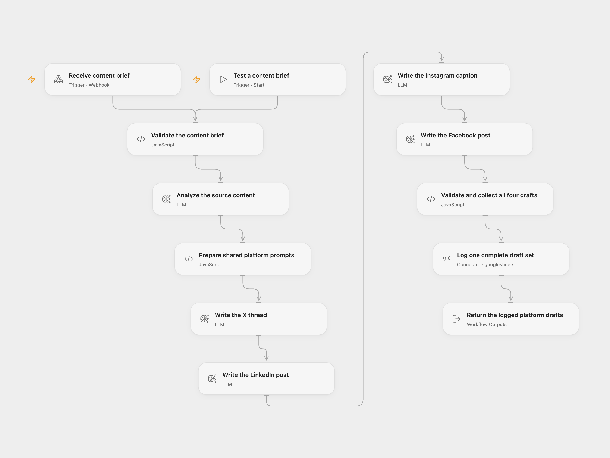

# Four Platform Content Repurposer

Turn one article or content brief into separate X, LinkedIn, Instagram and Facebook drafts. The workflow logs one complete set in Google Sheets and returns the drafts for review.

<picture>
  <source media="(prefers-color-scheme: dark)" srcset="preview-dark.png">
  
</picture>

[Open Flow JSON](templates/four-platform-content-repurposer.openflow.json) · [n8n JSON](templates/four-platform-content-repurposer.n8n.json)

## Setup and use

Create a sheet named **Lite Log** with these headers in columns A–G:

| Request ID | Title | Completed At | Twitter Thread | LinkedIn Post | Instagram Caption | Facebook Post |
| --- | --- | --- | --- | --- | --- | --- |

In Open Flow, select a configured `gpt-4o-mini-2024-07-18` model for all five model steps. Connect Google Sheets in **Log one complete draft set** and replace `YOUR_SPREADSHEET_ID`. Use **Test a content brief** with a `request` object, or publish the webhook and POST the object directly:

```json
{
  "content": "Our support team reviews recurring questions every Friday, updates the help center, and assigns an owner to unresolved issues.",
  "title": "A weekly support review",
  "brand_voice": "clear and practical"
}
```

`content` must be a string containing at least 50 characters after trimming its outer whitespace; `text` is accepted as an alternative. The original content is sent without trimming. Missing or empty `title` becomes `Untitled`; `brand_voice` defaults to `professional yet approachable`.

In n8n, select an OpenAI credential on each attached **Model**, and a Google Sheets credential in **Save to Google Sheets**. Set the destination spreadsheet and sheet. Activate the workflow and POST the same object to its production webhook. The input Code uses `crypto.randomUUID()`, as the source does. n8n Cloud allows `crypto`; self-hosted n8n must allow it with `NODE_FUNCTION_ALLOW_BUILTIN=crypto`, on the task runner when using runners.

Both formats use the model snapshot above, JSON object mode, the original system prompts, temperatures and generation budgets. OpenAI has [announced its shutdown on January 14, 2027](https://developers.openai.com/api/docs/deprecations/). Select an available compatible model in both formats before that date and check its draft quality and parameter support again.

## Behavior

One analysis step extracts key points and a core message. Four subsequent model steps write X, LinkedIn, Instagram and Facebook drafts in that order. All platform prompts receive the same analysis and brand voice. Successful runs append one row and return `success`, `requestId`, `title`, `completedAt`, the four platform names, complete `drafts` and a confirmation message. The Sheet stores the X thread as JSON text; Instagram's separate hashtag array remains available in the returned drafts.

The workflow checks JSON object structure, required text fields, the thread list and hashtag lists before logging. Requested post lengths, tweet counts and hashtag counts are model guidance, without hard length or count enforcement. Review facts, wording and each platform's limits before posting. The workflow does not publish posts.

The five model steps each allow three total workflow attempts, two seconds apart. n8n's attached model adapters have their internal retries disabled so the workflow owns this allowance. Sheet append allows two total attempts, one second apart. Open Flow retries only failures the platform classifies as safe to retry; n8n retries node failures more broadly. The configured model service can have its own internal request behavior. A failed model or Sheet step prevents a successful workflow result. A bad draft does not produce a blank success row.

Open Flow waits at most 60 seconds for a final webhook response. Five generation steps and retries can take longer. A timed-out HTTP reply does not prove that logging failed; inspect the execution and Sheet before submitting again. n8n's HTTP connection lifetime depends on its deployment. There is no request deduplication or rollback, and uncertain or repeated submissions can append duplicate rows. Use the manual Open Flow entry when a synchronous HTTP reply is unnecessary.

Submitted content goes to the selected model service. The Sheet receives the generated drafts, title, request ID and completion time. API and model use consumes your configured accounts' allowances.

## Changes to the source

- Replace the fanout into a collector that read unfinished branches with a complete, ordered generation chain and one Sheet append.
- Use supported native Basic LLM Chains and actual JSON object output instead of incompatible OpenAI node parameters.
- Validate all four drafts before logging; the source could silently omit malformed platform fields while reporting success.
- Bind the final result to the collected content rather than assuming a Sheet write response repeats it. Return all drafts, including Instagram's separate hashtags.
- Replace the environment-specific spreadsheet reference with normal destination configuration, and write cells as literal `RAW` values.
- Preserve the source retry allowances, prompt budgets and existing `crypto` prerequisite, and pin the model snapshot explicitly.


<details>
<summary>Source and license</summary>

Adapted from [FlowScribe Lite - AI Content Repurposing4Platforms](https://github.com/enescingoz/awesome-n8n-templates/blob/827110332c21cbe000ab13f6d292d5adb1f1f8db/Instagram_Twitter_Social_Media/FlowScribe%20Lite%20-%20AI%20Content%20Repurposing%204%20Platforms.json) in [enescingoz/awesome-n8n-templates](https://github.com/enescingoz/awesome-n8n-templates).

Source collection notice: © 2024–2026 Enes Cingoz, [CC BY 4.0](https://github.com/enescingoz/awesome-n8n-templates/blob/827110332c21cbe000ab13f6d292d5adb1f1f8db/LICENSE). The source export does not identify a separate template author or license. See [repository licensing](../../README.md#licensing) for the scope of OOMOL contributions and third-party material.

</details>
