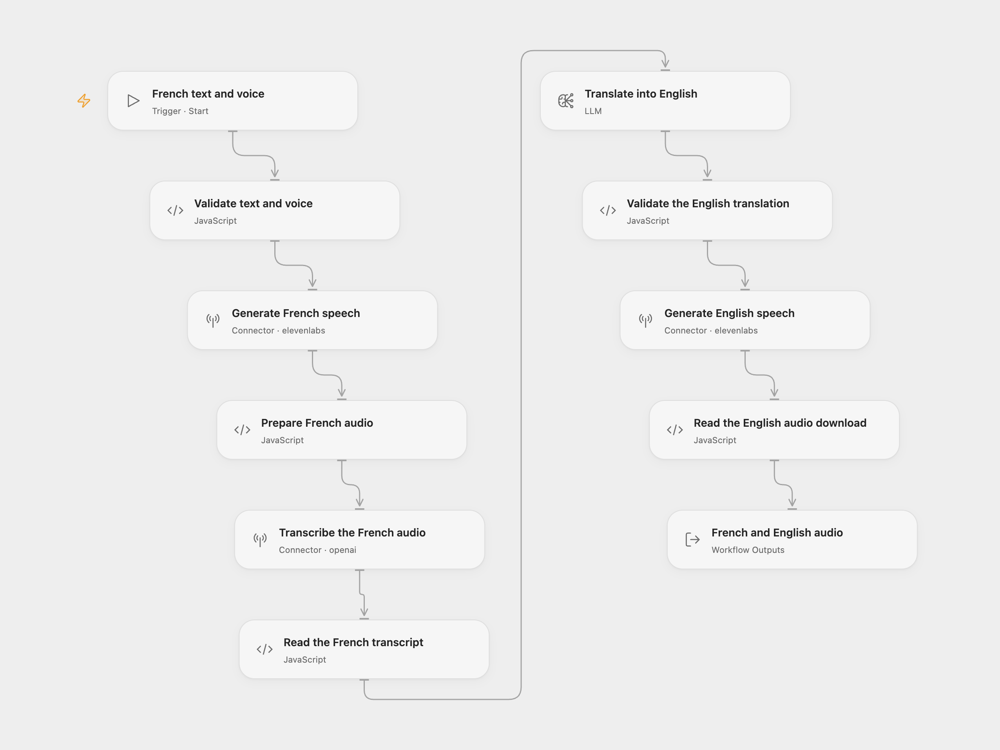

# French to English Audio

Turn French text into French speech, transcribe that audio, translate the transcript into English and synthesize the English text in the same ElevenLabs voice.

<picture>
  <source media="(prefers-color-scheme: dark)" srcset="preview-dark.png">
  
</picture>

[Open Flow JSON](templates/french-to-english-audio.openflow.json) · [n8n JSON](templates/french-to-english-audio.n8n.json)

## Setup and use

Use only text and audio that can be public. In Open Flow, both generated recordings are uploaded to Connector storage with public-read download URLs. Anyone with a URL can download that recording. Automatic expiry has not been verified; retention depends on the storage deployment. A later failure can leave the earlier French recording hosted. n8n keeps the recordings as execution binary files.

Connect ElevenLabs in **Generate French speech** and **Generate English speech**. Your voice must support French and English, with allowance for `eleven_multilingual_v2`. The Open Flow Connector deployment must have file transit enabled. Connect OpenAI in **Transcribe the French audio**, and select a configured `gpt-4o-mini-2024-07-18` model in **Translate into English**.

Use Run and supply:

```json
{
  "french_text": "Bonjour. Notre équipe prépare un guide public pour expliquer son travail.",
  "voice_id": "YOUR_ELEVENLABS_VOICE_ID"
}
```

Replace the voice ID with one available to your ElevenLabs account. French text must be nonempty and fit 10,000 characters. The original text is synthesized without trimming; the translated English text is trimmed and must also fit 10,000 characters. Both speech steps use the same voice, stability `0.5`, similarity boost `0.5` and MP3 format `mp3_44100_128`. The source's latency optimization level `1` is retained; ElevenLabs currently marks this option deprecated.

For n8n, edit **Configure French Text and Voice**. Select Header Auth credentials on both ElevenLabs HTTP nodes with header name `xi-api-key` and your API key as its value. Select OpenAI credentials in **Transcribe Audio** and **English Translation Model**. Use Execute Workflow. Keep keys in credentials.

## Behavior

The workflow generates French audio, transcribes that generated recording with `whisper-1`, translates the transcript into English at temperature `0`, and generates English audio in the same voice. It does not skip the French synthesis or transcription. Quotes and line breaks remain valid in both speech requests.

Open Flow returns `frenchTranscript`, `englishText`, `frenchAudio` and `englishAudio`. Each audio object contains `name`, `mimetype` and its public download `url`. Download the files you need while your storage deployment retains them. n8n returns the transcript and translation with English audio in binary `data` and French audio in binary `french`.

Two speech generations, one transcription and one translation step consume the selected services' allowances. No workflow-level retries are configured. n8n's model adapter can retry transient translation requests internally; a configured model service may have its own request behavior. A failed speech, transcription or translation step stops later work. There is no rollback of generated or hosted audio. Service request limits still apply; Whisper accepts files up to 25 MB, and long text can reach generation or transfer limits. The workflow checks returned file references and audio MIME types; it does not verify speech or translation accuracy. Review the text and listen before sharing a recording, and disclose that its voice is AI-generated.

OpenAI has announced shutdown of the default [translator snapshot on January 14, 2027](https://developers.openai.com/api/docs/deprecations/) and [`whisper-1` on February 26, 2027](https://developers.openai.com/api/docs/guides/speech-to-text). Configure compatible replacements in both formats before those dates and verify their request and response formats. This template retains the source transcription endpoint; it uses a separate text translation step.

## Changes to the source

- Make French text and voice ID reusable inputs, with a neutral example in n8n.
- Build speech requests as JSON objects so quotes, newlines and Unicode remain valid.
- Replace the source's omitted translator choice with the explicit snapshot above, which supports its configured temperature. The source currently imports with n8n's `gpt-5-mini` default; this model change can change translation wording.
- Validate empty transcripts and translations before later generation, and make MP3 output explicit.
- Return both recordings and the intermediate texts. Open Flow uses public-read hosted downloads instead of n8n execution binary storage; only use material that can be public, with no verified automatic expiry.


## Source and license

Adapted from [Translate audio using AI](https://github.com/enescingoz/awesome-n8n-templates/blob/827110332c21cbe000ab13f6d292d5adb1f1f8db/OpenAI_and_LLMs/Translate%20audio%20using%20AI.json) in [enescingoz/awesome-n8n-templates](https://github.com/enescingoz/awesome-n8n-templates).

Source collection notice: © 2024–2026 Enes Cingoz, [CC BY 4.0](https://github.com/enescingoz/awesome-n8n-templates/blob/827110332c21cbe000ab13f6d292d5adb1f1f8db/LICENSE). The source export does not identify a separate template author or license. See [repository licensing](../../README.md#licensing) for the scope of OOMOL contributions and third-party material.
