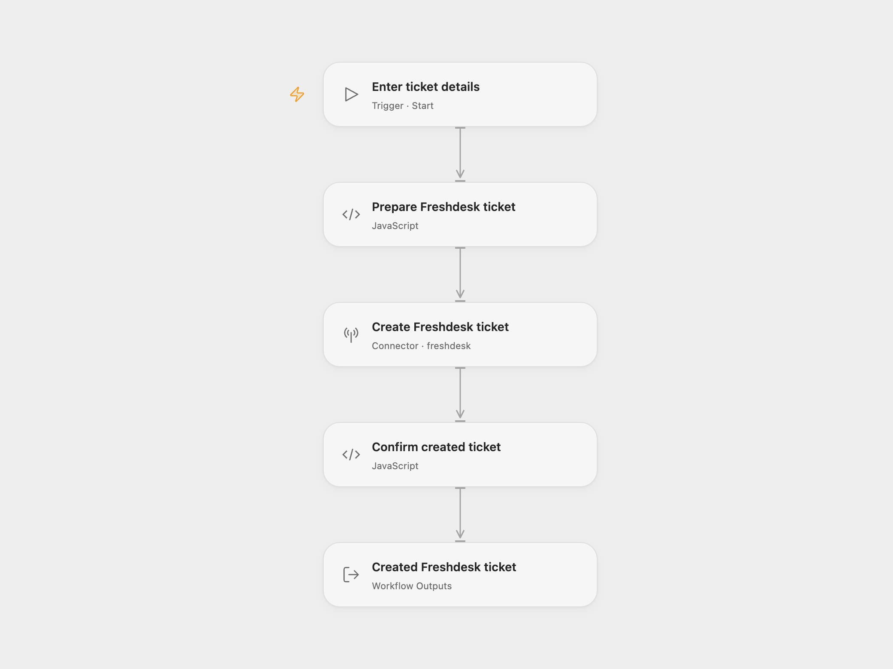

# Freshdesk Ticket Creator

Create one open, low-priority Freshdesk ticket for a requester email.

<picture>
  <source media="(prefers-color-scheme: dark)" srcset="preview-dark.png">
  
</picture>

[Open Flow JSON](templates/freshdesk-ticket-creator.openflow.json) · [n8n JSON](templates/freshdesk-ticket-creator.n8n.json)

## Setup

Select your Freshdesk API-key account in **Create Freshdesk ticket** and allow **Provider API** access. This permission is separate from individual Action permissions. Run with the requester **Email**, ticket **Subject** and **Description**. The description can contain HTML. In n8n, set your Freshdesk subdomain in the HTTP URL, choose **Freshdesk API** credentials and edit the JSON request fields in **Create Freshdesk ticket**.

The ticket uses Open status `2`, Low priority `1` and Portal source `2`, matching the source defaults. If your helpdesk requires custom ticket fields, add those fields to the prepared request in both formats before running. Freshdesk can create a contact when the requester email is new. Account rules may assign the ticket or send notifications.

Each run makes one creation request and returns the complete ticket record. There is no search, duplicate detection or update. Errors stop without retry or rollback. Check Freshdesk before rerunning a request whose write result is uncertain.

## Changes to the source

- Replace the source requester address with user configuration.
- Require a subject and description instead of sending the literal text `null`.
- Use the managed Freshdesk Provider API in Open Flow. In n8n, use the HTTP Request node with Freshdesk credentials to send the required HTTP Basic authentication.
- Expose and check the completed ticket record in Open Flow.

## Source and license

Adapted from [Freshdesk ticket workflow](https://github.com/Zie619/n8n-workflows/blob/ae8cf6dc5b873cbb4f74587aa9180ed3a9f70682/workflows/Manual/0960_Manual_Freshdesk_Automate_Triggered.json) in [Zie619/n8n-workflows](https://github.com/Zie619/n8n-workflows). The source export does not identify a separate template author or license.

The collection’s [MIT notice](https://github.com/Zie619/n8n-workflows/blob/94007c1445d9258a7da116646b79473e7c7c3282/LICENSE) is pinned at a later revision. This is the collection notice at that revision; it does not establish a separate original template author's license. Our changes are listed above; see [repository licensing](../../README.md#licensing).

> MIT License
>
> Copyright (c) 2025 Zie619
>
> Permission is hereby granted, free of charge, to any person obtaining a copy
> of this software and associated documentation files (the "Software"), to deal
> in the Software without restriction, including without limitation the rights
> to use, copy, modify, merge, publish, distribute, sublicense, and/or sell
> copies of the Software, and to permit persons to whom the Software is
> furnished to do so, subject to the following conditions:
>
> The above copyright notice and this permission notice shall be included in all
> copies or substantial portions of the Software.
>
> THE SOFTWARE IS PROVIDED "AS IS", WITHOUT WARRANTY OF ANY KIND, EXPRESS OR
> IMPLIED, INCLUDING BUT NOT LIMITED TO THE WARRANTIES OF MERCHANTABILITY,
> FITNESS FOR A PARTICULAR PURPOSE AND NONINFRINGEMENT. IN NO EVENT SHALL THE
> AUTHORS OR COPYRIGHT HOLDERS BE LIABLE FOR ANY CLAIM, DAMAGES OR OTHER
> LIABILITY, WHETHER IN AN ACTION OF CONTRACT, TORT OR OTHERWISE, ARISING FROM,
> OUT OF OR IN CONNECTION WITH THE SOFTWARE OR THE USE OR OTHER DEALINGS IN THE
> SOFTWARE.
